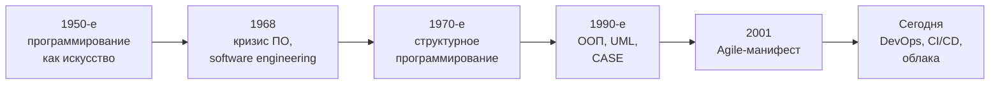

# Введение. Технология разработки ПО

## Основные понятия

> [!note] Определение
> **ПО** — совокупность **программ, данных и документации**, созданная для решения задач пользователей на компьютерах.

> [!note] Определение
> **Технология разработки ПО** — совокупность методов, процессов и инструментов, которые позволяют создавать ПО предсказуемо: в срок, в рамках бюджета и с заданным качеством.

### Программа ≠ программный продукт

> [!important] Главная мысль
> Программа, которая работает у автора, ещё не является продуктом, который можно отдать пользователям.

| | Программа | Программный продукт |
|---|---|---|
| **Для кого** | для автора или узкого круга | для широкого круга пользователей |
| **Тестирование** | проверена «на своих данных» | проверена на разных данных и сценариях |
| **Документация** | обычно нет | руководство пользователя, администратора, справка |
| **Сопровождение** | нет | исправление ошибок, обновления, поддержка |
| **Трудоёмкость** | 1× | примерно **3×** от программы |

> [!info] Дополнение
> В конспекте у этого пункта был только заголовок. Оценку «продукт в 3 раза дороже программы» дал Ф. Брукс в книге «Мифический человеко-месяц». Если программа ещё и встраивается в систему из других программ (программный системный продукт), трудоёмкость вырастает примерно в **9 раз**.

---

## Качество ПО: ГОСТ Р ИСО/МЭК 25010

| Характеристика | Что означает |
|---|---|
| **Функциональная пригодность** | решает задачи пользователя полностью и точно |
| **Эффективность** | оптимально использует ресурсы и время отклика |
| **Совместимость**¹ | работает вместе с другими системами и обменивается с ними данными |
| **Удобство использования** | понятен, изучаем, приятен в работе |
| **Надёжность** | стабильно работает при сбоях и нагрузке |
| **Защищённость** | не допускает несанкционированный доступ |
| **Сопровождаемость** | легко изменять, отлаживать, расширять |
| **Переносимость** | работает в разных средах и на разных ОС |

¹ В стандарте восемь характеристик. «Совместимость» в конспекте пропущена и добавлена.

---

## Классификация ПО по назначению

| Вид | Примеры | Назначение |
|---|---|---|
| **Системное** | ОС, драйверы, утилиты | управляет оборудованием и создаёт среду для других программ |
| **Прикладное** | браузеры, редакторы, информационные системы | решает задачи пользователя |
| **Инструментальное** | IDE, компиляторы, Git | служит для создания другого ПО |

---

## От кризиса ПО к инженерной дисциплине

> [!info] Дополнение
> В конспекте записана только хронология по годам. Содержание этапов дополнено.

| Период | Что происходило |
|---|---|
| **1950-е** | Программы небольшие, пишутся в машинных кодах и на ассемблере. Программирование считают искусством одиночек, методов почти нет |
| **1968** | Конференция НАТО в Гармише. Признан **«кризис ПО»**: проекты срывают сроки, превышают бюджет, программы полны ошибок. Появляется термин **software engineering** (программная инженерия) |
| **1970-е** | **Структурное программирование** (Э. Дейкстра), нисходящее проектирование, первое описание **каскадной модели** (У. Ройс, 1970) |
| **1990-е** | Распространяется **ООП**, появляется язык **UML** (1997), **CASE-средства**, модели зрелости процессов (CMM), процесс RUP |
| **2001** | **Agile-манифест**: ставка на людей, работающий продукт, сотрудничество с заказчиком и готовность к изменениям |
| **Сегодня** | **DevOps**, непрерывная интеграция и поставка (**CI/CD**), облачные сервисы, автоматизированное тестирование, ИИ-ассистенты в разработке |

> [!tip] Вывод
> Разработка ПО прошла путь от «искусства» к **инженерной дисциплине**: со стандартами, моделями жизненного цикла, измеримым качеством и управлением проектами.

---

## Вопросы для самопроверки

> [!question]- Из чего состоит ПО?
> Из программ, данных и документации.

> [!question]- Чем программный продукт отличается от программы?
> Продукт протестирован на разных сценариях, документирован, сопровождается и рассчитан на широкий круг пользователей. Поэтому он примерно в 3 раза трудоёмнее.

> [!question]- Назовите характеристики качества по ГОСТ Р ИСО/МЭК 25010.
> Функциональная пригодность, эффективность, совместимость, удобство использования, надёжность, защищённость, сопровождаемость, переносимость.

> [!question]- Что такое «кризис ПО»?
> Ситуация конца 1960-х, когда проекты массово срывали сроки и бюджеты, а программы были ненадёжны. Ответом стало появление программной инженерии.

> [!question]- К какому виду ПО относится Git?
> К инструментальному: он служит для создания другого ПО.
