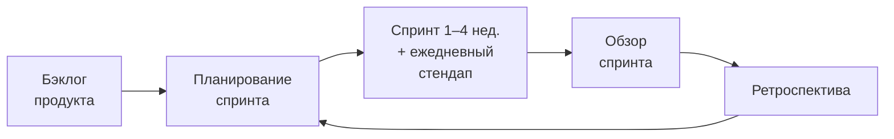

# Планирование и управление разработкой ПО

> [!note] Связанная лекция
> Эта же тема подробнее (WBS, формула риска, документы) разобрана в [[02.01/Лекции/16.10.26|16.10.26]].

## Что такое проект

> [!note] Определение
> **Проект** — временное предприятие с уникальным результатом. Разработка ПО почти всегда является проектом.

Признаки проекта:
- ограничен **сроком, бюджетом и ресурсами**;
- имеет **измеримый результат** и **критерии успеха**.

---

## Оценка трудоёмкости

Оценка по трём точкам (метод PERT):

$$T = \frac{O + 4M + P}{6}$$

| Обозначение | Значение |
|---|---|
| **T** | ожидаемая трудоёмкость |
| **O** | оптимистичная оценка |
| **M** | наиболее вероятная оценка |
| **P** | пессимистичная оценка |

> [!tip] Пример
> O = 4, M = 6, P = 14 дней → T = (4 + 4·6 + 14) / 6 = **7 дней**
>
> Наиболее вероятная оценка входит с весом 4, поэтому влияет на результат сильнее всего.

---

## Роли

| Роль | Зона ответственности |
|---|---|
| **Руководитель проекта** | план и коммуникации |
| **Аналитик** | требования |
| **Архитектор** | технические решения |
| **Разработчики, QA** | код и проверка |

---

## Документы проекта

| Документ | Содержание¹ |
|---|---|
| **Устав проекта** | цель, границы, участники |
| **План проекта** | WBS, расписание, бюджет |
| **Реестр рисков** | что может пойти не так и что с этим делать |
| **План коммуникаций** | кто, кому, когда и как сообщает информацию |

¹ Содержание документов дополнено по лекции [[02.01/Лекции/16.10.26|16.10.26]].

---

## Типовые риски ПО-проектов

> [!warning] Что чаще всего ломает проект
> 1. Размытые или меняющиеся требования
> 2. Недооценка трудоёмкости и сроков
> 3. Ключевой сотрудник недоступен
> 4. Интеграция с внешними системами не сходится
> 5. Тестирование оставлено на потом

---

## Гибкие методологии

> [!info] Дополнение
> В конспекте у раздела был только заголовок. Ниже основное, что нужно знать.

### Agile-манифест (2001)

| Важнее | Чем |
|---|---|
| **Люди** и взаимодействие | процессы и инструменты |
| **Работающий продукт** | исчерпывающая документация |
| **Сотрудничество с заказчиком** | переговоры о контракте |
| **Готовность к изменениям** | следование плану |

> [!tip]
> Правая колонка тоже важна, просто левая — важнее.

### Scrum

Работа идёт короткими циклами — **спринтами** (1–4 недели). В конце каждого спринта команда показывает работающую часть продукта.

| Роли | Артефакты | События |
|---|---|---|
| **Владелец продукта** — отвечает за ценность и приоритеты | **Бэклог продукта** — все задачи по приоритету | **Планирование спринта** |
| **Scrum-мастер** — следит за процессом, убирает препятствия | **Бэклог спринта** — задачи на текущий спринт | **Ежедневный стендап** (15 минут) |
| **Команда разработки** — делает продукт | **Инкремент** — готовая часть продукта | **Обзор спринта** и **ретроспектива** |

### Kanban

- Задачи на **доске** с колонками: «К выполнению» → «В работе» → «Проверка» → «Готово».
- **WIP-лимит** ограничивает число задач в работе одновременно, чтобы не распыляться.
- Спринтов нет: работа идёт **непрерывным потоком**.

| | Scrum | Kanban |
|---|---|---|
| **Ритм** | спринты фиксированной длины | непрерывный поток |
| **Роли** | заданы строго | не обязательны |
| **Изменения** | обычно между спринтами | в любой момент |
| **Подходит** | для разработки продукта с частыми релизами | для поддержки, потока заявок |

---

## Вопросы для самопроверки

> [!question]- Посчитайте T при O = 2, M = 5, P = 14.
> T = (2 + 4·5 + 14) / 6 = 36 / 6 = **6**.

> [!question]- Что входит в устав проекта?
> Цель, границы проекта и участники.

> [!question]- Чем Scrum отличается от Kanban?
> Scrum работает спринтами с фиксированными ролями и событиями. Kanban — непрерывный поток задач на доске с ограничением числа задач в работе.

> [!question]- Кто в Scrum определяет приоритеты задач?
> Владелец продукта (Product Owner).
