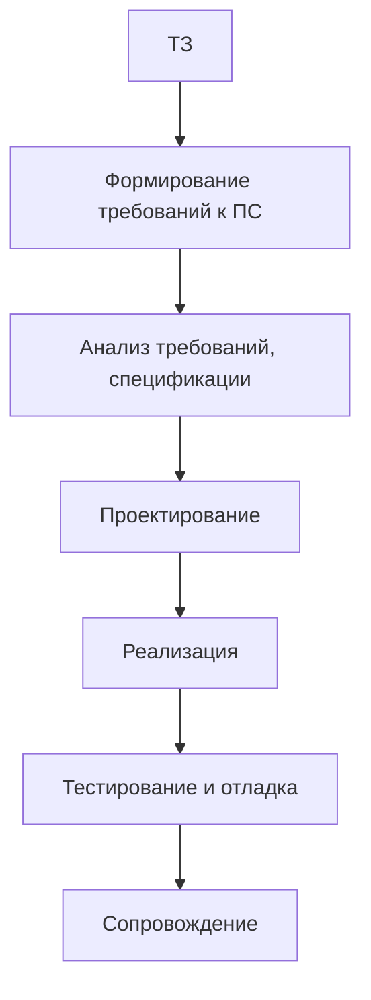
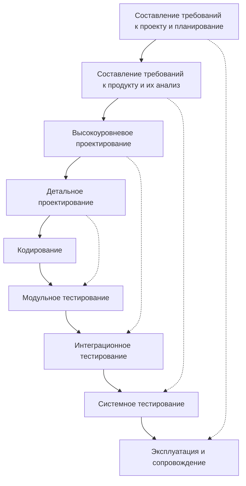
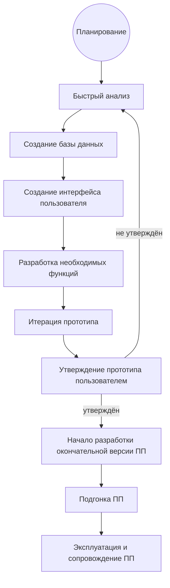

Модели жизненного цикла разработки программного продукта

> [!abstract] Содержание
> 1. [[#Понятие модели жизненного цикла]]
> 2. [[#Обзор существующих моделей]]
> 3. [[#Каскадная модель]]
> 4. [[#V-образная модель]]
> 5. [[#Модель прототипирования]]

---

## Понятие модели жизненного цикла

> [!note] Определение
> **Модель жизненного цикла** — схема выполнения работ и задач в процессах, обеспечивающих **разработку, эксплуатацию и сопровождение** программного продукта.

### Исторически ЖЦ включает
1. разработку требований или технического задания;
2. разработку системы или технического проекта;
3. программирование или рабочее проектирование;
4. пробную эксплуатацию;
5. сопровождение и улучшение;
6. снятие с эксплуатации.

---

## Обзор существующих моделей

| Модель | Особенности |
|---|---|
| **Каскадная** | прямолинейная и простая в использовании; нужен постоянный жёсткий контроль за ходом работы; разрабатываемое ПО недоступно для изменений |
| **V-образная** | простая в использовании; особое значение придаётся тестированию и сравнению результатов фаз тестирования и проектирования |
| **Прототипирования** | быстро создаётся частичная реализация системы до составления окончательных требований; обратная связь между пользователями и разработчиками; используемые требования неполные |
| **Быстрой разработки приложений (RAD)** | небольшие проектные группы из высококвалифицированных специалистов; сокращено время цикла и выше производительность; повторное использование кода и автоматизация разработки |
| **Многопроходная** | быстро создаётся работающая система; уменьшается возможность вносить изменения в процессе разработки; невозможен переход от текущей реализации к новой версии, пока строится текущая частичная реализация |
| **Спиральная** | охватывает каскадную модель; расчленяет фазы на меньшие части; гибкое проектирование; анализ рисков и управление ими; пользователи знакомятся с ПП раньше благодаря прототипам |

---

## Каскадная модель

> [!tip] Суть
> Прямолинейная и простая в использовании. Требует **постоянного жёсткого контроля** за ходом работы. Разрабатываемое ПО **недоступно для изменений**.

### Схема

> [!note] Сокращения
> - **ТЗ** — техническое задание
> - **ЭП** — эскизный проект
> - **ТП** — технический проект
> - **РП** — рабочий проект

---

## V-образная модель

> [!tip] Суть
> Простая в использовании. Особое значение придаётся **тестированию** и **сравнению результатов фаз тестирования и проектирования**: каждой фазе проектирования соответствует свой уровень тестирования.

### Схема

### Соответствие фаз проектирования и тестирования

| Фаза (левая ветвь) | Проверяется на этапе (правая ветвь) |
|---|---|
| Требования к проекту и планирование | Эксплуатация и сопровождение |
| Требования к продукту и их анализ | Системное тестирование |
| Высокоуровневое проектирование | Интеграционное тестирование |
| Детальное проектирование | Модульное тестирование |
| **Кодирование** — нижняя точка «V» | |

![[Pasted image 20260909124659.png]]

---

## Модель прототипирования

> [!tip] Суть
> Быстро создаётся **частичная реализация** системы **до** составления окончательных требований. Обеспечивается **обратная связь** между пользователями и разработчиками в процессе проекта. Используемые требования **неполные**.

### Схема

![[Pasted image 20260909125658.png]]

> [!note] Ключевая идея
> Прототип многократно дорабатывается вместе с пользователем (внутренний цикл), и только после его утверждения начинается разработка итоговой версии (внешний цикл).

---

## Краткие тезисы для повторения
- **Модель ЖЦ** — схема работ по разработке, эксплуатации и сопровождению ПП.
- **Каскадная** — последовательно, без возврата; изменения невозможны.
- **V-образная** — каждой фазе проектирования соответствует фаза тестирования.
- **Прототипирования** — прототип → обратная связь → доработка → итоговая версия.
- **RAD** — малые группы, быстрые циклы, повторное использование кода.
- **Многопроходная** — работающая система быстро, но менять нельзя.
- **Спиральная** — итерации + анализ рисков + ранние прототипы.