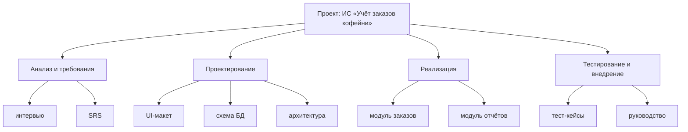
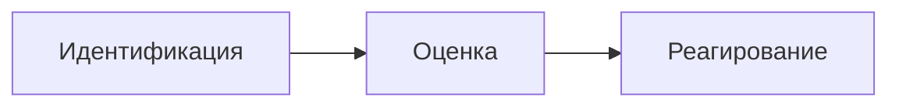
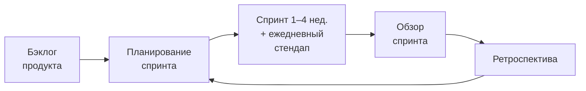

# Планирование и управление разработкой ПО

> [!abstract] Содержание
> 1. [[#Что такое проект]]
> 2. [[#WBS декомпозиция работ]]
> 3. [[#Оценка трудоёмкости]]
> 4. [[#Команда и документы проекта]]
> 5. [[#Риски проекта]]
> 6. [[#Гибкие методологии]]

---

## Что такое проект

> [!note] Определение
> **Проект** — временное предприятие с уникальным результатом.

Признаки проекта:
- ограничен **сроком, бюджетом и ресурсами**;
- имеет **измеримый результат** и **критерии успеха**.

> [!important]
> Почти каждый заказ на ПО — **проект**, а не рутина.

---

## WBS: декомпозиция работ

> [!note] Суть
> **WBS** (Work Breakdown Structure) разбивает проект на работы, которые можно **оценить, назначить и проконтролировать**.

Пример со слайда: проект «ИС „Учёт заказов кофейни“».

| Этап | Работы |
|---|---|
| **Анализ и требования** | интервью, SRS |
| **Проектирование** | UI-макет, схема БД, архитектура |
| **Реализация** | модуль заказов, модуль отчётов |
| **Тестирование и внедрение** | тест-кейсы, руководство |

---

## Оценка трудоёмкости

$$T = \frac{O + 4M + P}{6}$$

| Обозначение | Значение |
|---|---|
| **T** | ожидаемая трудоёмкость |
| **O** | оптимистичная оценка |
| **M** | наиболее вероятная оценка |
| **P** | пессимистичная оценка |

> [!tip] Пример (не с лекции)
> O = 4, M = 6, P = 14 дней → T = (4 + 4·6 + 14) / 6 = **7 дней**

### Правила оценки
- **Оценку делает тот, кто будет выполнять работу.**
- **Буфер** — часть плана, а не запас «на авось».
- **Функциональные точки** — оценка по объёму функциональности.

![[Pasted image 20261016102837.png]]

---

## Команда и документы проекта

### Роли

| Роль | Зона ответственности |
|---|---|
| **Руководитель проекта** | план и коммуникации |
| **Аналитик** | требования |
| **Архитектор** | решения |
| **Разработчики и QA** | код и проверки |

### Документы

| Документ | Содержание |
|---|---|
| **Устав проекта** | цель, границы, участники |
| **План проекта** | WBS, расписание, бюджет |
| **Реестр рисков** | что может пойти не так |
| **План коммуникаций** | кто, кому, когда |

---

## Риски проекта

> [!important] Формула
> **Риск = Вероятность × Ущерб**

Процесс работы с рисками:

### Типовые риски ПО-проектов

> [!warning]
> 1. Размытые или меняющиеся требования
> 2. Недооценка трудоёмкости и сроков
> 3. Ключевой сотрудник недоступен
> 4. Интеграция с внешними системами «не сходится»
> 5. Тестирование оставлено «на потом»

---

## Гибкие методологии

### Agile-манифест

| Важнее | Чем |
|---|---|
| **Люди** (и взаимодействие) | процессы и инструменты |
| **Работающий продукт** | исчерпывающая документация |
| **Сотрудничество с заказчиком** | переговоры о контракте |
| **Готовность к изменениям** | следование плану |

> [!tip]
> Правая колонка тоже важна, просто левая — важнее.

> [!info] Дополнение
> На лекции раздел закончился манифестом. Ниже две самые популярные гибкие методологии.

### Scrum

Работа идёт короткими циклами — **спринтами** (1–4 недели). В конце каждого спринта команда показывает работающую часть продукта.

| Роли | Артефакты | События |
|---|---|---|
| **Владелец продукта** — отвечает за ценность и приоритеты | **Бэклог продукта** — все задачи по приоритету | **Планирование спринта** |
| **Scrum-мастер** — следит за процессом, убирает препятствия | **Бэклог спринта** — задачи на текущий спринт | **Ежедневный стендап** (15 минут) |
| **Команда разработки** — делает продукт | **Инкремент** — готовая часть продукта | **Обзор спринта** и **ретроспектива** |

### Kanban

- Задачи на **доске** с колонками: «К выполнению» → «В работе» → «Проверка» → «Готово».
- **WIP-лимит** ограничивает число задач в работе одновременно, чтобы не распыляться.
- Спринтов нет: работа идёт **непрерывным потоком**.

| | Scrum | Kanban |
|---|---|---|
| **Ритм** | спринты фиксированной длины | непрерывный поток |
| **Роли** | заданы строго | не обязательны |
| **Изменения** | обычно между спринтами | в любой момент |
| **Подходит** | для разработки продукта с частыми релизами | для поддержки, потока заявок |

### Гибкий подход или каскад?

| Ситуация | Что выбрать |
|---|---|
| Требования понятны заранее и почти не меняются | каскадная модель |
| Требования уточняются по ходу, заказчик готов участвовать | Agile (Scrum, Kanban) |
| Поток однотипных заявок (поддержка) | Kanban |

---

## Вопросы для самопроверки

> [!question]- Что такое WBS и зачем она нужна?
> Иерархическая декомпозиция проекта на работы, которые можно оценить, назначить исполнителю и проконтролировать.

> [!question]- Посчитайте T при O = 2, M = 5, P = 14.
> T = (2 + 4·5 + 14) / 6 = 36 / 6 = **6**.

> [!question]- Риск А: вероятность 0,5, ущерб 100. Риск Б: вероятность 0,1, ущерб 300. Какой важнее?
> А: 0,5 × 100 = 50. Б: 0,1 × 300 = 30. Риск А важнее.

> [!question]- Кто должен оценивать трудоёмкость задачи?
> Тот, кто будет её выполнять.

> [!question]- Чем Scrum отличается от Kanban?
> Scrum работает спринтами с фиксированными ролями и событиями. Kanban — непрерывный поток задач на доске с ограничением числа задач в работе.
