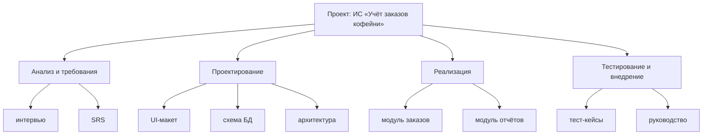
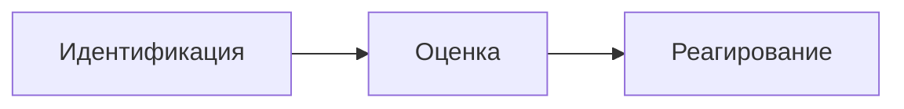

Планирование и управление разработкой ПО

> [!abstract] Содержание
> 1. [[#Что такое проект]]
> 2. [[#WBS декомпозиция работ]]
> 3. [[#Оценка трудоёмкости]]
> 4. [[#Команда и документы проекта]]
> 5. [[#Риски проекта]]
> 6. [[#Гибкие методологии]]

---

## Что такое проект

> [!note] Определение
> **Проект** — временное предприятие с уникальным результатом.

Признаки проекта:
- ограничен **сроком, бюджетом и ресурсами**;
- имеет **измеримый результат** и **критерии успеха**.

> [!important]
> Почти каждый заказ на ПО — **проект**, а не рутина.

---

## WBS: декомпозиция работ

> [!note] Суть
> **WBS** (Work Breakdown Structure) разбивает проект на работы, которые можно **оценить, назначить и проконтролировать**.

Пример со слайда: проект «ИС „Учёт заказов кофейни“».

| Этап | Работы |
|---|---|
| **Анализ и требования** | интервью, SRS |
| **Проектирование** | UI-макет, схема БД, архитектура |
| **Реализация** | модуль заказов, модуль отчётов |
| **Тестирование и внедрение** | тест-кейсы, руководство |

---

## Оценка трудоёмкости

$$T = \frac{O + 4M + P}{6}$$

| Обозначение | Значение |
|---|---|
| **T** | ожидаемая трудоёмкость |
| **O** | оптимистичная оценка |
| **M** | наиболее вероятная оценка |
| **P** | пессимистичная оценка |

> [!tip] Пример (не с лекции)
> O = 4, M = 6, P = 14 дней → T = (4 + 4·6 + 14) / 6 = **7 дней**

### Правила оценки
- **Оценку делает тот, кто будет выполнять работу.**
- **Буфер** — часть плана, а не запас «на авось».
- **Функциональные точки** — оценка по объёму функциональности.

![[Pasted image 20261016102837.png]]

---

## Команда и документы проекта

### Роли

| Роль | Зона ответственности |
|---|---|
| **Руководитель проекта** | план и коммуникации |
| **Аналитик** | требования |
| **Архитектор** | решения |
| **Разработчики и QA** | код и проверки |

### Документы

| Документ | Содержание |
|---|---|
| **Устав проекта** | цель, границы, участники |
| **План проекта** | WBS, расписание, бюджет |
| **Реестр рисков** | что может пойти не так |
| **План коммуникаций** | кто, кому, когда |

---

## Риски проекта

> [!important] Формула
> **Риск = Вероятность × Ущерб**

Процесс работы с рисками:

### Типовые риски ПО-проектов

> [!warning]
> 1. Размытые или меняющиеся требования
> 2. Недооценка трудоёмкости и сроков
> 3. Ключевой сотрудник недоступен
> 4. Интеграция с внешними системами «не сходится»
> 5. Тестирование оставлено «на потом»

---

## Гибкие методологии

### Agile-манифест

| Важнее | Чем |
|---|---|
| **Люди** (и взаимодействие) | процессы и инструменты |
| **Работающий продукт** | исчерпывающая документация |
| **Сотрудничество с заказчиком** | переговоры о контракте |
| **Готовность к изменениям** | следование плану |
