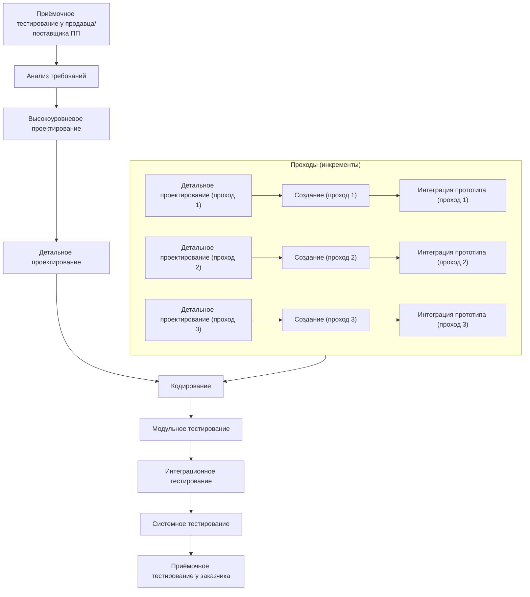
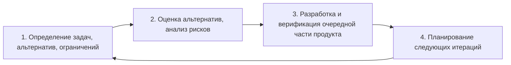

Модели ЖЦ: RAD, многопроходная, спиральная

> [!note] Продолжение
> Продолжение темы [[Модели жизненного цикла разработки программного продукта]] (каскадная, V-образная, прототипирования).

> [!abstract] Содержание
> 1. [[#1. Модель быстрой разработки приложений (RAD)]]
> 2. [[#2. Многопроходная (инкрементная) модель]]
> 3. [[#3. Спиральная модель]]
> 4. [[#Краткая сравнительная шпаргалка]]

---

## 1. Модель быстрой разработки приложений (RAD)

> [!tip] Суть
> **Конечный пользователь играет решающую роль.** Он тесно работает с разработчиками: участвует в формировании требований и проверяет их на работающих прототипах.

### Распределение работы
- В начале ЖЦ большая часть работы ложится на **пользователя**, зато система создаётся быстрее.
- В традиционном ЖЦ основная работа — **программирование и тестирование**.
- В RAD код автоматизируется и используется повторно, поэтому основная работа — **планирование и проектирование**.

### Фазы RAD

| # | Фаза | Содержание |
|---|---|---|
| 1 | **Составление требований и планирование** | метод *совместного планирования требований*: планирование работ и составление требований идут одновременно, через структурный анализ и обсуждение задач |
| 2 | **Описание пользователя** | проектирование ПП при непосредственном участии заказчика |
| 3 | **Создание** | детальное проектирование, кодирование, тестирование и поставка заказчику |
| 4 | **Сопровождение** | приёмочные испытания, установка ПП, обучение пользователей |

### График приложенных усилий (слайд)
Ось X — время (по фазам), ось Y — приложенные усилия.

| Фаза | Заказчики (пунктир) | Разработчики (сплошная) |
|---|---|---|
| Составление требований и планирование | средние, растут | низкие |
| Описание пользователя | **пик** усилий | средние |
| Создание | падают до минимума | **максимум** |
| Сопровождение | снова растут, держатся на среднем уровне | низкие |

> [!note]
> Значения на графике качественные (выше/ниже), точных чисел на слайде нет.

![[Pasted image 20261002103036.png]]

### Достоинства
- Современные инструментальные средства сокращают время цикла разработки.
- Участие заказчика сводит к минимуму риск, что он будет недоволен готовым ПП.
- Повторно используются компоненты существующих программ.

### Недостатки
- Если заказчик не может постоянно участвовать в разработке, это вредит ПП.
- Нужны высококвалифицированные кадры, умеющие работать с современными инструментами.
- Риск «зацикливания»: работа может никогда не завершиться, поэтому нужно вовремя остановиться.

> [!important] Применимость
> Для ПП, которые хорошо поддаются моделированию, когда **требования хорошо известны** и заказчик может непосредственно участвовать в разработке.

---

## 2. Многопроходная (инкрементная) модель

> [!tip] Суть
> Несколько итераций построения прототипа ПП. На каждой следующей итерации добавляются новые функции или повышается эффективность.

### Как работает
- На ранних этапах (планирование, анализ требований, проект) выполняется конструирование ПП **в целом**. Тогда же определяется **число инкрементов и их функции**.
- Каждый инкремент проходит оставшиеся фазы: **кодирование и тестирование**.
- Сначала создаются, тестируются и реализуются **базовые функции**, последующие итерации улучшают функциональность.

### Схема

![[Pasted image 20261002103051.png]]

### Преимущества
- В начале нужны средства только для разработки основных функций.
- После каждого инкремента получается **работающий продукт**; снижается риск неудачи и изменения требований.
- Разработчики и пользователи лучше понимают требования для поздних итераций.
- Инкременты легко тестировать.

### Недостатки
- Нет итераций внутри каждого инкремента.
- Полную функциональность надо определить в самом начале ЖЦ.
- Возможна тенденция оттягивать решение трудных задач.
- Общие затраты не снижаются по сравнению с другими моделями.
- Обязательно хорошее планирование и проектирование.

---

## 3. Спиральная модель

> [!tip] Суть
> Процесс разработки, сочетающий **проектирование и постадийное прототипирование**. Цель — объединить преимущества **восходящей и нисходящей** концепций.

### Четыре квадранта каждого витка (слайд)

| Квадрант | Содержание |
|---|---|
| **Верхний левый** | определение задач, альтернатив, ограничений |
| **Верхний правый** | оценка альтернатив, выделение рисков и способов борьбы с ними (**анализ рисков**) |
| **Нижний правый** | разработка и верификация очередной части продукта |
| **Нижний левый** | планирование следующих итераций |

### Что происходит по виткам (слайд)

| Виток | Основные результаты |
|---|---|
| **1-й** | концепция продукта, план ЖЦ и работы с требованиями, анализ рисков, прототип |
| **2-й** | разработка и валидация требований, план разработки, анализ рисков, модели, прототип |
| **3-й и далее** | проектирование, верификация и валидация проекта, план интеграции и тестирования, анализ рисков, рабочий прототип, наборы тестов |
| **Завершение** | проектирование модулей → кодирование → тестирование модулей → интеграция и тестирование системы → приёмочное тестирование → развёртывание |

> [!note]
> Радиус спирали — **совокупная стоимость**; по мере витков растёт ход работ. На слайде также отмечены **фиксация результатов** и **экспертизы** между витками.

![[Pasted image 20261002102904.png]]

### Преимущества
- Быстрое получение результата.
- Повышение конкурентоспособности.
- Изменяющиеся требования — не проблема.

### Недостатки
- Нет регламентации стадий.
- Спираль может продолжаться бесконечно, так как каждая реакция заказчика может породить новый цикл.

---

## Краткая сравнительная шпаргалка

| Модель | Главная идея | Ключевой плюс | Ключевой минус |
|---|---|---|---|
| **RAD** | заказчик участвует постоянно, прототипы, повторное использование кода | быстрый цикл, довольны заказчики | нужен заказчик «всегда рядом», риск зацикливания |
| **Многопроходная** | продукт строится инкрементами, сначала базовые функции | после каждого инкремента рабочий продукт | функции надо определить заранее, затраты не снижаются |
| **Спиральная** | витки: проектирование + прототип + анализ рисков | легко менять требования | нет регламента стадий, риск бесконечных витков |