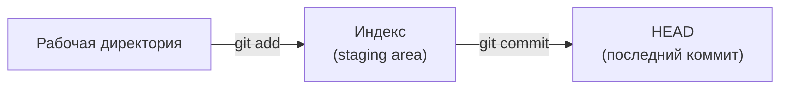

# Git — основные понятия, локальный репозиторий

### Часть 1. От истории СКВ к первому коммиту

> [!question] Проблемный вопрос
> Почему команда из десятков разработчиков не теряет ни одной строки кода, хотя все работают одновременно?

#### Эволюция систем контроля версий

**СКВ (VCS, Version Control System)** появились в 1970-х как инструмент отслеживания изменений в коде.

|Поколение|Годы|Представители|Особенности|
|---|---|---|---|
|Локальные|1970–1980-е|RCS, SCCS|История лежит на одном компьютере. Следят за правками одного разработчика, совместная работа невозможна.|
|Централизованные|1990–2000-е|CVS, Subversion|Общая история на центральном сервере, у разработчика только рабочая копия. Без сети нельзя посмотреть историю и сделать коммит.|
|Распределённые|с 2005 года|Git, Mercurial|Полная копия истории у каждого участника. Работа автономна, ветвление быстрое, потеря сервера не означает потерю кода. Современный стандарт.|

**Происхождение Git.** Его создал Линус Торвальдс в 2005 году для разработки ядра Linux, после того как отозвали бесплатную лицензию на BitKeeper. Нужен был быстрый, надёжный и полностью распределённый инструмент.

**Популярность.** Git используют более 93 % профессиональных разработчиков (Stack Overflow Developer Survey 2024). Mercurial и Perforce занимают нишевые сегменты.

#### Трёхдеревная архитектура Git

Главное отличие от СКВ прошлого поколения: каждое изменение проходит через три логических «дерева».

1. **Рабочая директория** (working directory) — файлы, которые вы редактируете сейчас. Git видит их как изменённые, но ещё не подготовленные.
2. **Индекс** (staging area) — подготовленные к коммиту изменения. Здесь собирается снимок того, что войдёт в следующий коммит.
3. **HEAD** — последний коммит. Это зафиксированный снимок репозитория и точка отсчёта для всей дальнейшей истории.

**Путь изменений:**



> [!tip] Что это даёт
> Можно подготовить и закоммитить только часть правок, затем взять следующие. Так получается логически чистая история: **один коммит — одна задача**.

**Объекты Git.** Всё в истории хранится как объекты:

- **blob** — содержимое файла;
- **tree** — структура каталогов;
- **commit** — снимок с метаданными и ссылкой на родителя;
- **tag** — именованная ссылка.

Каждый объект определяется **SHA-1-хешем**. Это гарантирует целостность истории и делает Git распределённым.

#### Базовые команды локального репозитория

|Команда|Что делает|
|---|---|
|`git init`|Превращает текущую папку в репозиторий: появляется скрытый каталог `.git` с историей|
|`git status`|Показывает изменённые, подготовленные и неотслеживаемые файлы («главный прибор разработчика»)|
|`git add README.md` / `git add .`|Кладёт изменения в индекс: выбирает, что войдёт в коммит (один файл или всё сразу)|
|`git commit -m "feat: добавить README"`|Фиксирует снимок с осмысленным сообщением|
|`git log --oneline --graph`|История коммитов: `--oneline` компактно, `--graph` с ветвлениями|
|`git diff`|Показывает, что изменено, но ещё **не** подготовлено к коммиту (рабочая папка против индекса)|

**Конвенция сообщений коммитов:**

| Префикс | Когда | Пример |
|---|---|---|
| `feat:` | новая функциональность | `feat: добавить форму входа` |
| `fix:` | исправление ошибки | `fix: исправить расчёт скидки` |
| `docs:` | документация | `docs: обновить README` |

> [!success] Привычка профессионала
> Регулярные небольшие коммиты. Это страховка для всей команды, ведь откатиться можно к любой точке истории.

### Часть 2. Чистый репозиторий и связь с сервером

Локальный репозиторий удобен одному человеку, но смысл контроля версий раскрывается, когда история хранится ещё и на сервере.

#### .gitignore

**Что это.** Файл в корне репозитория со списком шаблонов того, что Git не отслеживает.

**Что туда добавляют:**

|Категория|Примеры|Зачем|
|---|---|---|
|Секреты|`.env`, `.env.local`, `secrets.json`|Содержат пароли и токены. Попав в историю, секрет доступен всем, у кого есть репозиторий, даже после удаления из кода.|
|Зависимости и артефакты|`node_modules/`, `vendor/`, `dist/`, `build/`, `target/`|Восстанавливаются одной командой, а в истории это десятки тысяч лишних файлов.|
|Служебные файлы|`*.log`, `.DS_Store`, `Thumbs.db`, `.idea/`, `.vscode/`|Логи, файлы ОС и настройки редакторов индивидуальны для каждого компьютера и засоряют общую историю.|

**Синтаксис шаблонов:**

- `*.log` — все log-файлы в проекте;
- `node_modules/` — весь каталог целиком;
- `/secrets.txt` — только файл в корне репозитория.

> [!warning] Важно
> Если файл уже закоммичен, добавление в `.gitignore` его не спрячет. Сначала нужно убрать файл из индекса командой `git rm --cached`, сделать коммит, и только после этого игнорирование заработает.
> ```bash
> git rm --cached .env
> git commit -m "fix: убрать .env из репозитория"
> ```

#### Удалённые репозитории

**Remote (удалённый репозиторий)** — копия Git-репозитория на сервере: GitHub, GitLab, Bitbucket или собственный сервер компании. Это точка командной работы.

- **GitHub** бесплатно даёт публичные и приватные репозитории, pull requests, issues, GitHub Actions и реестры пакетов.
- **GitLab** предлагает собственные CI/CD, Pages и Registry.
- Платформу выбирает команда или организация.

#### SSH-ключи

После настройки доступа по SSH команды `push` и `pull` работают без ввода пароля.

**Порядок настройки:**

1. **Сгенерировать пару ключей:** `ssh-keygen -t ed25519 -C "student@example.com"`. Работает на Linux, macOS и Windows (Git Bash).
2. **Скопировать публичный ключ:** `cat ~/.ssh/id_ed25519.pub` (файл с расширением `.pub`).
3. **Добавить ключ в аккаунт:** Settings → SSH keys на GitHub или GitLab.
4. **Проверить подключение**¹: `ssh -T git@github.com`. В ответ должно прийти приветствие с вашим логином.

> [!warning]
> На сервер добавляют только **публичный** ключ (`.pub`). Приватный ключ (`id_ed25519` без расширения) никому не передают.

#### Работа с удалённым репозиторием¹


| Команда | Что делает |
|---|---|
| `git remote add origin git@github.com:user/repo.git` | связывает локальный репозиторий с удалённым; `origin` — стандартное имя |
| `git remote -v` | показывает, к каким удалённым репозиториям подключён проект |
| `git push -u origin main` | отправляет коммиты на сервер; `-u` запоминает связь веток, дальше достаточно `git push` |
| `git pull` | забирает чужие изменения с сервера и сливает со своими |
| `git fetch` | только скачивает изменения, не сливая их (можно сначала посмотреть) |
| `git clone <адрес>` | создаёт полную локальную копию существующего репозитория |

> [!tip] Типичный рабочий цикл
> `git pull` → правки → `git add` → `git commit` → `git push`.
> Начинайте работу с `pull`, чтобы не конфликтовать с изменениями коллег.

¹ В конспекте раздел обрывается на добавлении ключа. Проверка подключения и команды работы с сервером дополнены.

---

## Вопросы для самопроверки

> [!question]- Чем распределённая СКВ отличается от централизованной?
> В распределённой полная копия истории есть у каждого участника: можно работать без сети, и потеря сервера не означает потерю кода.

> [!question]- Назовите три «дерева» Git.
> Рабочая директория, индекс (staging area), HEAD.

> [!question]- Что показывает `git diff` без параметров?
> Изменения в рабочей папке, которые ещё не добавлены в индекс.

> [!question]- Почему `.env` нужно добавить в `.gitignore`?
> В нём хранятся пароли и токены. Попав в историю, секрет станет доступен всем, у кого есть репозиторий.

> [!question]- Чем `git pull` отличается от `git fetch`?
> `fetch` только скачивает изменения с сервера, а `pull` скачивает и сразу сливает их с вашей веткой.

> [!question]- Какой ключ добавляют на GitHub — публичный или приватный?
> Публичный (файл `.pub`).