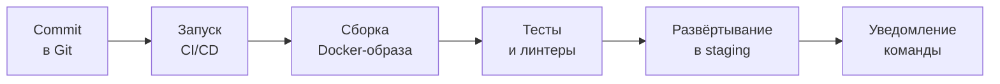

# Введение в инструментальные средства разработки ПО

### Часть 1. Инструментальная инфраструктура разработки

> [!question] Проблемный вопрос
> Как большому коллективу работать над одним проектом без хаоса, то есть кто, что и когда меняет в коде?

#### Понятие ИСР ПО

> [!note] Определение
> **Инструментальные средства разработки ПО** — совокупность программных инструментов, библиотек, фреймворков и сервисов, которые применяются на всех этапах жизненного цикла продукта, от анализа требований до сопровождения.

**Классификация по назначению:**

|Категория|Назначение|Примеры|
|---|---|---|
|Системы контроля версий|Хранят историю изменений, позволяют работать параллельно|Git|
|IDE|Редактор, отладчик и запуск проекта в одном окне|VS Code, IntelliJ IDEA|
|Сборка и зависимости|Собирают проект, подтягивают сторонние библиотеки|Maven, npm|
|Тестирование|Автоматически проверяют, что код работает|Jest, PyTest|
|Контейнеризация|Упаковывают приложение вместе с окружением|Docker|
|CI/CD|Автоматически собирают, проверяют и поставляют версии|GitHub Actions|
|Мониторинг и логирование|Следят за работающим приложением, собирают данные об ошибках|Grafana, ELK|
|AI-ассистенты|Дополняют код, ищут ошибки, объясняют чужой код|Copilot|

Курс изучает **конвейер разработки** целиком, а не отдельные инструменты по одному.

#### Пайплайн разработки

Инструменты тесно интегрированы: результат одного шага автоматически запускает следующий.

1. **Commit в Git** — разработчик записывает изменения в репозиторий.
2. **Запуск CI/CD** — пайплайн стартует автоматически.
3. **Сборка Docker-образа** — приложение упаковывается со всеми зависимостями.
4. **Тесты и линтеры** — проверка, что код работает и соответствует стандартам.
5. **Развёртывание в staging** — версия попадает в тестовое окружение.
6. **Уведомление команды** — результат прогона приходит в общий мессенджер.

Шаги 2–6 выполняются без участия человека. Сбой на любом этапе сразу становится известен всей команде, поэтому ошибки не накапливаются, а исправляются, пока изменение свежо в памяти.

#### Жизненный цикл ПО (SDLC) и инструменты

|Этап|Что происходит|Инструменты|
|---|---|---|
|1. Анализ требований|Определяют, что должен делать продукт|Трекинг задач, Confluence|
|2. Проектирование|Продумывают устройство системы, фиксируют в схемах|UML, PlantUML, Mermaid|
|3. Кодирование|Пишут и проверяют код|IDE, AI-ассистенты|
|4. Тестирование|Проверяют правильность работы|Jest, PyTest|
|5. Развёртывание|Запускают приложение на реальных серверах|Docker, Kubernetes, CI/CD|
|6. Сопровождение|Следят за продуктом, исправляют ошибки, развивают|Prometheus, Grafana, ELK, Jira|

> [!tip] Вывод
> Разработчику мало знать отдельные инструменты, нужно понимать, как они взаимодействуют в едином процессе, от коммита до развёртывания. Такой подход называется **DevOps**.

### Часть 2. Современные тенденции 2024–2026

Основные темы: DevOps, GitOps, AI-driven development, а также DevSecOps (безопасность на каждом этапе пайплайна).

#### DevOps

**DevOps** (Development + Operations) — культура и практика объединения разработки и эксплуатации. Цель: сократить время от идеи до продакшна и повысить надёжность продукта, убрав барьер между теми, кто создаёт программу, и теми, кто обеспечивает её работу.

**Ключевые практики:**

- **CI/CD** — каждая версия автоматически собирается, тестируется и поставляется.
- **IaC** (Infrastructure as Code) — серверы и инфраструктура описываются кодом и хранятся в репозитории, а не настраиваются вручную.
- **Микросервисы** — приложение состоит из независимых небольших сервисов, которые можно разрабатывать и обновлять по отдельности.
- **Контейнеризация** — каждый сервис работает в изолированном окружении на базе Docker, одинаково на любой машине.

В 2024–2025 годах DevOps — стандарт индустрии и базовый навык разработчика.

#### GitOps

**GitOps** — развитие DevOps: конфигурация инфраструктуры и параметры развёртывания хранятся в Git как **единый источник истины**. Желаемое состояние системы описано кодом и не расходится с реальностью.

**Как работает:**

1. Инфраструктура описана декларативно, то есть в репозитории хранится описание того, какой система должна быть.
2. Любое изменение проходит через pull request и попадает в общую историю, как изменение кода.
3. Автоматическая система постоянно приводит реальное состояние к описанному в Git.

**Инструменты:** ArgoCD, Flux, Terraform.

**Что даёт команде:**

- **Аудируемость** — вся история изменений в Git, видно, кто, что и когда менял.
- **Откаты** — возврат к предыдущему состоянию одним revert-коммитом, без ручных действий на серверах.
- **Командное обсуждение** — изменения инфраструктуры проходят код-ревью.

Изменение инфраструктуры равно изменению кода, поэтому к нему применимы те же правила дисциплины.

#### AI-driven development

**AI-driven development** — парадигма, в которой AI-ассистенты становятся полноценным участником разработки: пишут код вместе с человеком, проверяют его и объясняют решения.

**Что делают AI-ассистенты:**

- дописывают рутинный код;
- генерируют unit-тесты;
- объясняют незнакомый код;
- проводят первичный code review (находят явные проблемы до проверки человеком).

**Инструменты:** GitHub Copilot, Cursor, ChatGPT, Claude.

**Статистика:** более 50 % профессиональных разработчиков регулярно используют AI-ассистентов (GitHub Octoverse 2024).

**Новые вопросы:**

- авторское право на сгенерированный код;
- безопасность предлагаемых решений;
- необходимость верификации каждой подсказки;
- ответственность за результат работы.

> [!warning]
> За код, предложенный AI, отвечает разработчик, который его принял. Каждую подсказку нужно понимать и проверять.

#### DevSecOps

> [!info] Дополнение
> На лекции DevSecOps только назван в списке тенденций. Коротко о сути.

**DevSecOps** (Development + Security + Operations) — DevOps, в котором **безопасность встроена в каждый этап пайплайна**, а не проверяется один раз перед релизом.

Принцип **shift left** («сдвиг влево»): проблемы безопасности ищут как можно раньше, ещё при написании кода, потому что там их исправлять дешевле всего.

| Практика | Что проверяет | Примеры инструментов |
|---|---|---|
| **SAST** (статический анализ) | уязвимости в исходном коде | SonarQube, Semgrep |
| **Анализ зависимостей** (SCA) | известные уязвимости в сторонних библиотеках | Dependabot, Snyk |
| **Поиск секретов** | пароли и токены, случайно попавшие в репозиторий | gitleaks |
| **Сканирование образов** | уязвимости в Docker-образах | Trivy |

---

## Вопросы для самопроверки

> [!question]- Что такое инструментальные средства разработки ПО?
> Совокупность программных инструментов, библиотек, фреймворков и сервисов, которые применяются на всех этапах жизненного цикла продукта.

> [!question]- Какие шаги пайплайна выполняются без участия человека?
> Всё после коммита: запуск CI/CD, сборка образа, тесты и линтеры, развёртывание в staging, уведомление команды.

> [!question]- Что такое IaC?
> Infrastructure as Code: серверы и инфраструктура описываются кодом и хранятся в репозитории, а не настраиваются вручную.

> [!question]- Чем GitOps отличается от обычного DevOps?
> В GitOps Git — единый источник истины для инфраструктуры: желаемое состояние описано в репозитории, а автоматическая система приводит реальность к этому описанию.

> [!question]- Что означает принцип shift left в DevSecOps?
> Проверять безопасность как можно раньше, на этапе написания кода, а не перед релизом.