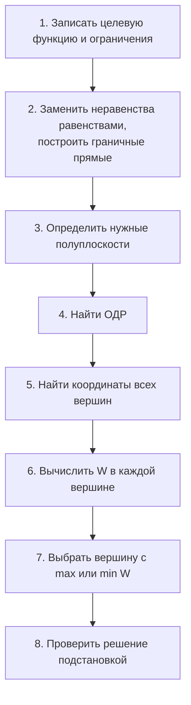

# Задачи линейного программирования

> [!abstract] Содержание
> 1. [[#1. Понятие линейного программирования]]
> 2. [[#2. Каноническая форма ЗЛП]]
> 3. [[#3. Геометрический метод решения ЗЛП]]
> 4. [[#4. Пример решения производственной задачи]]
> 5. [[#5. Симплекс-метод]]
> 6. [[#6. Решение ЗЛП в Microsoft Excel]]
> 7. [[#7. Отчёт об устойчивости и теневые цены]]
> 8. [[#8. Исследование чувствительности]]
> 9. [[#9. Сравнение методов решения ЗЛП]]

---

## 1. Понятие линейного программирования

> [!note] Определение
> **Линейное программирование (ЛП)** — раздел математики, изучающий задачи нахождения максимума или минимума **линейной функции** при **линейных ограничениях**.

Задача линейного программирования (**ЗЛП**) состоит из трёх частей:

| Часть | Что это |
|---|---|
| **Целевая функция** | функция, которую нужно максимизировать или минимизировать (прибыль, затраты) |
| **Система ограничений** | условия, которым должно удовлетворять решение (запасы ресурсов, нормы) |
| **Условия неотрицательности** | переменные не могут быть отрицательными (нельзя выпустить −5 деталей) |

Общий вид целевой функции:

$$W = c_1x_1 + c_2x_2 + \ldots + c_nx_n \to \max(\min)$$

где $x_j$ — переменные задачи, $c_j$ — коэффициенты целевой функции.

| Понятие | Определение |
|---|---|
| **Допустимый план** | набор значений переменных, удовлетворяющий всем ограничениям |
| **Оптимальный план** | допустимый план, при котором целевая функция достигает максимума или минимума |

ЗЛП применяется в производстве, транспорте, распределении ресурсов и информационных технологиях.

---

## 2. Каноническая форма ЗЛП

> [!note] Определение
> **Каноническая форма** — ограничения записаны как **равенства**, правые части **неотрицательны**, все переменные **неотрицательны**.

Правила приведения к канонической форме:

**1. Неравенство → равенство**
- при знаке $\leq$ **добавляется** неотрицательная переменная;
- при знаке $\geq$ **вычитается** неотрицательная переменная.

> [!example] Пример
> $$4x_1 + 2x_2 \leq 400 \quad\Rightarrow\quad 4x_1 + 2x_2 + x_3 = 400$$
> Переменная $x_3$ показывает **остаток неиспользованного ресурса**.

**2. Отрицательная правая часть.** Всё равенство умножается на $-1$.

**3. Свободная переменная.** Если переменная может принимать любые значения, её заменяют разностью двух неотрицательных:

$$x = x' - x'', \quad x', x'' \geq 0$$

**4. Минимум → максимум.** Функцию $W$ заменяют на $-W$. Оптимальный план остаётся прежним, а значение функции меняет знак.

---

## 3. Геометрический метод решения ЗЛП

Применяется для задач с **двумя переменными**.

Каждое линейное неравенство задаёт полуплоскость. Пересечение всех полуплоскостей с учётом неотрицательности образует **область допустимых решений (ОДР)**.

| Понятие | Что это |
|---|---|
| **ОДР** | множество всех допустимых планов (многоугольник на плоскости) |
| **Линия уровня** | прямая, на которой целевая функция имеет постоянное значение |
| **Вектор-градиент** | вектор коэффициентов целевой функции $(c_1; c_2)$, указывает направление её роста |

> [!important] Основная теорема ЛП
> Если оптимальное решение существует, оно достигается **хотя бы в одной вершине ОДР**.

### Алгоритм геометрического метода

---

## 4. Пример решения производственной задачи

Предприятие выпускает **корпуса** ($x_1$) и **кронштейны** ($x_2$). Нужно максимизировать прибыль при ограниченных ресурсах.

**Математическая модель:**

$$W = 300x_1 + 200x_2 \to \max$$

$$\begin{cases} 4x_1 + 2x_2 \leq 400 & \text{(фрезерные часы)} \\ 2x_1 + 3x_2 \leq 360 & \text{(токарные часы)} \\ x_1, x_2 \geq 0 \end{cases}$$

**Вершины ОДР:**

| Вершина | Координаты | $W$ |
|---|---|---|
| O | (0; 0) | 0 |
| A | (100; 0) | 30 000 |
| **B** | **(60; 80)** | **34 000** |
| C | (0; 120) | 24 000 |

> [!info] Как найдена вершина B
> Это пересечение двух граничных прямых. Из первого уравнения $x_2 = 200 - 2x_1$. Подставляем во второе: $2x_1 + 3(200 - 2x_1) = 360 \Rightarrow x_1 = 60$, тогда $x_2 = 80$.

> [!success] Ответ
> Оптимальный план: $x_1 = 60$, $x_2 = 80$. Максимальная прибыль — **34 000 рублей**. Оба ресурса используются полностью.

---

## 5. Симплекс-метод

> [!info] Дополнение
> На лекции симплекс-метод упоминается в сравнении и в настройках Excel, но не разобран. Коротко о сути.

**Симплекс-метод** — универсальный алгоритм для ЗЛП с **любым числом переменных**.

Идея: оптимум лежит в вершине ОДР, поэтому метод **переходит от одной вершины к соседней**, каждый раз улучшая значение целевой функции. Когда улучшать больше некуда, найден оптимум.

1. Привести задачу к канонической форме.
2. Найти начальный опорный план (обычно все основные переменные = 0).
3. Проверить план на оптимальность по симплекс-таблице.
4. Если план не оптимален, перейти к соседней вершине с лучшим $W$.
5. Повторять шаги 3–4, пока план не станет оптимальным.

---

## 6. Решение ЗЛП в Microsoft Excel

Используется надстройка **«Поиск решения»** (Solver).

Модель на листе должна содержать:
- **изменяемые ячейки** — значения переменных;
- **целевую ячейку** — формулу целевой функции;
- **ограничения** — расход ресурсов и их запасы;
- **формулы** расчёта расхода и остатка ресурсов.

> [!tip] Порядок решения
> 1. Включить надстройку «Поиск решения»: Файл → Параметры → Надстройки.
> 2. Создать таблицу с переменными, коэффициентами и ограничениями.
> 3. Указать целевую ячейку и выбрать максимум или минимум.
> 4. Указать изменяемые ячейки.
> 5. Добавить ограничения и условие неотрицательности.
> 6. Выбрать метод **«Поиск решения линейных задач симплекс-методом»**.
> 7. Запустить расчёт и проверить результат.

Для примера выше Excel должен получить $x_1 = 60$, $x_2 = 80$, $W = 34\,000$.

---

## 7. Отчёт об устойчивости и теневые цены

**Отчёт об устойчивости** показывает, как изменение коэффициентов целевой функции и запасов ресурсов влияет на оптимальное решение.

> [!note] Определение
> **Теневая цена** (двойственная оценка) ресурса — насколько изменится оптимальное значение целевой функции, если запас ресурса увеличить на **одну единицу** (в пределах диапазона устойчивости).

Для примера:

| Ресурс | Запас | Теневая цена |
|---|---|---|
| Фрезерные часы | 400 | 62,5 |
| Токарные часы | 360 | 25 |

> [!example] Проверка двойственности
> $$400 \cdot 62{,}5 + 360 \cdot 25 = 25\,000 + 9\,000 = 34\,000$$
> Сумма «запас × теневая цена» равна оптимальной прибыли.

> [!tip] Как понимать
> Один дополнительный фрезерный час принесёт +62,5 руб. прибыли, токарный — +25 руб. Значит, докупать выгоднее фрезерные часы.

В отчёте также указаны **допустимое увеличение и уменьшение** правых частей ограничений. В этих пределах теневая цена сохраняется. За ними задачу нужно решать заново.

---

## 8. Исследование чувствительности

**Исследование чувствительности** — изучение того, как изменение параметров задачи влияет на оптимальный план и значение целевой функции.

Изменять можно:
- коэффициенты целевой функции;
- запасы ресурсов;
- другие параметры модели.

После каждого изменения заново запускают «Поиск решения» и записывают новые значения переменных, целевой функции и теневых цен.

В пределах диапазона устойчивости изменение запаса ресурса на $\Delta b_i$ меняет целевую функцию на:

$$\Delta W = \Delta b_i \cdot y_i$$

где $y_i$ — теневая цена ресурса.

> [!example] Пример
> Добавим 10 фрезерных часов: $\Delta W = 10 \cdot 62{,}5 = 625$. Новая прибыль — $34\,625$ руб.

---

## 9. Сравнение методов решения ЗЛП

| Критерий | Геометрический метод | Симплекс-метод | Excel |
|---|---|---|---|
| **Число переменных** | 2 | любое | до 200 (по материалу работы) |
| **Трудоёмкость** | невысокая | средняя | низкая |
| **Наглядность** | высокая | низкая | средняя |
| **Анализ устойчивости** | ограничен | через двойственные оценки | встроенный отчёт |
| **Автоматизация** | нет | возможна | встроена |

---

## Вопросы для самопроверки

> [!question]- Из каких трёх частей состоит ЗЛП?
> Целевая функция, система ограничений, условия неотрицательности.

> [!question]- Приведите к канонической форме: $3x_1 + x_2 \geq 12$.
> Вычитаем неотрицательную переменную: $3x_1 + x_2 - x_3 = 12$, $x_3 \geq 0$.

> [!question]- Где ищут оптимальное решение в геометрическом методе?
> В вершинах ОДР: по основной теореме ЛП оптимум достигается хотя бы в одной вершине.

> [!question]- Что показывает теневая цена ресурса?
> На сколько вырастет оптимальное значение целевой функции при увеличении запаса ресурса на единицу.

> [!question]- Когда нельзя пользоваться геометрическим методом?
> Когда переменных больше двух.
