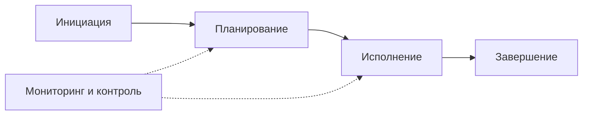

# Понятие проекта и основные сведения

## 1. Управление проектами

> [!note] Определение
> **Управление проектами** — отдельная область менеджмента со своими подходами, задачами и стандартами.

Основные принципы описаны в стандартах проектной деятельности. Самый известный разработчик таких стандартов — **PMI** (Project Management Institute, Институт управления проектами), работающий с **1969 года**. Широко применяются и фреймворки гибких методологий.

PMI оформил управление проектами как область знаний и ввёл основные понятия, закреплённые затем в стандарте **PMBOK**. Отсюда берут начало понятия:
- жизненный цикл проекта;
- фазы и стадии проекта;
- подсистемы и процессы управления проектами.

> [!info] В России
> Действует **ГОСТ Р 54869-2011** «Проектный менеджмент. Требования к управлению проектом».

---

## 2. Что такое проект

> [!note] Определение
> **Проект** — деятельность, направленная на создание **уникального** продукта, услуги или результата и **ограниченная во времени**.

| Качество | Что означает |
|---|---|
| **Разовость** | проект — временное, разовое явление |
| **Уникальность** | в каждом проекте есть что-то неповторимое |
| **Инновационность** | в ходе проекта всегда создаётся что-то новое |
| **Результативность** | проект направлен на достижение определённого результата |
| **Временная локализация** | проект ограничен чёткими временными рамками |

> [!important] Главное — время
> В проектном управлении важнейшая характеристика — **время**. Главная задача менеджера проекта — **контроль сроков**: их расширение ведёт к росту бюджета и рисков.

> [!info] Дополнение: треугольник ограничений
> Время связано с двумя другими ограничениями проекта. Изменение одного почти всегда меняет остальные.
> ```mermaid
> flowchart LR
>     A["Сроки"] --- B["Стоимость"]
>     B --- C["Содержание<br>(объём работ)"]
>     C --- A
> ```
> *Пример:* заказчик просит добавить функции (содержание ↑) → либо растут сроки и бюджет, либо страдает качество.

**Объектами проектирования** могут быть: объекты материальной культуры, нематериальные свойства и отношения, рекламные кампании, процессы, организационные структуры, законы и услуги.

---

## 3. Классификация проектов

> [!info] Дополнение
> В конспекте записаны только признаки. Типовые виды проектов по каждому признаку добавлены.

| № | Признак | Виды |
|---|---|---|
| 1 | **По масштабу** | малые, средние, крупные, мегапроекты |
| 2 | **По сложности** | простые, сложные (организационно, технически, экономически), очень сложные |
| 3 | **По срокам реализации** | краткосрочные (до 1 года), среднесрочные (1–3 года), долгосрочные (более 3 лет) |
| 4 | **По требованиям к качеству** | стандартные, повышенного качества, бездефектные (атомная энергетика, авиация) |
| 5 | **По уровню участников** | международные, государственные, региональные, отраслевые, корпоративные |
| 6 | **По характеру изменений** | инновационные (создают новое), поддерживающие (улучшают существующее) |
| 7 | **По сферам деятельности** | технические, организационные, экономические, социальные, смешанные |
| 8 | **По целевым установкам** | создание продукта, решение проблемы, развитие организации |
| 9 | **По финансированию** | инвестиционные, бюджетные, кредитные, спонсорские, благотворительные |
| 10 | **По ресурсам и прибыли** | коммерческие (цель — прибыль), некоммерческие (социальный эффект) |

> [!example] Пример
> Внедрение ИС управления в одном отеле: **малый, среднесрочный, корпоративный, организационно-технический, инновационный, коммерческий** проект.

---

## 4. Общие задачи управления проектами

| № | Задача | Суть |
|---|---|---|
| 1 | **Цели и обоснование** | определить цели проекта, выявить потребности заинтересованных сторон |
| 2 | **Структура проекта** | подцели, основные этапы работ, управление изменениями |
| 3 | **Финансы и бюджет** | источники финансирования, учёт ресурсов и стоимости |
| 4 | **Команда** | набор исполнителей, управление персоналом |
| 5 | **Контракты** | договоры, управление поставщиками и внешними сторонами |
| 6 | **График и сроки** | расписание работ с учётом зависимостей и рисков |
| 7 | **Риски** | оценка рисков, стратегии реагирования |
| 8 | **Мониторинг и контроль** | отчётность, анализ хода выполнения |
| 9 | **Качество** | контроль выполнения требований, улучшения |
| 10 | **Коммуникации** | вовлечённость заинтересованных сторон, прозрачность информации |

---

## 5. Жизненный цикл проекта

Один из ключевых объектов управления проектами — **жизненный цикл проекта**. С ним связаны основные подсистемы и процессы управления.

> [!info] Дополнение
> Конспект заканчивается на этом понятии. Типовые фазы жизненного цикла:



| Фаза | Что происходит |
|---|---|
| **Инициация** | формулируют идею и цель, обосновывают проект, утверждают устав |
| **Планирование** | составляют план работ, график, бюджет, план рисков |
| **Исполнение** | выполняют работы, создают результат |
| **Мониторинг и контроль** | идут параллельно: сравнивают факт с планом, вносят корректировки |
| **Завершение** | сдают результат, закрывают договоры, фиксируют уроки проекта |

---

## Вопросы для самопроверки

> [!question]- Что такое проект?
> Деятельность, направленная на создание уникального продукта, услуги или результата и ограниченная во времени.

> [!question]- Перечислите качества проекта.
> Разовость, уникальность, инновационность, результативность, временная локализация.

> [!question]- Почему главная задача менеджера проекта — контроль сроков?
> Затягивание сроков ведёт к росту бюджета и рисков.

> [!question]- Какой стандарт ввёл понятия жизненного цикла, фаз и процессов управления проектами?
> PMBOK, разработанный институтом PMI.

> [!question]- Какой ГОСТ регулирует управление проектом в России?
> ГОСТ Р 54869-2011.
