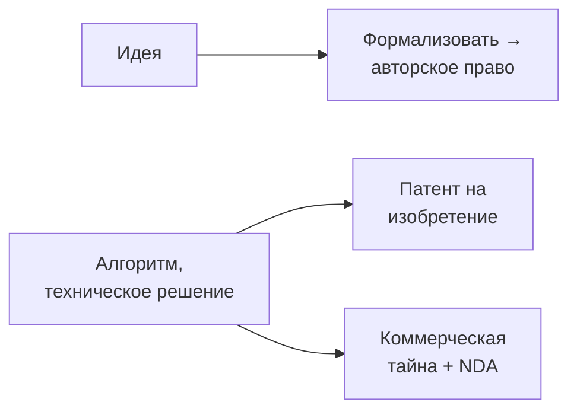

# Как защитить алгоритмы, технические решения, идеи

> [!note] Связанная лекция
> Основы авторского и патентного права — в [[03.02/Лекции/29.09.26|29.09.26]].

### 1. Защита идеи через авторское право

> [!warning] Саму идею защитить нельзя
> Её нужно **формализовать**: подробно описать и выразить, например, в электронном файле любого формата.

- Авторское право защищает **форму реализации** объекта, а не его суть.

> [!example] Пример
> Идея «приложение для бронирования столиков» не защищена: такое приложение может сделать кто угодно. Защищены ваш конкретный код, дизайн и тексты.

### 2. Алгоритм

- **Алгоритм** – последовательность команд для решения поставленной задачи.
- Уникальный алгоритм, используемый при создании ПО, является интеллектуальной собственностью разработчика.
- На него можно получить **патент как на изобретение**, если он представляет собой способ или решение задачи, а не просто код.

### 3. Техническое решение

- **Техническое решение** – способ или процесс, помогающий решить поставленную задачу.
- Как и алгоритм, оно патентуется как изобретение.

### 4. Коммерческая тайна и NDA

- Алгоритмы, технические решения и идеи можно защитить **режимом коммерческой тайны**.
- С работниками и контрагентами заключают **NDA** (Non-disclosure agreement, соглашение о неразглашении). Это договор об обмене материалами, знаниями или информацией, представляющей ценность.
- В NDA можно прописать ответственность за нарушение: штрафы и пени за разглашение.

### 5. Способы передачи исключительного права

|Договор|Суть|Важные моменты|
|---|---|---|
|**Трудовой**|Произведения, созданные по трудовому договору и должностной инструкции, называются «служебными» (ст. 1296 ГК РФ). Исключительное право по умолчанию принадлежит **работодателю**.|Если нет должностной инструкции или служебного задания, право на произведение можно оспорить.|
|**Лицензионный**|Даёт право **пользования** интеллектуальной собственностью на определённых условиях.|Условия могут быть такими: срок, ежемесячные роялти, территория (например, одна страна).|
|**Об отчуждении исключительного права**|Исключительное право **полностью переходит** от одного лица к другому.|Новый правообладатель обязан выплатить вознаграждение. Без этого условия договор считается **незаключённым**. Оплата может быть разовой фиксированной или периодическими процентными отчислениями от дохода.|
|**Авторского заказа**|Автор создаёт произведение для заказчика.|В отличие от трудового договора, исключительное право **по умолчанию не переходит** к заказчику, поэтому это условие нужно прописать. Существенные условия: предмет договора (что автор обязуется создать) и сроки выполнения.|

### Главное

> [!success] Итог
> - **Идея** защищается через формализацию и авторское право.
> - **Алгоритм и техническое решение** защищаются патентом или коммерческой тайной с NDA.
> - **Исключительное право** передаётся одним из четырёх договоров: трудовым, лицензионным, об отчуждении или авторского заказа.

---

## Вопросы для самопроверки

> [!question]- Можно ли защитить идею?
> Саму идею нельзя. Нужно формализовать её — описать и выразить в файле, тогда защищается форма выражения.

> [!question]- Как можно защитить алгоритм?
> Патентом как изобретение (если это способ решения задачи, а не просто код) или режимом коммерческой тайны с NDA.

> [!question]- Кому принадлежит право на программу, написанную сотрудником по служебному заданию?
> Работодателю (служебное произведение, ст. 1296 ГК РФ).

> [!question]- Чем лицензионный договор отличается от договора об отчуждении?
> Лицензия даёт только право пользования на условиях. При отчуждении исключительное право полностью переходит к новому правообладателю.

> [!question]- Переходит ли право к заказчику по договору авторского заказа автоматически?
> Нет, это условие нужно прямо прописать в договоре.

