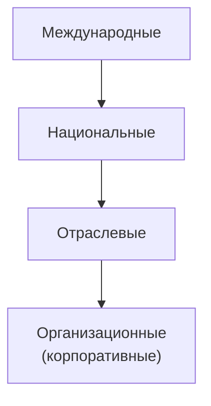

# Стандарты управления проектами

## 1. Что такое стандарты управления проектами

> [!note] Определение
> **Стандарты управления проектами** — документы, определяющие понятия, термины, методологии, фазы, роли, обязанности и компетентность в сфере проектного менеджмента.

Это совокупность знаний и опыта, проверенных на практике и признанных авторитетными источниками.

## 2. Для чего нужны стандарты

- обеспечить **единый подход** к менеджменту в разных отраслях, компаниях и государствах;
- установить **общие требования** к эффективности;
- определить **продуктивные практики** и методики управления проектами;
- содействовать **развитию** и профессиональному совершенствованию сотрудников;
- способствовать **обмену знаниями** и опытом между заинтересованными сторонами.

## 3. Принцип применения стандартов

> [!important] Стандарт — не инструкция
> Стандарты управления проектами **не являются жёсткими инструкциями**, которым нужно следовать безоговорочно.
>
> Это общие рекомендации, которые **адаптируют** под конкретный проект, организацию, отрасль или регион. Стандарты постоянно обновляются вслед за изменениями технологий, требований и ожиданий заинтересованных сторон.

## 4. Основные задачи стандартизации

> [!note] Определение
> **Стандартизация управления проектами** — процесс разработки, принятия, распространения и применения стандартов.

Задачи стандартизации:
- закрепляет общепринятые **правила, требования и критерии**;
- создаёт **методы и инструменты**, которые служат образцом или эталоном;
- даёт **знания и опыт** для обучения и развития компетентности;
- повышает **согласованность** подходов, методов и терминологии между компаниями, отраслями и странами;
- стимулирует **постоянное совершенствование**.

## 5. Виды стандартов

| Вид | Кто разрабатывает | Особенности |
|---|---|---|
| **Международные** | международные организации | широкое признание во всём мире, основа для национальных и отраслевых стандартов |
| **Национальные** | национальные органы по стандартизации | учитывают законодательство, культуру и экономику страны; могут быть обязательными или добровольными |
| **Отраслевые** | отраслевые ассоциации или компании | учитывают риски и задачи конкретной отрасли; соответствуют международным и национальным требованиям |
| **Организационные** | конкретная компания для себя | основаны на стандартах выше и учитывают цели, ресурсы и культуру компании; обычно добровольны, но могут быть обязательны для сотрудников и подрядчиков |

> [!info] Дополнение: российские стандарты
> - **ГОСТ Р 54869-2011** — требования к управлению проектом;
> - **ГОСТ Р 54870-2011** — требования к управлению портфелем проектов;
> - **ГОСТ Р 54871-2011** — требования к управлению программой;
> - **ГОСТ Р ИСО 21500-2014** — руководство по проектному менеджменту (перевод международного ISO 21500).

## 6. PMI (Project Management Institute)

**PMI** — крупнейшая в мире некоммерческая организация, развивающая профессию управленца проектами. Разрабатывает стандарты по управлению проектами, программами, рисками, требованиями и другим аспектам.

> [!tip] Самый известный стандарт — PMBOK
> **PMBOK** (Project Management Body of Knowledge) — свод знаний: основные понятия, термины, фазы, процессы и области знаний по управлению проектами.
> Является основой для сертификации **PMP** (Project Management Professional).

**Другие стандарты PMI:**

| Стандарт | О чём |
|---|---|
| The Standard for Program Management | управление программами (несколько связанных проектов) |
| The Standard for Portfolio Management | управление портфелями проектов и программ |
| The Practice Standard for Project Risk Management | управление рисками |
| The Practice Standard for Project Requirements Management | управление требованиями |
| The Practice Standard for Earned Value Management | метод освоенного объёма (заработанной стоимости) |
| The Practice Standard for Project Configuration Management | управление конфигурацией проекта |

**Особенности стандартов PMI:** высокая детализация, формализация и универсальность. Подходят для проектов любой сложности и отрасли.

## 7. IPMA (International Project Management Association)

**IPMA** — ассоциация, объединяющая более 70 национальных организаций по управлению проектами.

> [!tip] Основной стандарт — ICB
> **ICB** (Individual Competence Baseline) — стандарт компетенций управленца. Описывает **29 компетенций**, необходимых для управления проектами.
> Является основой для сертификации **IPMA 4-L-C** (Four Level Certification System, четырёхуровневая система).

Компетенции делятся на три категории:
- **технические**;
- **поведенческие**;
- **контекстные**.

> [!note]
> В актуальной версии ICB 4 эти группы называются «Практика», «Люди» и «Перспектива».

**Другие стандарты IPMA:**

| Стандарт | О чём |
|---|---|
| **NCB** (National Competence Baseline) | национальная адаптация ICB под специфику страны |
| **OCB** (Organisational Competence Baseline) | 28 компетенций для системы управления проектами в компании |
| **PEB** (Project Excellence Baseline) | критерии оценки качества продукта и итогов проекта (конкурс IPMA Project Excellence Award) |
| **PMD** (Project Management Delta) | методология аудита сильных и слабых сторон системы управления проектами |

## 8. PMI и IPMA: сравнение

> [!info] Дополнение
> Сводная таблица для повторения.

| | PMI | IPMA |
|---|---|---|
| **Главный стандарт** | PMBOK | ICB |
| **Фокус** | **процессы**: что и в каком порядке делать | **компетенции**: каким должен быть менеджер |
| **Сертификация** | PMP | IPMA 4-L-C (четыре уровня) |
| **Происхождение** | США | Европа (Швейцария) |

---

## Вопросы для самопроверки

> [!question]- Почему стандарты не являются жёсткими инструкциями?
> Это общие рекомендации, которые адаптируют к конкретному проекту, организации, отрасли и региону.

> [!question]- Назовите четыре вида стандартов.
> Международные, национальные, отраслевые, организационные (корпоративные).

> [!question]- Что такое PMBOK?
> Свод знаний по управлению проектами от PMI: понятия, фазы, процессы и области знаний. Основа сертификации PMP.

> [!question]- Чем подход IPMA отличается от подхода PMI?
> PMI описывает процессы управления проектом, IPMA — компетенции, которыми должен обладать менеджер.

> [!question]- Сколько компетенций описывает ICB?
> 29.
