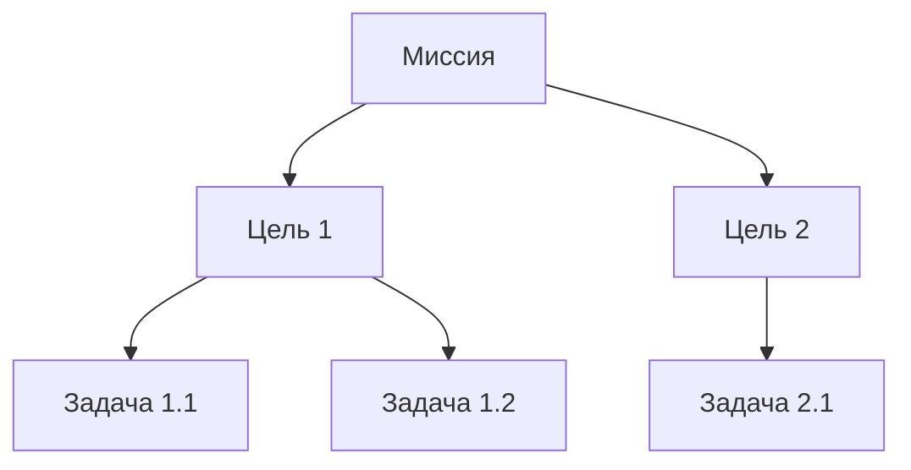
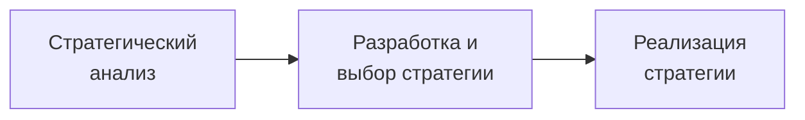

# Цель и стратегия проекта

## 1. Миссия

> [!note] Определение
> **Миссия** — генеральная цель проекта, чётко выраженная причина его существования.

Миссия:
- определяет статус проекта;
- служит ориентиром для целей следующих уровней;
- задаёт направление для стратегий на разных организационных уровнях.

## 2. Цели проекта

> [!info] Дополнение
> На лекции цели упоминаются как связующее звено между миссией и стратегией. Ниже — как их правильно формулировать.

Миссия раскладывается на **дерево целей**: общая цель → подцели → конкретные задачи.

Хорошая цель формулируется по критериям **SMART**:

| Буква | Критерий | Вопрос |
|---|---|---|
| **S** | Specific — конкретная | Что именно нужно сделать? |
| **M** | Measurable — измеримая | Как понять, что цель достигнута? |
| **A** | Achievable — достижимая | Реально ли это при наших ресурсах? |
| **R** | Relevant — значимая | Связана ли цель с миссией? |
| **T** | Time-bound — ограниченная по времени | К какому сроку? |

> [!example] Пример
> ❌ «Улучшить работу отеля».
> ✅ «Сократить время заселения гостя с 15 до 5 минут к 1 марта за счёт внедрения ИС».

## 3. Стратегия проекта

> [!note] Определение
> **Стратегия проекта** — центральное звено в выработке направлений действий, которые ведут к результатам, заданным миссией и системой целей.

### Три процедуры подготовки стратегии

| Процедура | Содержание |
|---|---|
| **Стратегический анализ**¹ | оценка внешней среды и собственных возможностей; инструменты — SWOT-анализ (сильные и слабые стороны, возможности, угрозы), PEST-анализ (политика, экономика, общество, технологии) |
| **Разработка и выбор стратегии** | выбор направления на трёх организационных уровнях (см. ниже) |
| **Реализация стратегии** | прежде всего — изменения в **организационной структуре** и **организационной культуре** |

¹ Инструменты стратегического анализа добавлены.

### Уровни стратегии

| Уровень | Что определяет |
|---|---|
| **Корпоративная** | общее направление развития: стратегия **роста, сохранения или сокращения** |
| **Деловая** | как конкретный товар будет **конкурировать** на конкретном рынке |
| **Функциональная** | конкретизация стратегии для каждого подразделения (маркетинг, производство, финансы) |

> [!important] Где стратегия проекта
> Стратегия проекта разрабатывается **в рамках деловой стратегии**: она отвечает на вопрос, как продукция проекта будет конкурировать на рынке.

---

## Вопросы для самопроверки

> [!question]- Чем миссия отличается от цели?
> Миссия — генеральная причина существования проекта. Цели — конкретные измеримые результаты, которые из неё вытекают.

> [!question]- Назовите три процедуры подготовки стратегии.
> Стратегический анализ, разработка и выбор стратегии, реализация стратегии.

> [!question]- На каком уровне разрабатывается стратегия проекта?
> В рамках деловой стратегии.

> [!question]- Что требуется для реализации стратегии в первую очередь?
> Изменения в организационной структуре и организационной культуре.

> [!question]- Сформулируйте по SMART цель «сделать сайт быстрее».
> Например: «Сократить время загрузки главной страницы с 4 до 1,5 секунды к концу квартала».
