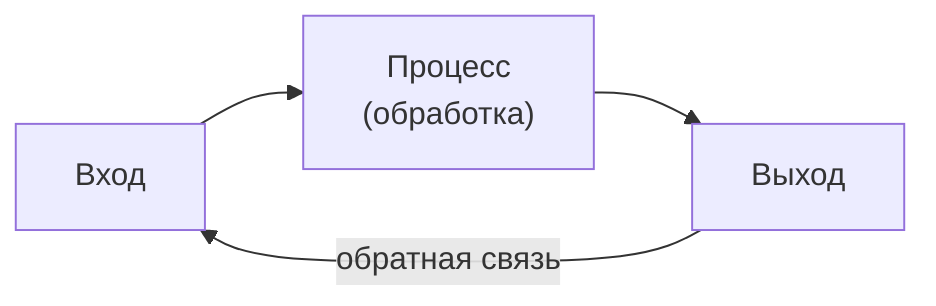
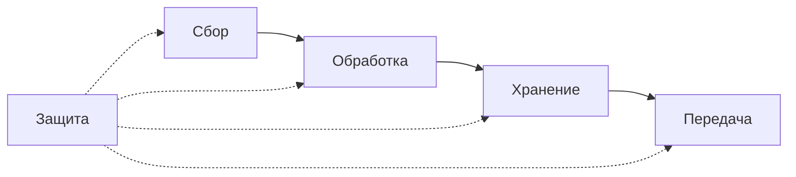

# Понятие ИС и процессы, протекающие в ней

## 1. Система

> [!note] Определение
> **Система** — совокупность взаимодействующих элементов, объединённых общей целью.

Признаки системы:

| Признак | Что означает |
|---|---|
| **Наличие цели** | система существует ради определённого результата |
| **Элементы и связи** (структура) | система состоит из частей, связанных между собой |
| **Целостность** | система больше суммы своих частей: у неё есть свойства, которых нет ни у одного элемента в отдельности |

> [!example] Пример целостности
> Ни процессор, ни монитор, ни программа по отдельности не умеют «вести учёт товаров». Вместе — умеют.

## 2. Информационная система (ИС)

> [!note] Определение
> **ИС** — взаимосвязанная совокупность средств, методов и персонала для хранения, обработки и выдачи информации в интересах достижения цели.

Состав ИС:

| Компонент | Примеры¹ |
|---|---|
| **Технические средства** | серверы, компьютеры, сеть, принтеры, сканеры |
| **Программное обеспечение** | ОС, СУБД, прикладные программы |
| **Данные** | базы данных, справочники, документы |
| **Организационно-методические материалы** | инструкции, регламенты, должностные обязанности |
| **Персонал** | пользователи, администраторы, разработчики |

¹ Примеры добавлены для наглядности.

> [!important]
> Персонал — обязательная часть ИС. Без людей, которые вводят данные и принимают решения, ИС не работает.

## 3. ИС и ИТ

> [!note] Определение
> **Информационная технология (ИТ)** — методы, способы и средства преобразования информации.

| | ИТ | ИС |
|---|---|---|
| **Вопрос** | «**Как?**» обрабатывать информацию | «**Зачем и для кого?**» |
| **Суть** | инструмент | работающий «организм»: техника, данные, процедуры, люди |
| **Связь** | — | ИС использует ИТ как инструмент достижения цели и развития |

### Модель работы ИС

## 4. Чем ИС отличается от набора программ

| Набор программ | ИС |
|---|---|
| программы решают разные задачи независимо | **целостность и единая цель** |
| данные разбросаны по файлам | **организованные данные** — база данных |
| каждый работает как привык | **регламенты и процедуры** |
| нет распределения ролей | **персонал**: пользователи, администраторы |

## 5. Базовые процессы в ИС

| № | Процесс | Что происходит | Примеры |
|---|---|---|---|
| 1 | **Сбор** | получение и фиксация первичных данных | документы, веб-формы, сканеры, датчики |
| 2 | **Обработка** | преобразование данных | расчёты, группировка, поиск, отчёты |
| 3 | **Хранение** | сохранение данных во времени | базы данных, архивы, резервные копии |
| 4 | **Передача** | обмен данными между подсистемами и пользователями | сеть, интеграция, выгрузки |
| 5 | **Защита** | охрана данных от потери, искажения и чужого доступа | см. ниже |

### Защита информации

**Средства защиты:**
- аутентификация и авторизация (вход по логину и паролю);
- разграничение прав доступа;
- резервное копирование¹;
- шифрование¹;
- антивирусы и межсетевые экраны¹.

> [!info] Дополнение: свойства защищённой информации
> В конспекте этот пункт остался пустым. Классически выделяют три свойства (триада **CIA**):
>
> | Свойство | Что означает | Чем нарушается |
> |---|---|---|
> | **Конфиденциальность** | доступ только у тех, кому разрешено | утечка, взлом |
> | **Целостность** | данные не искажены и не изменены без разрешения | ошибка, вирус, подмена |
> | **Доступность** | данные доступны тогда, когда нужны | сбой сервера, DDoS-атака |

¹ Дополнено к средствам, названным на лекции.

---

## Вопросы для самопроверки

> [!question]- Что значит «система больше суммы своих частей»?
> У системы появляются свойства, которых нет ни у одного элемента по отдельности.

> [!question]- Назовите пять компонентов ИС.
> Технические средства, ПО, данные, организационно-методические материалы, персонал.

> [!question]- Чем ИС отличается от ИТ?
> ИТ отвечает на вопрос «как?» — это инструмент. ИС отвечает на вопрос «зачем и для кого?» — это работающая система из техники, данных, процедур и людей.

> [!question]- Перечислите базовые процессы в ИС.
> Сбор, обработка, хранение, передача, защита.

> [!question]- Какие три свойства информации обеспечивает защита?
> Конфиденциальность, целостность, доступность.
