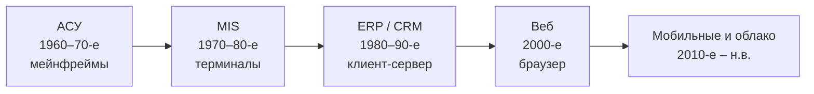

# Этапы развития информационных систем

### 1. Первые поколения: АСУ и MIS (1960–1980-е)

#### АСУ (1960–1970-е)

**АСУ** (автоматизированная система управления) – первый класс ИС. Создавались в госсекторе и крупной промышленности.

- **Задачи:** учёт производства, плановые расчёты, обработка статистики.
- **Особенности:**
    - централизованная обработка на больших ЭВМ (мейнфреймах);
    - пакетная обработка данных;
    - малая интерактивность;
    - высокая стоимость.
- **Мейнфрейм** – большая универсальная ЭВМ, занимающая целый зал.
- **Пакетная обработка** – задания собираются в пакет и выполняются по очереди, без диалога с пользователем (сдали перфокарты – вечером получили расчёты).
- **Пример:** АСУ предприятия.

#### MIS (1970–1980-е)

**MIS** (Management Information Systems, управленческие ИС) – системы для подготовки регулярных отчётов для менеджеров.

- **Архитектура:** терминал – мейнфрейм.
- Данные обрабатываются в централизованном вычислительном центре (ВЦ).
- Пользователи получают сводные отчёты «по запросу».
- **Функциональные области:** финансы, склад, кадры.
- **Пример:** ИС учёта кадров.
- **Отличие от АСУ:** АСУ – техпроцессы и плановые расчёты, MIS – отчёты для менеджеров.

#### Ограничения первых поколений

1. **Дороговизна** – доступны только крупным организациям.
2. **Зависимость от ВЦ** – простой центра означает простой всей системы.
3. **Жёсткие форматы отчётов** – что заложили программисты, то и получишь.
4. **Нет самообслуживания** – пользователь зависит от программистов и операторов ВЦ.

> [!tip] Вывод
> Бизнесу нужны более доступные и гибкие системы, поэтому смена платформы неизбежна.

---

### 2. Корпоративные системы: ERP и CRM (1980–1990-е)

#### ПК меняют архитектуру

Появились персональные компьютеры и локальные сети (ЛВС).

||Файл-серверная|Клиент-серверная|
|---|---|---|
|Где хранятся данные|Файлы на общем сервере|Данные на сервере|
|Где обработка|На каждом ПК|Разделена: клиент отправляет запрос и получает результат, сервер обрабатывает|
|Минус/плюс|Сеть перегружается при росте числа пользователей|Нагрузка на сеть ниже|

**АРМ** (автоматизированное рабочее место) – ПК со специализированным ПО на рабочем месте специалиста, с доступом к общим данным.  
**Итог:** вычисления приблизились к пользователю.

#### ERP (Enterprise Resource Planning)

Класс корпоративных систем планирования ресурсов предприятия.

- **Главная ценность:** единая база данных. Информация вводится один раз, нет дублирования и противоречий.
- **Сквозные процессы:** закупки → производство → продажи → финансы.
- **Интеграция подразделений:** отделы работают в одной системе.
- **Примеры:** SAP ERP, 1С:ERP, Oracle EBS.

#### CRM (Customer Relationship Management)

Управление взаимоотношениями с клиентами.

- **Главная ценность:** единый профиль каждого клиента.
- **Ключевые черты:**
    - карточки клиентов;
    - история обращений;
    - продажи (воронка и сопровождение сделок);
    - маркетинговые кампании (рассылки, сегменты аудитории).
- **Примеры:** Bitrix24, amoCRM, Salesforce.

> [!important] Запомнить
> **ERP** — ресурсы предприятия, **CRM** — клиенты предприятия.

#### Эра типовых решений «из коробки»

Появились массовые коммерческие ИС, то есть типовые решения для многих организаций.

**Цепочка:**

1. Типовое решение (установка без разработки с нуля).
2. Настройка и доработка под процессы конкретного предприятия.
3. Проектирование и ТЗ. От их качества зависит успех внедрения.

> [!tip] Вывод
> Выросла роль проектирования и технического задания. Именно этому посвящён МДК.

---

### 3. Веб, мобильные и облачные платформы (2000-е – настоящее время)

#### Веб-системы (2000-е)

Интернет стал средой доступа к системам.

- **Архитектура (3 уровня):** веб-клиент (браузер) → сервер приложений (бизнес-логика) → СУБД (база данных).
- **Сферы применения:** корпоративные порталы, интернет-банкинг, электронная коммерция, «Госуслуги».
- **Преимущества:**
    - доступ из любого места;
    - не нужна установка клиента;
    - централизованное обновление (исправили на сервере один раз, и все получили).

#### Мобильные платформы (2010-е)

Приложения под iOS и Android делают ИС постоянно доступными «в кармане».

- **Возможности:**
    - **геолокация** – сервис знает, где пользователь;
    - **push-уведомления** – система сама сообщает о событиях;
    - **офлайн-режим** – работа без сети с синхронизацией позже.
- **Сферы:** банки, транспорт, доставка, соцсети.
- **Итог:** мобильность стала массовым каналом взаимодействия с ИС.

#### Облачные модели обслуживания

(чем выше уровень, тем меньше настройки, но и контроля)

|Модель|Расшифровка|Что даёт|Примеры|
|---|---|---|---|
|**SaaS**|Software as a Service|Готовое приложение через браузер|Почта, CRM, офисные сервисы|
|**PaaS**|Platform as a Service|Платформа для разработки и развёртывания приложений|Базы данных, среды выполнения|
|**IaaS**|Infrastructure as a Service|Виртуальная инфраструктура: серверы, хранилища, сети|Аренда «железа»|

Примеры провайдеров: Яндекс Облако, Облако Mail.ru.

#### Облако: преимущества и риски

|Преимущества|Риски|
|---|---|
|Оплата по мере использования|Зависимость от провайдера|
|Масштабируемость (ресурсы растут с задачей)|Требования к каналу связи|
|Отказоустойчивость (дублирование в дата-центрах)|Безопасность данных|
|Быстрое развёртывание (дни, а не месяцы)|Сложность переноса данных между провайдерами|

> [!important]
> Выбор «облако или своя серверная» — проектное решение, которое принимает специалист по ИС.

---

### 4. Современные тенденции: данные, ИИ, импортозамещение

Специалист проектирует ИС, которые «думают, учатся и работают в правовом поле РФ».

#### Данные как актив

- **Big Data** – большие объёмы разнородных данных.
- **Аналитические платформы и BI** – отчёты и дашборды для принятия решений.
- **Data Lake** («озеро данных») – хранение данных «как есть» до обработки.

#### ИИ в составе ИС

ИИ – не отдельная система, а встраиваемый компонент.

- Рекомендательные сервисы (что показать пользователю).
- Чат-боты (поддержка клиентов 24/7).
- Распознавание (тексты, лица, документы).
- Генеративные сервисы (создание контента по запросу).

> [!tip] Вывод
> Данные — сырьё для ИИ, отсюда термин «данные как актив».

#### Импортозамещение

- Организации переходят на российские платформы из реестра отечественного ПО.
- **Цель:** технологическая независимость и безопасность данных.
- **Примеры:** 1С, Astra Linux, PostgreSQL.
- К ИС бюджетной сферы предъявляются повышенные требования.

#### Контейнеризация и DevOps (кратко)

- **CI/CD** – автоматическая сборка, тестирование и доставка версий.
- **Контейнеры** – приложение одинаково работает в любой среде.

---

### Опорная таблица: поколения ИС

|№|Поколение|Период|Платформа|Характерные системы|Примеры|
|---|---|---|---|---|---|
|1|АСУ|1960–1970-е|Мейнфреймы|Учёт, плановые расчёты|АСУ предприятия|
|2|MIS|1970–1980-е|Мейнфрейм + терминалы|Отчётность для управления|MIS, ИС учёта кадров|
|3|Корпоративные|1980–1990-е|ПК, клиент-сервер|ERP, CRM|SAP, 1С:ERP, Bitrix24|
|4|Веб|2000-е|Браузер|Порталы, e-commerce, госсервисы|Интернет-банк, «Госуслуги»|
|5|Мобильные и облачные|2010-е – н.в.|Мобильные устройства, облако|SaaS, мобильные приложения|Банковские приложения, облачные CRM|

### Итоги

- Развитие ИС – это движение от дорогих централизованных систем к доступным распределённым и облачным решениям.
- **Цепочка:** АСУ (мейнфреймы) → MIS (терминалы) → ERP/CRM (клиент-сервер) → веб (браузер) → мобильные и облако.
- Вычисления сначала приблизились к рабочему месту, потом ушли в карман (смартфон), потом в облако.
- Современный специалист проектирует ИС поверх этих платформ, учитывая их возможности и ограничения (ОК 01, ПК 5.1).

### Словарь терминов

**Блок 1. Первые поколения**
- **Информационная система (ИС)** – взаимосвязанная совокупность технических средств, ПО, данных и персонала для сбора, хранения, обработки и выдачи информации в интересах управления и принятия решений. Персонал – обязательная часть ИС.
- **АСУ** – комплекс программно-аппаратных средств и персонала для управления производством. Рутину выполняет техника, ключевые решения принимает человек.
- **Мейнфрейм** – большая универсальная ЭВМ высокой производительности и надёжности, единый центр обработки данных.
- **Пакетная обработка** – задания собираются в пакет и обрабатываются последовательно без участия пользователя. Результат доступен только после завершения всего пакета.
- **MIS** – управленческая ИС, готовит регулярные сводные отчёты для менеджеров.
- **Терминал** – устройство ввода-вывода (клавиатура и экран) без собственной вычислительной мощности. Вся обработка идёт на центральной машине.

**Блок 2. Корпоративные системы**
- **АРМ** – автоматизированное рабочее место: ПК со специализированным ПО у специалиста (например, АРМ приёмной комиссии).
- **ЛВС** – локальная вычислительная сеть: объединение компьютеров в пределах здания или организации для совместного использования файлов, баз данных и устройств.
- **Файл-серверная архитектура** – файлы на общем сервере, обработка на каждом клиенте. Сеть перегружается при росте числа пользователей.
- **Клиент-серверная архитектура** – обработка разделена между клиентом и сервером. Нагрузка на сеть снижается.
- **ERP** – интегрированная система планирования и учёта всех ресурсов предприятия в единой БД.
- **CRM** – система управления взаимоотношениями с клиентами (профиль, история обращений, воронка продаж, маркетинг).

**Блок 3. Веб, мобильные, облако**
- **СУБД** – ПО для создания, хранения и обработки баз данных. Обеспечивает целостность, поиск и защиту информации.
- **Веб-система** – ИС, доступная через браузер. Трёхуровневая архитектура: веб-клиент, сервер приложений, СУБД.
- **Мобильная платформа** – программная среда мобильных устройств (iOS, Android): геолокация, push-уведомления, офлайн-режим.
- **Облачные технологии** – предоставление вычислительных ресурсов (серверов, хранилищ, приложений) через интернет как услуги. Масштабируются под задачу, оплата по факту использования.
- **SaaS · PaaS · IaaS** – три модели облачного обслуживания (приложение · платформа · инфраструктура).
- **Импортозамещение** – переход на отечественные решения из реестра российского ПО ради технологической независимости и безопасности данных.

---

## Вопросы для самопроверки

> [!question]- Чем MIS отличается от АСУ?
> АСУ решала задачи техпроцессов и плановых расчётов, MIS готовила регулярные отчёты для менеджеров.

> [!question]- Почему клиент-серверная архитектура вытеснила файл-серверную?
> В файл-серверной по сети гоняются целые файлы, и сеть перегружается с ростом числа пользователей. В клиент-серверной передаются только запросы и результаты.

> [!question]- В чём главная ценность ERP?
> Единая база данных: информация вводится один раз, нет дублирования и противоречий между отделами.

> [!question]- Чем SaaS отличается от IaaS?
> SaaS — готовое приложение через браузер. IaaS — только виртуальная инфраструктура (серверы, сети), всё остальное настраивает клиент.

> [!question]- Назовите два риска облачных решений.
> Например: зависимость от провайдера и требования к каналу связи (также безопасность данных и сложность переноса).