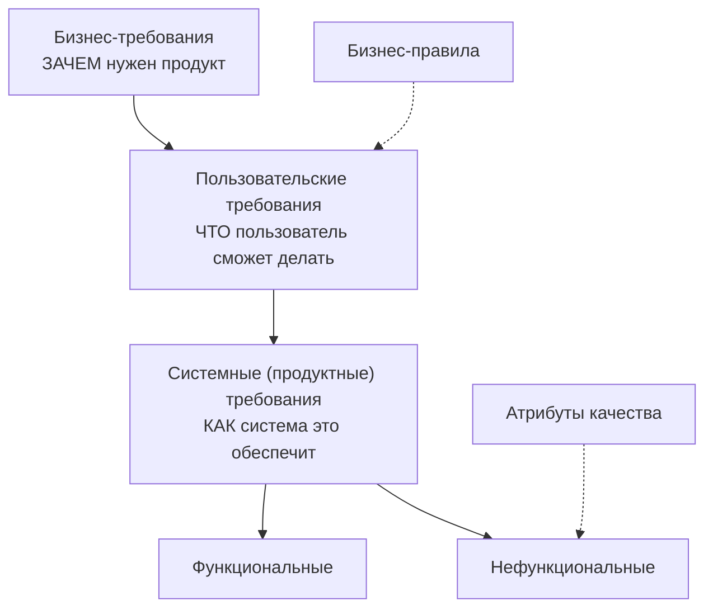

# Основные принципы тестирования. Тестирование документации и требований

## 1. Основные принципы тестирования

> [!note] Определение
> **Принципы тестирования** — фундаментальные правила, отражающие объективные ограничения и закономерности процесса тестирования. Они в явном или неявном виде лежат в основе всех техник и подходов.

| Тестирование **может** | Тестирование **не может** |
|---|---|
| использовать огромный набор техник, подходов и инструментов, чтобы проверить наиболее вероятные и востребованные ситуации и обнаружить дефекты | гарантировать отсутствие дефектов в непроверенных ситуациях |
| | гарантировать, что проблем не будет в будущем: исправление дефектов повышает качество, но не даёт гарантий |

> [!tip]
> Список принципов с пояснениями — в лекции [[05.03/Лекции/11.09.26|11.09.26]].

---

## 2. Требования

> [!note] Определение
> **Требование** — описание того, какие функции и с соблюдением каких условий должно выполнять приложение в процессе решения полезной для пользователя задачи.

> [!important] Суть проблемы
> Требования — отправная точка: по ним команда проектирует, реализует и тестирует. **Чем позже обнаружена проблема в требованиях, тем дороже её решение.**

### Продуктная и проектная документация

| Вид | Что включает |
|---|---|
| **Продуктная** | документы, которые команда использует при разработке и поддержке продукта |
| **Проектная** | продуктная документация + дополнительные документы ранних и поздних стадий проекта |

---

## 3. Сбор и выявление требований

| Понятие | Суть |
|---|---|
| **Сбор требований** | активное извлечение информации **от заказчика** |
| **Выявление требований** | более широкое понятие: включает и техники, в которых заказчик **напрямую не участвует** |

### 8 техник сбора и выявления

| Техника | Суть¹ |
|---|---|
| **Интервью** | беседа с заказчиком или пользователями |
| **Фокус-группы** | обсуждение с группой представителей пользователей |
| **Анкетирование** | письменный опрос большого числа людей |
| **Семинары и мозговой штурм** | совместная генерация и обсуждение идей |
| **Наблюдение** | изучение того, как пользователи реально работают |
| **Прототипирование** | быстрый макет, на котором уточняют требования |
| **Анализ документов** | изучение регламентов, стандартов, существующих систем |
| **Моделирование процессов** | построение схем бизнес-процессов (BPMN, IDEF0) |

¹ Пояснения добавлены.

---

## 4. Уровни и типы требований

### Три уровня требований

| Уровень | Отвечает на вопрос | Пример¹ |
|---|---|---|
| **Бизнес-требования** | зачем нужен продукт | «Сократить время заселения гостя до 5 минут» |
| **Пользовательские требования** | что пользователь сможет сделать | «Администратор может заселить гостя по номеру брони» |
| **Системные требования** | как система это обеспечит | «Поиск брони по номеру выполняется не дольше 1 секунды» |

¹ Примеры добавлены.

### Типы требований

| Тип | Определение | Примеры |
|---|---|---|
| **Функциональные** | описывают **поведение** системы | вычисления, преобразования, проверки, обработка |
| **Нефункциональные** | описывают **свойства** системы | удобство, безопасность, надёжность, расширяемость |
| **Бизнес-правила** | особенности процессов, ограничений и правил, принятых в предметной области | «Скидка постоянного гостя — 10%» |
| **Атрибуты качества** | расширяют нефункциональные требования: свойства, не связанные с функциональностью, но важные для целей | производительность, масштабируемость, восстанавливаемость |

> [!tip] Как отличить функциональное от нефункционального
> Если требование отвечает на вопрос «**что** система делает?» — функциональное. Если на вопрос «**какой** она должна быть?» — нефункциональное.

> [!note]
> Как проверять качество требований — в лекции [[05.03/Лекции/29.09.26|29.09.26]].

---

## Вопросы для самопроверки

> [!question]- Может ли тестирование гарантировать отсутствие дефектов?
> Нет. Оно показывает наличие дефектов в проверенных ситуациях, но ничего не гарантирует для непроверенных.

> [!question]- Чем сбор требований отличается от выявления?
> Сбор — активное получение информации от заказчика. Выявление шире: включает техники без прямого участия заказчика (анализ документов, наблюдение).

> [!question]- Назовите три уровня требований.
> Бизнес-требования, пользовательские требования, системные требования.

> [!question]- «Пароль хранится в зашифрованном виде» — функциональное или нефункциональное требование?
> Нефункциональное: оно описывает свойство (безопасность), а не поведение системы.

> [!question]- Что такое бизнес-правило?
> Правило или ограничение предметной области, например «бронь без предоплаты снимается через 24 часа».
