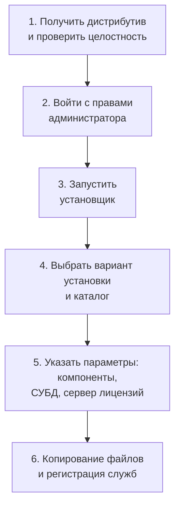

## Установка и настройка ПО ИС

### 1. Виды программного обеспечения

| Вид | Что входит | Примеры¹ |
|---|---|---|
| **Системное** | Операционная система, драйверы, служебные программы | Windows Server, Astra Linux |
| **Серверное** | СУБД, веб-серверы, серверы приложений | PostgreSQL, MS SQL Server, сервер 1С:Предприятия |
| **Прикладное** | Конфигурации ИС, решающие задачи пользователей | 1С:Бухгалтерия, CRM, система управления отелем |
| **Общего назначения** | Программы для повседневной работы | Офисный пакет, браузер, антивирус |

¹ Примеры добавлены для наглядности.

### 2. Системные требования

Для каждого продукта производитель публикует **минимальные** и **рекомендуемые** требования: объём оперативной памяти и дискового пространства, версию и разрядность ОС, версию СУБД.

| | Минимальные | Рекомендуемые |
|---|---|---|
| **Что означают** | Программа технически запустится | Программа будет нормально работать под реальной нагрузкой |
| **Для чего подходят** | Для пробного запуска и демонстрации | Для рабочей эксплуатации |

> [!important] Правило проектирования
> Инфраструктуру под ИС проектируют по **рекомендуемым** требованиям и закладывают **запас 30–50%** на рост объёма данных.
>
> *Пример:* производитель рекомендует 16 ГБ ОЗУ и 200 ГБ диска → закладываем 24 ГБ ОЗУ и 300 ГБ диска.

### 3. Подготовка к установке

Перед установкой выполняют четыре проверки:

| № | Проверка | Вопросы |
|---|---|---|
| 1 | **Аппаратная совместимость** | Поддерживает ли процессор нужную разрядность? Хватит ли оперативной памяти и места на диске? |
| 2 | **Программная совместимость** | Поддерживает ли устанавливаемая версия продукта установленную версию ОС и СУБД? |
| 3 | **Лицензионное обеспечение** | Есть ли лицензии и ключи? Хватает ли рабочих мест? |
| 4 | **Сетевые требования** | Открыты ли нужные порты? Доступны ли сервер лицензий и сервер обновлений? |

Результат подготовительного этапа — **краткий план установки**.

> [!info] Дополнение: что входит в план установки
> - на какие серверы и рабочие места ставится ПО;
> - какие компоненты и в каком порядке устанавливаются;
> - параметры подключения к СУБД и серверу лицензий;
> - кто и когда выполняет работы;
> - как откатиться назад, если что-то пойдёт не так.

#### Установка не на чистую машину

Если на компьютере уже есть другое ПО, дополнительно проверяют **конфликты**.

> [!info] Дополнение
> В конспекте фраза оборвана. Обычно проверяют:
> - нет ли **старой версии** того же продукта;
> - не заняты ли нужные **порты** другими службами;
> - не блокирует ли установку **антивирус** или межсетевой экран;
> - совместимы ли **общие компоненты** (библиотеки, драйверы, .NET, Java).
>
> Перед установкой делают **резервную копию** или точку восстановления.

### 4. Типовой порядок установки



> [!tip] Как проверить целостность дистрибутива
> Производитель публикует **контрольную сумму** файла (обычно SHA-256). После скачивания её вычисляют заново и сравнивают. Если суммы не совпали, файл повреждён или подменён.
> ```powershell
> Get-FileHash .\setup.exe -Algorithm SHA256
> ```

### 5. Учётные записи для служб

> [!warning] Службы не запускают от имени администратора
> Для служб ИС создают **отдельные учётные записи с минимально необходимыми правами** (принцип наименьших привилегий).
>
> Если такую службу взломают или она сработает с ошибкой, ущерб ограничится её правами, а не всей системой.

### 6. Варианты установки

| Вариант | Степень участия администратора | Когда применяют |
|---|---|---|
| **Тихая** (автоматическая) | Никакой: установка идёт без окон, параметры берутся из командной строки или файла ответов | Массовая установка на много компьютеров |
| **Типовая** | Минимальная: параметры по умолчанию | Стандартная установка без особых требований |
| **Выборочная** | Полная: администратор сам выбирает компоненты и параметры | Нестандартная конфигурация, экономия места, особые требования |

### 7. Первичная настройка

После установки выполняют первичную настройку. Особое внимание уделяют **подключению к базе данных**.

> [!info] Дополнение: параметры подключения к БД
> адрес сервера СУБД, порт, имя базы данных, учётная запись и пароль, кодировка.

Большинство первичных настроек в дальнейшем меняют через **параметры конфигурации**. Поэтому их значения фиксируют:
- в **журнале установки**;
- в **конфигурационном файле**.

### 8. Проверка работоспособности

Завершающий шаг — **контрольный пример**: небольшая цепочка типовых операций, результат которой известен заранее. Результаты проверки записывают в **журнал установки**.

> [!example] Пример контрольного примера
> Пример добавлен для наглядности. Для системы управления отелем:
> 1. Создать бронирование на тестового гостя.
> 2. Заселить гостя в номер.
> 3. Добавить услугу (например, завтрак).
> 4. Выселить гостя и сформировать счёт.
>
> **Ожидаемый результат:** сумма в счёте равна стоимости проживания плюс стоимость услуги, номер получил статус «на уборке».

---

## Вопросы для самопроверки

> [!question]- Почему нельзя ориентироваться на минимальные требования?
> Минимальные требования гарантируют только запуск. Под реальной нагрузкой и с ростом данных система будет работать медленно или падать.

> [!question]- Какие четыре проверки выполняют перед установкой?
> Аппаратная совместимость, программная совместимость, лицензионное обеспечение, сетевые требования.

> [!question]- Зачем проверять контрольную сумму дистрибутива?
> Чтобы убедиться, что файл не повреждён при скачивании и не подменён злоумышленником.

> [!question]- Почему службы ИС не запускают от имени администратора?
> При взломе или ошибке служба с правами администратора может повредить всю систему. С минимальными правами ущерб ограничен.

> [!question]- Чем тихая установка отличается от выборочной?
> Тихая идёт без участия человека с заранее заданными параметрами. При выборочной администратор сам выбирает компоненты и настройки.

> [!question]- Что такое контрольный пример?
> Короткая цепочка типовых операций с заранее известным результатом. Если результат совпал, система работает правильно.
