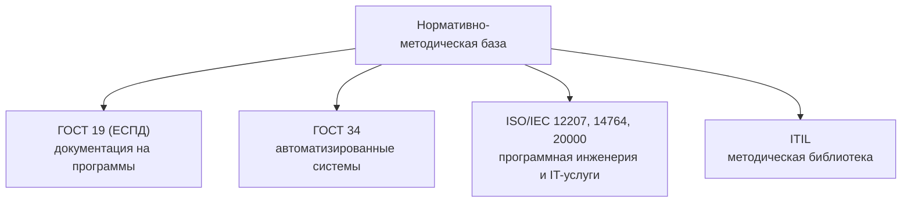

# Нормативно-методическая база сопровождения ИС

## 1. Зачем нужна стандартизация

Стандартизация решает три задачи:

| Задача | Что означает |
|---|---|
| **Воспроизводимость** | одна и та же работа выполняется одинаково, кто бы её ни делал |
| **Прослеживаемость** | известно, что, когда и кем было сделано |
| **Сопоставимость** | качество можно измерять и сравнивать на протяжении всего срока службы |

## 2. Из чего состоит нормативная база в РФ

## 3. ГОСТ 19 — ЕСПД

> [!note] Определение
> **ЕСПД (Единая система программной документации)** — комплекс ГОСТ 19, устанавливающий требования к составу, содержанию и оформлению программных документов. Документы ЕСПД сопровождают программное средство на всех стадиях.

| Документ | Значение для сопровождения |
|---|---|
| **Техническое задание** | содержит требования, с которыми сверяют запросы на изменение; исходная точка анализа дефектов |
| **Руководство оператора** | описывает порядок работы с программой; основа консультирования пользователей и подготовки инструкций |
| **Паспорт и формуляр** | фиксируют версию, состав поставки, сведения об изменениях и рекламациях |
| **Схемы (ГОСТ 19.701-90)** | условные обозначения для схем алгоритмов, программ и данных |
| **Лист регистрации изменений** | порядок внесения изменений в документацию с указанием причин, дат и исполнителей |

## 4. ГОСТ 34 — автоматизированные системы

Комплекс ГОСТ 34 распространяется на **автоматизированные системы в целом**, включая их организационное обеспечение.

| Стандарт | О чём |
|---|---|
| **ГОСТ 34.601-90** | стадии и этапы создания АС; стадия **сопровождения** включает гарантийное обслуживание и оперативное устранение неисправностей |
| **ГОСТ 34.602-89** | требования к **техническому заданию** — документу, фиксирующему требования заказчика к системе |

> [!note]
> С 2022 года на смену этим стандартам пришли ГОСТ Р 59793-2021 и ГОСТ 34.602-2020, но по содержанию они близки.

### Эксплуатационная документация (ЭД)

На этапе ввода системы в действие создаётся комплект ЭД:
- техническое описание системы;
- руководство пользователя;
- руководство по эксплуатации технических средств;
- регламент обслуживания.

## 5. ISO/IEC 20000 — управление IT-услугами

Стандарты серии **ISO/IEC 20000** (в РФ — **ГОСТ Р ИСО/МЭК 20000-1**) устанавливают требования к системе управления IT-услугами (**ITSM**).

> [!important] Главная идея
> ИС рассматривается не как набор программ и оборудования, а как **поставщик услуг**, ценность которых измеряется **удовлетворённостью потребителей**.

Стандарт требует:
- определить **каталог услуг**;
- установить **измеримые показатели качества** (например, время реакции на заявку);
- управлять **инцидентами и запросами** на обслуживание.

> [!info] Дополнение: остальные стандарты из списка
> - **ISO/IEC 12207** — процессы жизненного цикла ПО, включая процесс сопровождения.
> - **ISO/IEC 14764** — подробно описывает процесс сопровождения ПО и его виды (корректирующее, адаптивное, совершенствующее, профилактическое).
> - **ITIL** — не стандарт, а библиотека лучших практик; ISO/IEC 20000 во многом на ней основан. Подробнее — в лекции [[06.02/Лекции/04.09.26|04.09.26]].

---

## Вопросы для самопроверки

> [!question]- Какие три задачи решает стандартизация?
> Воспроизводимость, прослеживаемость, сопоставимость.

> [!question]- Что такое ЕСПД?
> Комплекс ГОСТ 19, устанавливающий требования к составу, содержанию и оформлению программных документов.

> [!question]- Какой документ фиксирует версию и историю изменений программы?
> Паспорт и формуляр.

> [!question]- Чем ГОСТ 19 отличается от ГОСТ 34?
> ГОСТ 19 касается документации на программы. ГОСТ 34 — автоматизированных систем в целом, включая организационное обеспечение.

> [!question]- Какую идею закладывает ISO/IEC 20000?
> ИС — поставщик услуг, ценность которых измеряется удовлетворённостью потребителей.
