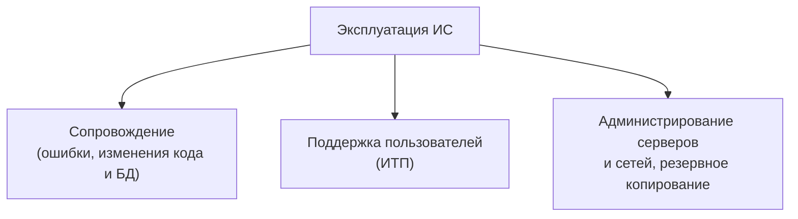
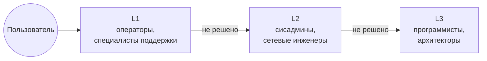

# Сопровождение ИС. Введение: роль, цели и задачи

> [!abstract] Темы курса
> Сопровождение ИС · ITIL · DevOps

## 1. Основные понятия

> [!note] Определение
> **Сопровождение ИС** — комплекс мероприятий по сохранению работоспособности ИС, исправлению ошибок, внесению изменений в код и базу данных для адаптации системы к новым требованиям.

> [!note] Определение
> **ИТП (информационно-техническая поддержка)** — взаимодействие с конечными пользователями и заказчиками: помощь людям, работающим с ИС, решение их проблем, консультирование и обеспечение бесперебойной работы инфраструктуры.

> [!note] Определение
> **Эксплуатация ИС** — понятие, включающее сопровождение, поддержку, администрирование серверов и сетей, резервное копирование.

## 2. Зачем нужно сопровождение

1. Пользователи совершают **ошибки**.
2. **Бизнес-процессы меняются** — ИС нужно адаптировать.
3. Обновляются **системное ПО, оборудование и прикладные программы**.
4. Появляются новые **уязвимости** безопасности.
5. **Растёт объём данных**, и система начинает тормозить.

> [!info] Дополнение: виды сопровождения (ISO/IEC 14764)
> Причины выше соответствуют четырём классическим видам сопровождения. Они понадобятся в лекции [[06.02/Лекции/30.10.26|30.10.26]] об обновлениях.
>
> | Вид | Суть | Пример |
> |---|---|---|
> | **Корректирующее** | исправление найденных ошибок | отчёт неверно считает итог |
> | **Адаптивное** | приспособление к изменениям среды | новая версия ОС, новый закон |
> | **Совершенствующее** | улучшение функций и производительности | ускорить формирование отчёта |
> | **Профилактическое** | предотвращение будущих проблем | очистка старых логов, обновление библиотек |

## 3. Навыки специалиста по сопровождению

| Hard skills (профессиональные) | Soft skills (гибкие) |
|---|---|
| чтение и анализ журнала событий | клиентоориентированность и эмпатия |
| основы сетей и командной строки | умение переводить с IT-языка на человеческий |
| работа с СУБД | алгоритмическое мышление |
| администрирование ОС | стрессоустойчивость |
| системы удалённого доступа | |

> [!important]
> В большинстве случаев **гибкие навыки важнее** профессиональных.

## 4. Уровни технической поддержки

В крупной компании поддержка строится **по уровням**: простые проблемы быстро решаются внизу, сложные передаются наверх.

| Уровень | Кто работает | Задачи |
|---|---|---|
| **L1** (первая линия) | оператор колл-центра или отдельный специалист | приём заявок (тикетов), первичная диагностика, типовые задачи: сброс пароля, настройка принтера, установка базового ПО, консультации по интерфейсу. **Очень важны гибкие навыки** |
| **L2** (вторая линия) | системные администраторы, сетевые инженеры | то, с чем не справилась L1: права доступа к БД, анализ журнала событий, восстановление после сбоев, сетевое оборудование, обновления |
| **L3** (третья линия) | программисты и архитекторы | исправление багов в исходном коде, оптимизация запросов к БД, изменения архитектуры |

> [!example] Пример: «не печатается счёт гостю»
> - **L1** проверяет, включён ли принтер и выбран ли он по умолчанию.
> - **L2** видит в журнале ошибку доступа к сетевому принтеру и исправляет права.
> - **L3** выясняет, что шаблон счёта ломается на длинных фамилиях, и исправляет код.

## 5. ITIL

> [!info] Дополнение
> ITIL указана в темах курса, но на лекции не раскрыта.

**ITIL** (IT Infrastructure Library) — библиотека лучших практик управления IT-услугами (ITSM). Главная идея: IT-отдел — **поставщик услуг** для бизнеса, а не просто «люди, которые чинят компьютеры».

| Практика ITIL | Суть |
|---|---|
| **Service Desk** | единая точка входа для всех обращений пользователей |
| **Управление инцидентами** | как можно быстрее восстановить работу услуги |
| **Управление проблемами** | найти и устранить **причину** повторяющихся инцидентов |
| **Управление изменениями** | вносить изменения контролируемо, с оценкой рисков |
| **Управление уровнем услуг** (SLA) | договориться о сроках и качестве обслуживания |

> [!tip] Инцидент или проблема?
> **Инцидент** — «у бухгалтера не открывается 1С» (чиним сейчас). **Проблема** — «1С перестаёт открываться у всех каждый понедельник» (ищем причину).

## 6. DevOps

> [!note] Определение
> **DevOps** — культура, методология и набор практик, объединяющих разработку ПО и его эксплуатацию. Главная цель — сократить жизненный цикл разработки и обеспечить **непрерывную поставку** качественного продукта.

Подробнее — в лекции [[06.02/Лекции/11.09.26|11.09.26]].

---

## Вопросы для самопроверки

> [!question]- Чем сопровождение отличается от технической поддержки?
> Сопровождение — изменения самой системы: исправление ошибок, доработка кода и БД. Поддержка — помощь пользователям, работающим с системой.

> [!question]- Назовите причины, по которым ИС нужно сопровождать.
> Ошибки пользователей, изменение бизнес-процессов, обновления ПО и оборудования, новые уязвимости, рост объёма данных.

> [!question]- Кто работает на L2 и какие задачи решает?
> Системные администраторы и сетевые инженеры: права доступа, анализ журналов, восстановление после сбоев, сетевое оборудование.

> [!question]- Почему на L1 особенно важны гибкие навыки?
> L1 напрямую общается с пользователями, часто расстроенными, и должна понятно объяснить решение без IT-жаргона.

> [!question]- Чем инцидент отличается от проблемы в ITIL?
> Инцидент — конкретный сбой, работу нужно восстановить быстро. Проблема — причина одного или нескольких инцидентов, её ищут и устраняют.
