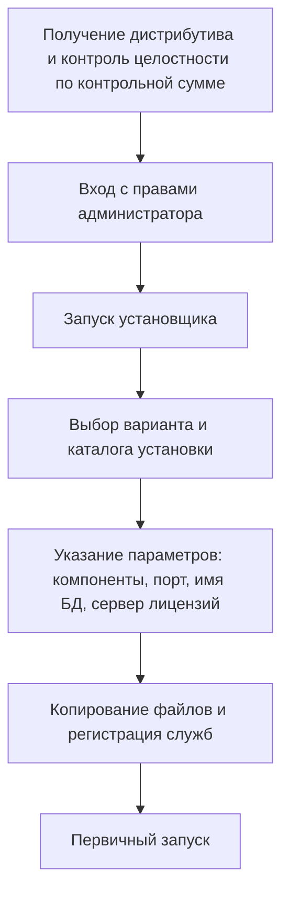

Установка и настройка программного обеспечения ИС

## 1. Виды программного обеспечения ИС и требования к нему

### Классификация ПО, с которым работает служба сопровождения

| Вид | Примеры |
|---|---|
| **Системное** | операционные системы, драйверы, утилиты |
| **Прикладное** | конфигурации ИС, офисные пакеты, специализированные приложения |
| **Серверное** | СУБД, веб-серверы, почтовые серверы, среды выполнения |
| **Общего назначения** | архиваторы, антивирусы, средства удалённого доступа |

### Требования производителя
Для каждого продукта публикуются **минимальные** и **рекомендуемые** требования:
- объём оперативной памяти и дискового пространства;
- версия и разрядность ОС;
- версия СУБД;
- права пользователя.

> [!important] Минимальные ≠ рекомендуемые
> - **Минимальные** — программа лишь **технически запустится**. При реальной нагрузке (десятки одновременных пользователей, большие объёмы данных) работа будет неприемлемо медленной.
> - При проектировании инфраструктуры ориентируются на **рекомендуемые** требования и закладывают **резерв ресурсов не менее 30–50 %** на рост объёмов данных.

---

## 2. Проверка совместимости и подготовка окружения

> [!warning]
> Установка «с ходу», без подготовки — источник большинства проблем, которые потом приходится разгребать службе сопровождения.

### Четыре проверки

| Проверка | Что выясняют |
|---|---|
| **Аппаратная совместимость** | достаточно ли памяти и диска; поддерживает ли процессор нужную разрядность; есть ли место на диске с учётом роста БД |
| **Программная совместимость** | поддерживает ли версия продукта установленные версии ОС и СУБД (современные серверные продукты не поддерживают устаревшие ОС, старые приложения могут не работать на новых) |
| **Лицензионная проверка** | есть ли лицензии, ключи, достаточное ли число рабочих мест |
| **Сетевые требования** | открыты ли нужные порты; доступны ли серверы лицензий и обновлений |

### Результат подготовки — краткий план установки
- перечень компонентов на каждом узле;
- учётные записи, от имени которых выполняется установка и работают службы;
- параметры подключения к БД;
- порядок проверки после установки.

### Если установка не на чистую машину — проверить конфликты
- занятость портов и имён служб;
- наличие старых версий того же продукта;
- антивирус, способный заблокировать установку.

---

## 3. Порядок и варианты установки

### Типовой порядок

> [!tip] Учётные записи служб
> Сервисы ИС **не должны работать от имени администратора**. Для них создают **выделенные записи с минимально необходимыми правами** — это уменьшает последствия компрометации и случайных повреждений.

### Варианты установки по степени вмешательства пользователя

| Вариант | Суть |
|---|---|
| **Типовая** | значения по умолчанию, минимум решений |
| **Выборочная** | администратор сам выбирает компоненты и параметры |
| **Автоматическая (тихая)** | без интерфейса, из командной строки |

**Тихая установка:**
- применяется при **массовом развёртывании** рабочих мест;
- параметры передаются **файлом ответов** или **ключами командной строки**;
- для распространённых установщиков Windows ключ **`/S`** или **`/qn`**;
- единый файл параметров = одинаковая конфигурация всех рабочих станций.

---

## 4. Первичная настройка и подключение к базе данных

### Что настраивается после установки
- региональные параметры и язык интерфейса;
- **подключение к серверу БД**: адрес, порт, имя базы, способ аутентификации;
- роли и права пользователей;
- загрузка лицензий;
- интеграция с другими системами (при необходимости);
- резервное копирование **начального состояния**.

> [!important] Соединение с БД
> - строка подключения должна содержать верные **адрес, порт и имя базы**;
> - у учётной записи должны быть **права на базу**;
> - **порт СУБД** должен быть открыт на межсетевом экране.

Большинство первичных настроек потом меняется через параметры конфигурации, поэтому их значения **фиксируются в журнале установки** и в конфигурационном файле организации.

---

## 5. Проверка работоспособности и типичные ошибки установки

### Обязательная проверка (минимальный контроль)
1. запуск приложения и вход под **тестовой учётной записью**;
2. открытие соединения с БД;
3. выполнение **контрольного примера**.

> [!note] Контрольный пример
> Небольшая цепочка типовых операций (создание записи → сохранение → поиск → печать документа), результат которой **заранее известен** и должен совпасть с ожидаемым. Прошёл — базовые функции работоспособны.

Результаты фиксируются в журнале установки; **только после положительной проверки** рабочие места передаются пользователям.

### Таблица 4 — Типичные ошибки установки и их причины

| Симптом | Вероятная причина | Устранение |
|---|---|---|
| Установщик не запускается или сразу завершается | недостаточно прав; ограниченная учётная запись | запуск от имени администратора, проверка политики ограничений |
| Ошибка при копировании файлов | мало места на диске; блокировка файлов антивирусом | освободить место, временные исключения для каталога установки |
| Приложение установлено, но не соединяется с БД | неверная строка подключения, закрыт порт СУБД, нет прав у учётной записи | проверка адреса, порта, учётных данных; правила межсетевого экрана |
| Служба приложения не стартует | у учётки службы нет права входа в систему; конфликт порта | настройка прав учётной записи, смена порта |
| Всё работает, но медленно | работа по минимальным требованиям; окружение не соответствует рекомендуемому | довести ресурсы до рекомендуемых, перенести БД на выделенный диск |

> [!success] Итог
> Установка — не единичный запуск установщика, а **регламентированная процедура**:
> анализ требований → подготовка окружения → установка с минимально достаточными правами → первичная настройка → контрольный пример → документирование.
>
> Эти шаги многократно повторяются (новые рабочие места, переустановка, восстановление после сбоев), поэтому **отработанный и зафиксированный порядок установки — один из главных активов службы сопровождения**.
