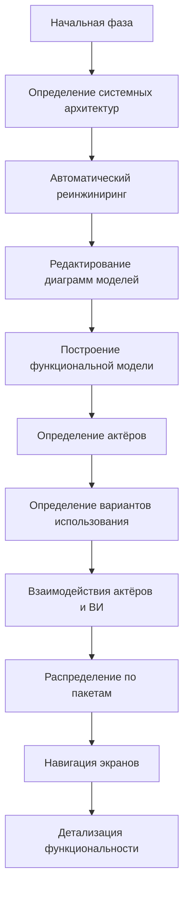

# Процессы системного проектирования программных средств

## 1. Проектирование программных модулей и компонентов

### Модульность
Сложную систему делят на более простые части — **модули**. Модульность позволяет применять принцип **разделения задач** на двух уровнях:
- работа с элементами каждого модуля отдельно (без учёта других модулей);
- работа с общими характеристиками групп модулей и связями между ними — для объединения в более крупный компонент.

### Направления проектирования

| Подход | Суть |
|---|---|
| **Снизу вверх** | сначала проектируются модули, затем они объединяются |
| **Сверху вниз** | сначала система разбивается на модули, затем каждый проектируется отдельно |

### Иерархические уровни структуры ПС
1. **Программные модули** — законченные компоненты текста программ.
2. **Функциональные группы (компоненты), пакеты программ.**
3. **Комплексы программ** — законченные программные продукты целевого назначения.

> [!note] Закономерность
> С ростом уровня иерархии увеличивается размер текста программ и число обрабатываемых переменных, команды становятся более специализированными, а **возможность повторного использования снижается**.

### Сравнение уровней

| Уровень | Размер / состав | Особенности |
|---|---|---|
| **Модуль** | 10–100 операторов | около десятка типов входных переменных; если нужно >100 операторов — декомпозировать на несколько модулей |
| **Функциональная группа** | несколько или десятки модулей, до ~10 тыс. строк | сложные автономные задачи; растёт число типов переменных и разнообразие выходных данных |
| **Комплекс программ** | несколько или десятки функциональных групп; сотни модулей, десятки–сотни тысяч операторов | задачи управления и обработки информации; до 20–30 иерархических уровней |

### Что включает проектирование модулей
- локальные функции и подробные описания алгоритмов обработки данных;
- межмодульные интерфейсы;
- внутренние структуры данных;
- структурные схемы передач управления;
- средства управления в исключительных ситуациях.

Этим определяются порядок шагов обработки, ситуации и типы данных, меняющие процесс обработки, и повторно используемые функции.

> [!tip] Требования для многократного использования
> - унифицированные правила структурного построения;
> - единое оформление спецификаций требований, текстов программ и комментариев;
> - директивное ограничение размера модулей по числу строк (например, 30 или 50 операторов) с учётом языка программирования.

---

## 2. Программная инженерия и оценка качества

### Классы программ по особенностям жизненного цикла (ЖЦ)

| Класс | Характеристика |
|---|---|
| **Малые** | небольшие программы, создаются одиночками или коллективом 3–5 человек; для автоматизации научных исследований или анализа простых процессов самими разработчиками; не тиражируются. Регламентация ЖЦ, длительное сопровождение версий, стандарты и сертификация **не нужны** |
| **Большие (крупномасштабные)** | комплексы для сложных систем управления и обработки информации; программные продукты с **гарантированным качеством**; большая размерность, трудоёмкость и стоимость → нужен анализ экономической эффективности всего ЖЦ и конкурентоспособности |

Крупные комплексы — компоненты систем, реализующие их основные функциональные свойства; они увеличивают сложность и создают предпосылки для изменений ЖЦ.

### Что такое программная инженерия
- Организованное, контролируемое, методичное отслеживание динамики изменений в ЖЦ программ и данных, их слаженная разработка при строгом учёте и контроле каждого изменения.
- Часть **системотехники**: охватывает все аспекты ЖЦ — от системных требований до завершения использования продукта.
- **Не** рассматривает технические детали создания компонентов; её задачи — управление проектами ПС, разработка средств, методов и теорий для обеспечения ЖЦ.
- Программирование компонентов — дело в основном **индивидуальное**, программная инженерия систем — всегда **коллективная** работа.

### Что дают стандарты ЖЦ
- сборка систем из крупных функциональных узлов, отвечающих стандартам; применение проверенных проектных решений;
- расширение и совершенствование функций с сохранением целостности и первичных затрат;
- систематическое повышение качества функционирования комплексов программ и баз данных;
- улучшение технико-экономических характеристик;
- совершенствование технологий обеспечения ЖЦ.

### Типовой технологический процесс
Методическая основа технологии — набор этапов и операций в последовательности и взаимосвязи, от **инициирования проекта и подготовки ТЗ** до **завершения испытаний или применения версии ПС**. Объединяет методы разработки программ и данных с методами обеспечения качества и управления с учётом технологических и человеческих факторов.

**Индустриализация** базируется на стандартизации процессов разработки, структурного построения и интерфейсов с ОС и внешней средой. С начала разработки определяются состав и этапы работ и необходимые ресурсы.

### Обеспечение качества
Качество комплексов программ зависит от **качества технологии и инструментальных средств**. Уровень технологической поддержки ЖЦ связан с оценкой реальных или возможных характеристик качества конкретного комплекса. Методология обеспечения качества поддержана методическими документами, инструментами и комплексом международных стандартов.

Методы и средства позволяют:
1. создавать модули и компоненты **высокого гарантированного качества**;
2. **предотвращать дефекты проектирования** (системы обеспечения качества, автоматизация ЖЦ);
3. **обнаруживать и устранять ошибки** — верификация и систематическое тестирование на всех этапах;
4. **удостоверять достигнутое качество** — испытания и сертификация перед передачей в эксплуатацию.

> [!important] Как снижаются затраты и ошибки
> - Современные технологии программной инженерии и САПР — ресурсосберегающие, сокращают затраты на проектирование, реализацию, сопровождение и развитие ПС.
> - В первую очередь нужны методы **системного анализа и проектирования**: точное представление целей, назначения и функций с начала ЖЦ, чтобы системные дефекты не переходили на следующие этапы.
> - Все этапы разработки и сопровождения поддерживаются **верификацией** и **автоматизированным тестированием** корректности решений.

### Сертификация
- Выполняется **аттестованными проблемно-ориентированными испытательными центрами** (см. лекцию 18).
- Нужна, когда программы управляют сложными процессами или обрабатывают столь важную информацию, что дефекты могут нанести значительный ущерб.
- Устанавливает **соответствие документации** и допускает к эксплуатации в пределах параметров внешней среды, исследованных при проверках.

### Кадровая проблема
Важнейшая проблема — обучение специалистов программной инженерии: использование международных стандартов, умение формализовать требования и достигать конкретных значений характеристик качества с учётом доступных ресурсов.

---

## 3. Реинжиниринг, этапы реинжиниринга

### Определение
**Реинжиниринг ПО** — процесс создания новой функциональности или устранения ошибок путём революционного изменения, но с использованием уже эксплуатируемого ПО. Это изменение системы **после обратного инжиниринга**.

### Цели
- получить представление о составе существующей системы;
- смоделировать существующую систему;
- определить фрагменты кода, пригодные для новой системы;
- определить наследуемые данные.

### Задачи
- определение системных архитектур;
- определение актёров существующей системы;
- определение её функциональности;
- определение логической структуры;
- восстановление реляционной модели данных.

> [!note] Отличие от разработки нового проекта
> Порядок действий принципиально другой. Логическая архитектура определена **реализацией** (структура каталогов, размещение файлов, распределение задач между сервером и клиентами), часть моделей можно получить **автоматически**. Поэтому не функциональное описание служит основой для выявления классов, а наоборот — **готовые диаграммы классов облегчают описание поведения системы**.

### Этапы реинжиниринга

#### 1) Начальная фаза
- Определить, что есть по существующей системе: исходные тексты, БД, описания и т. д.
- Зафиксировать **текущее состояние** наследуемой системы (последующие изменения не учитываются).
- По возможности развернуть наследуемую ПС у разработчика.

#### 2) Определение системных архитектур
- Начинается ещё на начальном этапе: определяется оборудование и стандартное ПО для установки и запуска системы.
- Фактически определяются архитектуры **БД, оборудования, стандартного ПО, телекоммуникаций**.
- Представляются в нотации **UML** (+ текстовые описания), уточняются в ходе реинжиниринга.

#### 3) Автоматический реинжиниринг
Выполняется инструментами визуального моделирования; полученные модели принимаются как исходные.

| Объект | Условие | Результат |
|---|---|---|
| **Бизнес-логика** | есть (полностью или частично) исходники на объектно-ориентированном / объектно-базированном языке | диаграммы классов и компонентов UML |
| **База данных** | инструменты проектирования БД | реляционная модель данных; может быть переведена в диаграмму классов UML (инструментом или программными мостами к средствам ОО-моделирования) |

#### 4) Редактирование диаграмм моделей
- Автоматические модели трудно читать — элементы размещены без учёта наглядности.
- **Нельзя** делать содержательные преобразования (удалять/добавлять элементы); цель — наглядность: перемещение элементов, комментарии.
- **Иерархическая реструктуризация** — через **пакеты** UML:
  - верхний уровень — пакеты-подсистемы с именами, отражающими суть; общие пакеты классов;
  - пакет верхнего уровня для классов, которые трудно отнести к другому пакету;
  - внутри подсистем — пакеты: пользовательский интерфейс, связь с БД, управление, обработка, классы данных.

#### 5) Построение функциональной модели
- Описывается **диаграммами вариантов использования** и детализирующими их **диаграммами последовательностей и деятельностей**.
- Источник — работающая наследуемая система и эксперименты с ней.
- Эффективно привлечь **эксперта заказчика**: кто использует систему, что она делает для каждого типа пользователей, с какими системами взаимодействует, какие работы выполняются периодически.

##### Определение актёров
Вопросы для поиска актёров:
- Кто непосредственные пользователи? (указывать **роли**, а не людей);
- С каким внешним оборудованием или программами взаимодействует система?
- Есть ли работы, запускаемые по времени или интервалам? (если да — актёр **«таймер»**).

Источники ответов: опрос экспертов заказчика, документация, либо запуск системы и анализ экранных форм/меню. Имена актёров отражают их роли.

##### Определение вариантов использования (ВИ)
Определяются по анализу экранов работающей системы:
1. Найти все **первичные экраны**, для каждого завести отдельный **пакет ВИ** на головной диаграмме (будет пакет актёров + несколько пакетов ВИ).
2. Детализировать по правилам:
   - экран содержит **меню** → пакет ВИ; каждая строка меню — подпакет или отдельный ВИ;
   - основной экран — **форма** → отдельный ВИ.

##### Взаимодействия актёров и ВИ
Определяется, какие актёры участвуют в каждом ВИ; в модель включаются **ассоциации** с направлением передачи информации.

##### Распределение по пакетам
Если актёров/ВИ много — делить на пакеты (проще поддержка, понимание, распределение ответственности). Критерии объединения ВИ в пакет:
- взаимодействуют с **одним актёром**;
- связаны отношениями **включения** или **расширения**.

Главное — иметь чёткую стратегию разбиения.

##### Навигация экранов
Строится одновременно с выделением ВИ, как **диаграмма классов UML**:

| Элемент экрана | Элемент модели |
|---|---|
| экран | класс |
| поля | атрибуты |
| функциональные кнопки | операции |
| кнопки меню | одноимённые отношения |

#### 6) Детализация функциональности
Построение **сценариев реализации ВИ**:
- преобладает **логика выполнения** (ветвления, параллельность) → **диаграммы деятельностей**;
- преобладает **передача данных** → **диаграммы последовательностей**.

Детализировать в первую очередь:
- ВИ, где важны последовательность действий, состояние системы, разветвлённая логика;
- ВИ основной функциональности;
- ВИ, которые заказчик хочет сохранить в новой ПС.

Способы детализации:
- **анализ исходных кодов** — выявление ветвлений, выражений, циклов → восстановление алгоритмов (диаграммы деятельностей / состояний);
- **эксперименты** с работающей системой — варьирование входных данных, анализ реакции, проверка гипотез об алгоритмах.

> [!success] Итог
> Модели, полученные в результате реинжиниринга, — основа для определения **требований** к проектируемой ПС и для построения **логической и функциональной моделей новой системы**.
