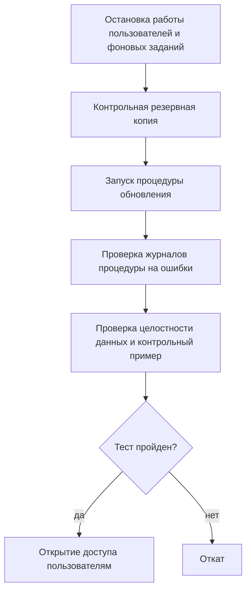

Обновление и модификация информационных систем

## 1. Причины и виды обновлений

**Обновление** — установленная поставщиком или силами организации процедура замены версии ПО на более новую **с сохранением данных и настроек**.

### Причины (совпадают с видами сопровождения)

| Причина | Вид обновления |
|---|---|
| исправление дефектов и уязвимостей | корректирующие и защитные |
| адаптация к изменениям среды и законодательства | адаптивные |
| расширение и ускорение функциональности | обновления новых версий |

> [!important] Обновления безопасности
> Исправления уязвимостей; при их отсутствии растёт риск компрометации системы. Имеют **высший приоритет по срочности** — наравне с исправлениями критических дефектов.

### Виды по масштабу изменений

| Вид                                 | Суть                                                                                                                                            |
| ----------------------------------- | ----------------------------------------------------------------------------------------------------------------------------------------------- |
| **Патч (заплатка)**                 | небольшое исправление отдельной ошибки, как правило не меняет совместимость                                                                     |
| **Минорное обновление**             | накопительный пакет исправлений и небольших улучшений                                                                                           |
| **Мажорное обновление**             | переход на новую версию с изменением функциональности, форматов данных, интерфейса; нужна проверка совместимости, возможно доработка интеграций |
| **Экстренное исправление (hotfix)** | оперативное устранение критической проблемы, устанавливается **вне обычного графика**                                                           |

> [!note] Терминология
> У разных вендоров терминология релизов отличается → в регламенте организации закрепить **единую внутреннюю терминологию** и сопоставить её с терминами поставщиков.

---

## 2. Управление версиями: нумерация и журнал версий

### Нумерация версий
Трёхкомпонентная схема **«старшая.младшая.исправление»**, например `8.4.2`:

| Компонент | Растёт при |
|---|---|
| **Старший** (8) | несовместимых изменениях и новой функциональности |
| **Младший** (4) | совместимых улучшениях |
| **Исправление** (2) | устранении ошибок без изменения функциональности |

> [!tip] Принцип
> Сравнение номеров версий должно сразу показывать, **насколько рискованно обновление** и нужно ли расширенное тестирование.

### Журнал версий (журнал обновлений)
Фиксирует:
- дату установки;
- узел или рабочую группу;
- номер установленной версии;
- перечень изменений (со ссылкой на уведомление поставщика);
- результат проверки контрольным примером;
- исполнителя и результат.

Позволяет в любой момент ответить, **что и когда менялось** — первое, что нужно при расследовании «неожиданного» сбоя.

### Release notes
Уведомления об изменениях: поставщик сопровождает выпуск перечнем исправленных ошибок и изменённых функций. Их анализ — **обязательный подготовительный шаг**.

---

## 3. Регламент обновления: подготовка, тестирование, окно обслуживания

Каждое обновление в эксплуатационной ИС проводится **по регламенту**.

### Планирование
- анализ уведомления поставщика;
- оценка объёма изменений и рисков;
- определение **последовательности обновления узлов**: тестовая среда → наименее критичные производственные узлы → остальные;
- назначение ответственного и даты.

### Подготовка
- **резервное копирование** данных и настроек — обязательно перед любым обновлением;
- проверка целостности дистрибутива;
- уведомление пользователей о планируемом перерыве.

### Тестирование на стенде
- обновление разворачивается на **тестовой копии** системы с тестовой копией данных;
- выполняется **расширенный контрольный пример**, проверяются интеграции и отчёты;
- результаты фиксируются;
- только после успеха — перенос в производственную среду.

### Окно обслуживания
Заранее согласованный с владельцем системы и пользователями интервал **наименее интенсивной работы** (ночь, выходные, технологические паузы), в течение которого допускается недоступность системы.

> [!important] Расчёт продолжительности окна
> **Окно = плановая длительность обновления + резерв на откат и повторную попытку**
> Резерв — обычно **не менее 50 %** от плановой длительности.

---

## 4. Выполнение обновления и порядок отката

### Последовательность в окне обслуживания

### Откат
Возврат к предыдущей версии + восстановление данных из резервной копии, сделанной **непосредственно перед обновлением**.

> [!warning] Откат нужно обеспечить заранее
> Сохраняются:
> - дистрибутив предыдущей версии;
> - копия конфигурации;
> - резервная копия базы данных.

### После успешного обновления
- обновить **журнал версий**;
- при необходимости скорректировать **инструкции пользователей** (изменившийся интерфейс — частая причина обращений в поддержку);
- **усиленное наблюдение** в течение нескольких дней: журналы ошибок, скорость операций, характер обращений.

---

## 5. Типичные ошибки при обновлении и их предупреждение

### Таблица 5 — Типичные ошибки при обновлении ПО

| Ошибка | Следствие | Предупреждение |
|---|---|---|
| Обновление **без резервной копии** | при неудаче — долгое восстановление или потеря данных | обязательное копирование перед обновлением с проверкой выполнимости копии |
| Обновление **сразу всех узлов** | массовый сбой при несовместимости | поэтапно: стенд → пилотная группа → остальные узлы |
| **Отсутствие тестирования** на стенде | ошибки обнаруживаются в проде в разгар рабочего дня | обязательное тестирование контрольным примером до переноса в эксплуатацию |
| Обновление **в рабочее время** | простой пользователей, конфликты с открытыми сессиями | согласование окна обслуживания с владельцем системы |
| **Игнорирование release notes** | неучтённые изменения форматов и интерфейса ломают интеграции и инструкции | анализ release notes до решения об обновлении |
| **Незаполненный журнал версий** | нельзя связать сбой с недавним изменением | дисциплина ведения журнала, отметка о результатах проверки |

> [!success] Итог: четыре опоры грамотного обновления
> 1. **резервная копия**;
> 2. **тестирование на стенде**;
> 3. **окно обслуживания**;
> 4. **готовый план отката**.
>
> Обновления безопасности выполняются **вне очереди**, но с соблюдением минимального цикла: **копия → быстрая проверка на стенде → установка → контрольный пример**.