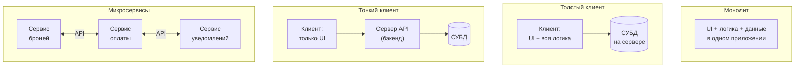

# Информационная система: состав, жизненный цикл, архитектура

## 1. Данные и информация

| Понятие | Определение | Пример¹ |
|---|---|---|
| **Данные** | зарегистрированные сведения, которые сами по себе ничего не значат | `305, 12.11, 4500` |
| **Информация** | данные, приведённые к виду, понятному человеку или машине, и имеющие смысл в определённом контексте | «Номер 305 забронирован на 12 ноября, стоимость 4500 ₽» |

¹ Пример добавлен.

> [!tip]
> Данные становятся информацией, когда получают **контекст и смысл**.

## 2. Состав ИС

| Компонент | Что входит |
|---|---|
| **Данные** | базы данных, массивы данных — то, ради чего всё затевается |
| **Аппаратное (техническое) обеспечение** | рабочие станции, серверы, сетевое оборудование, СХД (системы хранения данных), каналы связи |
| **Программное обеспечение** | ОС, СУБД, языки программирования, фреймворки, **прикладные модули** — код, написанный отдельно и дополняющий основной функционал ИС |
| **Организационное обеспечение** | процессы и люди: инструкции, регламенты, бизнес-процессы, роли |
| **Правовое обеспечение** | лицензии на ПО, закон о персональных данных (**152-ФЗ**), коммерческая тайна |

## 3. Жизненный цикл разработки ИС

Период от создания замысла ИС до вывода её из эксплуатации. Укрупнённые этапы сформированы на основе **ГОСТ 34.601-90** «Информационная технология. Комплекс стандартов на автоматизированные системы. Стадии создания» и международных стандартов.

| Этап | Что делают |
|---|---|
| **Формирование требований** | отвечают на вопросы: что хотим от ИС? зачем она нужна? |
| **Проектирование** | архитектура, ТЗ, прототипы интерфейсов, проектирование базы данных |
| **Разработка** | программирование, настройка |
| **Тестирование и внедрение** | проверка работоспособности («обкатка»), обучение пользователей |
| **Сопровождение и поддержка** | исправление ошибок, доработки, помощь пользователям |
| **Вывод из эксплуатации** | перенос данных, отключение системы |

## 4. Архитектура ИС

> [!note] Определение
> **Архитектура ИС** — структура системы, описывающая её компоненты и связи между ними.

| Архитектура | Суть | Плюсы¹ | Минусы¹ |
|---|---|---|---|
| **Монолитная** | всё приложение — единое целое, работает на одном компьютере | просто разработать и развернуть | трудно масштабировать и менять по частям |
| **Клиент-сервер, толстый клиент** | клиент содержит всю логику и обращается к СУБД на сервере | быстрый отклик интерфейса | обновлять нужно каждое рабочее место |
| **Клиент-сервер, тонкий клиент** | клиент обращается к серверу API (бэкенду), тот — к СУБД | обновляется только сервер, клиент простой (часто браузер) | зависимость от сети и сервера |
| **Микросервисная** | система разбита на множество независимых микросервисов, общающихся через API | сервисы масштабируются и обновляются независимо | сложность: сеть, контракты API, мониторинг |

¹ Плюсы и минусы добавлены.

---

## Вопросы для самопроверки

> [!question]- Чем данные отличаются от информации?
> Данные — зарегистрированные сведения без смысла. Информация — данные, имеющие смысл в определённом контексте.

> [!question]- Какие виды обеспечения входят в ИС?
> Данные, аппаратное, программное, организационное и правовое обеспечение.

> [!question]- Какой закон относится к правовому обеспечению при работе с персональными данными?
> 152-ФЗ «О персональных данных».

> [!question]- Чем толстый клиент отличается от тонкого?
> Толстый клиент содержит всю бизнес-логику и сам обращается к СУБД. Тонкий только отображает интерфейс, а логика выполняется на сервере API.

> [!question]- Как общаются микросервисы между собой?
> Через API.
