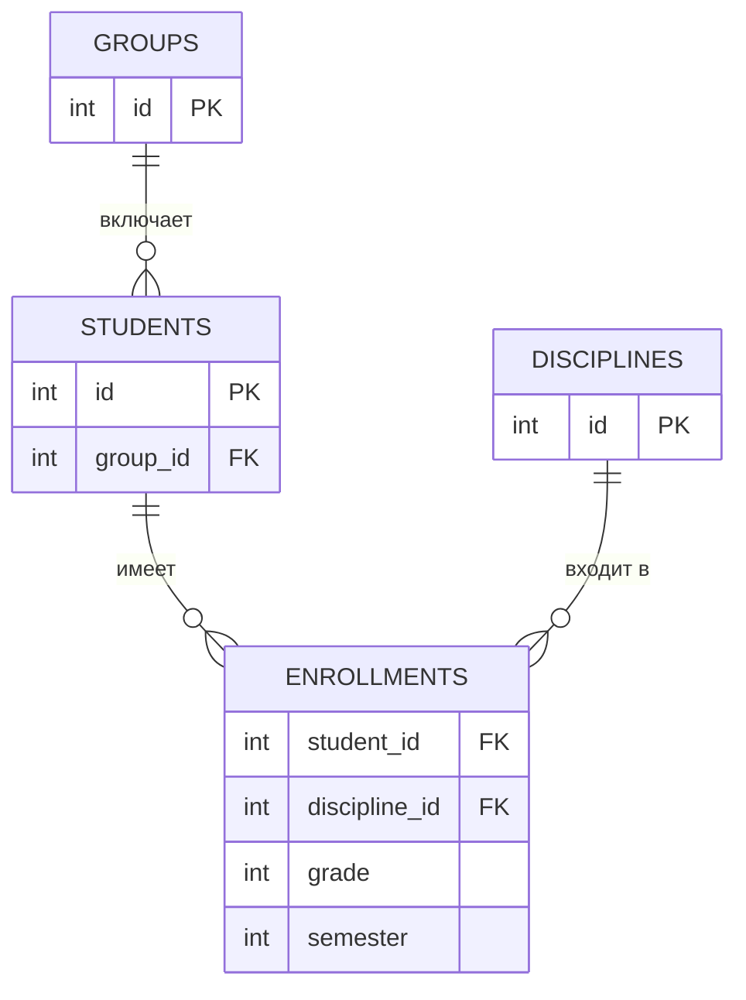

Реляционная модель данных. Проектирование и нормализация БД

> [!abstract] Цели занятия
> - освоить понятия: отношение, атрибут, кортеж, домен, ключ;
> - изучить поддержание целостности: первичные и внешние ключи;
> - понять природу избыточности и аномалий;
> - научиться нормализовать до 3НФ и переходить от ER-модели к таблицам.

> [!abstract] План
> 1. [[#1. Отношение, атрибут, кортеж, домен]]
> 2. [[#2. Ключи и целостность данных]]
> 3. [[#3. Избыточность и аномалии]]
> 4. [[#4. Нормальные формы 1НФ, 2НФ, 3НФ]]
> 5. [[#5. ER-моделирование и переход к таблицам]]
> 6. [[#Выводы]]

---

## 1. Отношение, атрибут, кортеж, домен

Реляционная модель предложена **Э. Коддом в 1970 году**: данные описываются как совокупность **отношений**.

| Понятие модели | Что это | В СУБД |
|---|---|---|
| **Отношение** | таблица | таблица |
| **Атрибут** | именованный столбец | столбец |
| **Кортеж** | строка: набор значений, по одному на каждый атрибут | строка |
| **Домен** | множество допустимых значений атрибута (напр., «оценка» — целые 2–5) | тип данных / CHECK |

- **Степень отношения** — число атрибутов.
- **Кардинальность** — число кортежей.

### Свойства таблиц в реляционной модели
- значения **атомарны** (в ячейке одно неделимое значение, не список);
- кортежи **уникальны** (одинаковых строк нет);
- строки и столбцы **не упорядочены** (порядок задаётся явно при выборке).

> [!note] Почему реляционные БД живут десятилетиями
> Атомарность значений + единый язык **SQL**: любую предметную область можно представить связанными таблицами, а данные из нескольких таблиц соединять запросами в любой комбинации.

---

## 2. Ключи и целостность данных

### Первичный ключ (PK, Primary Key)
Минимальный набор атрибутов, однозначно идентифицирующий каждый кортеж.

| Вид | Описание | Примеры |
|---|---|---|
| **Естественный** | значение из предметной области | номер паспорта, СНИЛС, ИНН |
| **Суррогатный** | искусственно сгенерированный счётчик, не зависит от смысла данных | `id` |

> [!tip] Практика
> Предпочитают **суррогатные** ключи: естественные значения меняются, содержат ошибки ввода и не всегда уникальны.

**Требования к PK:** уникальность и обязательность (**NULL запрещён**) — это **целостность сущностей**.

### Внешний ключ (FK, Foreign Key)
Атрибут (или набор), ссылающийся на PK другого (или того же) отношения. Выражает **связь**.
Пример: в таблице оценок `student_id` ссылается на PK таблицы студентов.

### Ссылочная целостность
СУБД контролирует:
- нельзя вставить оценку несуществующему студенту (запись осталась бы «осиротевшей»);
- нельзя удалить студента, у которого есть оценки, пока не определено правило:
  - запрет,
  - каскадное удаление,
  - обнуление ссылки.

> [!important] Что удерживает базу согласованной
> PK + FK + проверки доменов (`CHECK`) + обязательность (`NOT NULL`) — согласованность обеспечивается **на уровне данных, а не приложения**.

---

## 3. Избыточность и аномалии

**Избыточность** — повторение одних и тех же сведений во многих строках. Главная болезнь неспроектированной базы.

Пример таблицы:
`Заказ(номер, дата, клиент, город, телефон, товар, количество)`
Заказы 101 и 102 клиента Иванова (Казань) повторяют его город и телефон; при 100 заказах данные продублированы 100 раз.

### Три группы аномалий

| Аномалия | Суть | Пример |
|---|---|---|
| **Обновления** | изменение нужно вносить во все строки; часть забыли → база противоречива | клиент переехал, город поменяли не везде |
| **Вставки** | нельзя добавить данные без сопутствующих | нельзя завести клиента, пока он не сделал заказ |
| **Удаления** | удаление одних данных уничтожает другие | удалили последний заказ → пропали все сведения о клиенте |

> [!success] Вывод
> Данные о клиенте хранятся **один раз** — в таблице клиентов; в заказах — только **ссылка** на клиента. Такое разложение выполняется по формальным правилам — **нормализации**.

---

## 4. Нормальные формы 1НФ, 2НФ, 3НФ

### 1НФ — атомарность
Нет списков и повторяющихся групп в ячейке.
- ❌ Поле «товары: ручка, бумага, скотч».
- ✅ Отдельная строка на каждый товар заказа (**позиция заказа**).

### 2НФ — полная зависимость от ключа
Применима к таблицам с **составным ключом**. Каждый неключевой атрибут зависит **от всего ключа**, а не от его части.

Пример: `Позиция(номер_заказа, код_товара, наименование, количество)`
- Ключ: (номер_заказа, код_товара).
- `наименование` зависит только от `код_товара` → выносим в таблицу товаров.

```sql
CREATE TABLE goods (id INT PRIMARY KEY, name TEXT);
```
В позиции остаётся `goods_id` и `количество`.

### 3НФ — нет транзитивных зависимостей
Неключевые атрибуты не должны зависеть друг от друга.

Пример: `(код_клиента, город, регион)` — `регион` зависит от `города`, а не от клиента напрямую.
→ выносим **справочник городов с регионом**; клиент хранит только код города.

### Таблица 8 — Нормальные формы и устраняемые проблемы

| Форма | Устраняемая проблема | Мероприятие |
|---|---|---|
| **1НФ** | списки и повторяющиеся группы в ячейках | отдельная строка на каждый экземпляр (позиция заказа) |
| **2НФ** | зависимость неключевого атрибута от части составного ключа | вынос наименования товара из позиций в таблицу товаров |
| **3НФ** | транзитивные зависимости между неключевыми атрибутами | вынос справочника городов с регионом из таблицы клиентов |

> [!note] Мнемоника
> - **1НФ** — атомарность;
> - **2НФ** — «один факт о ключе **целиком**»;
> - **3НФ** — «один факт о ключе **напрямую**».

После приведения к 3НФ избыточность и аномалии исчезают: каждое изменение — в **одной строке одной таблицы**.

> [!warning] Денормализация
> Иногда из 3НФ сознательно выходят ради скорости отчётов, но только **осознанно**, когда база уже спроектирована правильно.

---

## 5. ER-моделирование и переход к таблицам

Проектирование начинается **не с таблиц, а с ER-модели** (Entity — Relationship, «сущность — связь»).

- **Сущность** — класс объектов предметной области (Студент, Группа, Дисциплина, Заказ, Товар).
- **Атрибуты** — свойства сущности.
- **Связи** — ассоциации между сущностями: **1:1**, **1:N**, **M:N**.
- **Нотации:** Чена, IDEF1X, «вороньи лапки». Сущность — прямоугольник с атрибутами внутри, связи — линии с кратностью.

### Правила перехода ER → реляционная схема

| ER-элемент | Таблица |
|---|---|
| сущность | таблица |
| атрибут | столбец |
| ключевой атрибут | первичный ключ |
| связь **1:N** | внешний ключ на стороне «многих» |
| связь **M:N** | промежуточная таблица с двумя внешними ключами |

**Примеры:**
- **1:N** — Группа (1) — Студент (N): таблица `students` получает столбец `group_id`.
- **M:N** — Студент (M) — Дисциплина (N): таблица `enrollments(student_id, discipline_id)`; удобно добавить атрибуты самой связи — **оценку** и **семестр**.



---

## Выводы
- Реляционная модель — отношения с **атомарными значениями** и **ключами**.
- Целостность обеспечивают **первичные и внешние ключи**.
- **Нормализация до 3НФ** устраняет избыточность и аномалии.
- **ER-моделирование** связывает предметную область со схемой БД формальными правилами перехода.