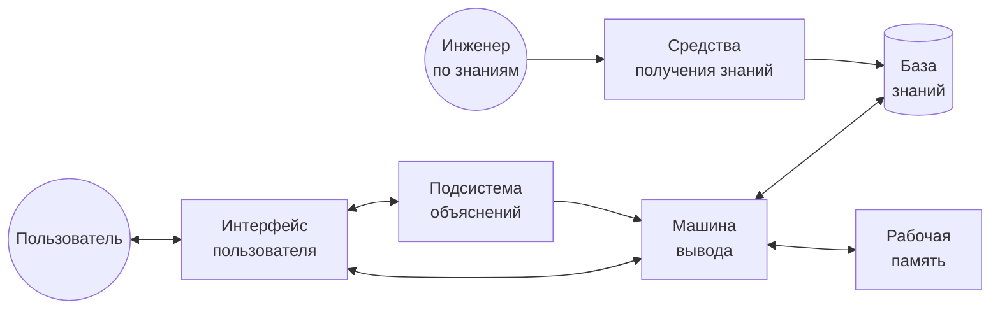

# Экспертные системы

## 1. Что такое экспертная система

> [!note] Определение
> **Экспертная система (ЭС)** — программа, воспроизводящая рассуждения опытного специалиста в узкой предметной области и выдающая заключение или рекомендацию **с объяснением**.

### Причины создания
- экспертов **мало**, их время **дорого**, а знания **уходят вместе с сотрудником**;
- работа человека может занимать **больше времени**, чем работа машины.

## 2. Структура ЭС

> [!important] Ядро ЭС
> **База знаний** и **машина вывода**.



| Компонент | Назначение |
|---|---|
| **База знаний** | правила и исходные факты, извлечённые из эксперта |
| **Рабочая память** | факты текущего сеанса консультации |
| **Машина вывода** | применяет правила к фактам |
| **Подсистема объяснений** | отвечает, **почему** задан вопрос и **как** получено заключение |
| **Интерфейс пользователя** | ввод данных о задаче и выдача заключения |
| **Средства получения знаний** | наполнение и отладка базы знаний инженером |

## 3. Кто участвует в разработке

| Участник | Роль |
|---|---|
| **Эксперт** | источник знаний и окончательный судья базы знаний; он же — главный тестировщик |
| **Инженер по знаниям** (когнитолог) | извлекает знания у эксперта, формализует их и встраивает в систему |
| **Программист** | реализует систему на инструментальном средстве |

## 4. Пример: диагностика принтера

Работу интерфейса и подсистемы объяснений можно показать на правилах:

```text
П1: ЕСЛИ индикатор питания горит, ТО принтер включён.
П2: ЕСЛИ принтер включён И индикатор ошибки мигает, ТО застряла бумага.
П3: ЕСЛИ принтер включён И индикатор ошибки не горит И страница пустая, ТО закончился тонер.¹
```

¹ Третье правило добавлено для примера.

Система ведёт **обратный вывод**: начинает от гипотезы (цели) и задаёт пользователю **только те вопросы**, которые нужны для её доказательства. Каждое заключение сопровождается **трассировкой** сработавших правил.

> [!example] Как выглядит консультация
> **ЭС:** Горит ли индикатор питания? — **Да.**
> **ЭС:** Мигает ли индикатор ошибки? — **Да.**
> **ЭС:** Вероятно, застряла бумага.
> **Пользователь:** Как получено заключение?
> **ЭС:** По П1 принтер включён (индикатор питания горит). По П2 при включённом принтере и мигающем индикаторе ошибки — застряла бумага.

## 5. Этапы создания ЭС

ЭС разрабатывают **циклами прототипирования**: каждый этап может вернуть разработку на предыдущий.


> [!info] Дополнение
> В конспекте этапы только названы. Содержание этапов и методы извлечения знаний добавлены.

| Этап | Что делают |
|---|---|
| **Идентификация** | определяют задачу, участников, источники знаний, цели и ресурсы |
| **Концептуализация** | эксперт и инженер по знаниям выявляют основные понятия, связи и способы рассуждения — строят неформальную модель |
| **Формализация** | выбирают способ представления знаний (правила, фреймы, семантические сети) и записывают знания формально |
| **Реализация** | создают прототип на инструментальном средстве, наполняют базу знаний |
| **Тестирование** | эксперт проверяет систему на реальных задачах, находит ошибки в знаниях |
| **Опытная эксплуатация** | систему проверяют конечные пользователи |

### Методы извлечения знаний

| Группа | Методы |
|---|---|
| **Коммуникативные** (с участием эксперта) | интервью, анкетирование, «мысли вслух» (эксперт решает задачу и проговаривает рассуждения), круглый стол, игры с экспертом |
| **Текстологические** (без эксперта) | анализ учебников, инструкций, документации, отчётов |

---

## Вопросы для самопроверки

> [!question]- Что составляет ядро экспертной системы?
> База знаний и машина вывода.

> [!question]- Зачем ЭС подсистема объяснений?
> Чтобы ответить пользователю, почему задан вопрос и как получено заключение. Это повышает доверие к рекомендации.

> [!question]- Чем рабочая память отличается от базы знаний?
> База знаний хранит постоянные правила и факты предметной области. Рабочая память — факты текущей консультации.

> [!question]- Кто такой инженер по знаниям?
> Специалист, который извлекает знания у эксперта, формализует их и встраивает в систему.

> [!question]- Почему при обратном выводе система задаёт меньше вопросов?
> Она начинает с гипотезы и спрашивает только то, что нужно для её доказательства.

> [!question]- Перечислите этапы создания ЭС.
> Идентификация, концептуализация, формализация, реализация, тестирование (затем опытная эксплуатация).
