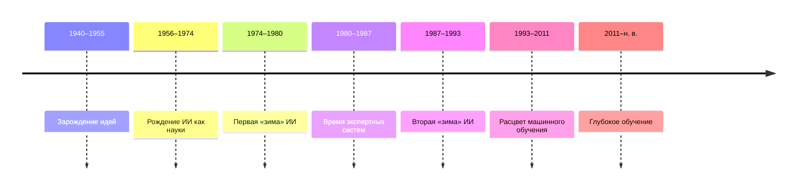

# Машинное обучение. Этапы развития ИИ

## 1. Основные понятия

> [!note] Определение
> **Искусственный интеллект (AI)** — область компьютерных наук, которая создаёт программные и аппаратные системы, способные выполнять задачи, требующие по человеческим меркам интеллектуального поведения: обучение, рассуждение, распознавание образов, понимание естественного языка, принятие решений.

> [!note] Определение
> **Нейронные сети** — класс алгоритмов машинного обучения, вдохновлённый биологическими нейронными сетями мозга. Состоят из слоёв связанных искусственных нейронов, которые обрабатывают информацию с помощью математических операций.

> [!info] Дополнение: машинное обучение
> **Машинное обучение (ML)** — раздел ИИ, в котором система не программируется явно, а **учится на примерах** (данных) и сама находит закономерности.
> ```mermaid
> flowchart LR
>     A["ИИ"] --> B["Машинное<br>обучение"] --> C["Нейронные<br>сети"] --> D["Глубокое<br>обучение"]
> ```
> Каждое следующее понятие — часть предыдущего.

## 2. Тест Тьюринга

**Алан Тьюринг** — британский математик. В **1950 году** в статье «Computing Machinery and Intelligence» предложил знаменитый **тест Тьюринга**.

> [!tip] Суть теста
> Если человек в ходе текстового диалога **не может отличить** собеседника-машину от живого человека, машину можно считать «разумной».

Это была первая попытка определить, что значит «мыслящая машина».

## 3. Подходы к определению ИИ

| № | Подход | Суть |
|---|---|---|
| 1 | **Мыслить как человек** | моделирование когнитивных функций: мышления, обучения |
| 2 | **Действовать как человек** | внешнее поведение, неотличимое от человеческого (тест Тьюринга) |
| 3 | **Мыслить рационально** | логический вывод на основе формальных законов и правил |
| 4 | **Действовать рационально** | достижение целей в окружающей среде |
| 5 | **Роботы, автономные агенты** | системы, самостоятельно действующие в реальной среде |

## 4. Этапы развития ИИ



### Зарождение идей (1940–1955)
- **1943** — Уоррен Мак-Каллок и Уолтер Питтс предложили **математическую модель искусственного нейрона** на основе биологического. Она стала теоретической основой современных нейросетей.
- **1950** — тест Тьюринга.
- **1952** — Артур Сэмюэл создал программу для игры в шашки, которая **самообучалась** в процессе игры. В **1959** году он ввёл термин **«машинное обучение»**.

### Рождение ИИ как науки (1956–1974)
- **1956** — **Дартмутский семинар**. Джон Маккарти ввёл термин **AI** (Artificial Intelligence).
- **1958** — язык программирования **LISP**, на десятилетия ставший основным инструментом исследований ИИ.
- **1966** — **ELIZA** (Дж. Вейценбаум): первая диалоговая система, имитирующая психотерапевта.

### Первая «зима» ИИ (1974–1980)
К середине 1970-х финансирование резко сократилось. Причины:
- **комбинаторный взрыв** — алгоритмы, работавшие на малых задачах, становились неэффективными на реальных;
- ограничения вычислительной техники;
- критика. Британский учёный **Джеймс Лайтхилл**¹ в докладе 1973 года показал неэффективность большинства подходов того времени.

### Время экспертных систем (1980–1987)
- Интерес к ИИ возродился благодаря **экспертным системам**: они решали узкоспециализированные задачи на уровне человека.
- **Проблемы:** трудоёмкость создания базы знаний, хрупкость (система ломается на непредусмотренных случаях), сложность сопровождения.

### Вторая «зима» ИИ (1987–1993)
- С появлением ПК специализированные **LISP-машины** стали неконкурентоспособными.
- После бума экспертных систем финансирование снова сократилось.

### Расцвет машинного обучения (1993–2011)
- **Статистический ИИ** (основан на данных и вероятностях) пришёл на смену **символическому** (основан на логике и правилах).
- Ключевые факторы: развитие методов машинного обучения и появление **больших данных**.
- **1997** — компьютер Deep Blue обыграл чемпиона мира по шахматам Гарри Каспарова¹.

### Глубокое обучение (2011 — настоящее время)
С 2010-х годов идёт бурный рост **глубокого обучения**, который продолжается и сегодня.

> [!info] Дополнение: ключевые события¹
> - **2012** — нейросеть AlexNet резко превзошла другие методы в распознавании изображений.
> - **2016** — AlphaGo обыграла чемпиона мира по игре го.
> - **2017** — архитектура **Transformer**, основа современных языковых моделей.
> - **2022** — ChatGPT сделал большие языковые модели массовыми.

¹ Имя учёного и события после 1993 года добавлены.

---

## Вопросы для самопроверки

> [!question]- В чём суть теста Тьюринга?
> Если человек в текстовом диалоге не может отличить машину от человека, машину можно считать разумной.

> [!question]- Кто и когда ввёл термин «искусственный интеллект»?
> Джон Маккарти на Дартмутском семинаре в 1956 году.

> [!question]- Кто ввёл термин «машинное обучение»?
> Артур Сэмюэл, в 1959 году.

> [!question]- Что такое комбинаторный взрыв?
> Резкий рост числа вариантов с увеличением размера задачи: алгоритмы, работавшие на малых задачах, становились неэффективны на реальных.

> [!question]- Чем статистический ИИ отличается от символического?
> Символический основан на логике и правилах, заданных человеком. Статистический — на данных и вероятностях, закономерности находятся автоматически.

> [!question]- Почему наступила вторая «зима» ИИ?
> LISP-машины проиграли персональным компьютерам, а экспертные системы оказались дорогими и хрупкими — финансирование снова сократили.
