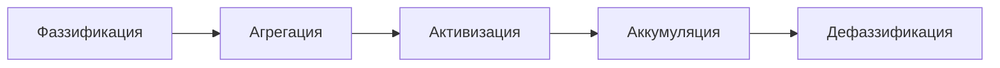

# Нечёткая логика. Обработка естественного языка и генеративные модели

## Часть 1. Нечёткая логика

> [!note] Определение
> **Нечёткая логика** — обобщение классической логики: утверждение может быть истинным **в степени от 0 до 1**, а не только «да» или «нет».

### Основные понятия

| Понятие | Определение | Пример |
|---|---|---|
| **Лингвистическая переменная** | переменная, значения которой — слова | «температура» |
| **Терм** | одно из словесных значений переменной | «низкая», «средняя», «высокая» |
| **Функция принадлежности** | ставит числу в соответствие **степень принадлежности** к терму (от 0 до 1) | 18 °C принадлежит терму «низкая» со степенью 0,5 |

**Пример правила:** ЕСЛИ температура **низкая**, ТО мощность нагрева **высокая**.

### Чем нечёткая логика лучше классической

| Классическая логика | Нечёткая логика |
|---|---|
| нужна резкая граница: «холодно — ниже 18 °C» | плавный переход: 17,9 °C и 18,1 °C почти одинаково «холодные» |
| 17,9 °C — холодно, 18,1 °C — уже нет | 17,9 °C — холодно на 0,51, 18,1 °C — на 0,49 |

> [!tip] Достоинство подхода
> Можно работать с **неточными формулировками эксперта** («довольно холодно», «высокий риск») без жёстких порогов.

### Этапы нечёткого вывода

| Этап | Что происходит |
|---|---|
| **Фаззификация** | входные числа переводятся в степени принадлежности термам |
| **Агрегация** | вычисляется истинность условий правил (операции И, ИЛИ) |
| **Активизация** | выходные термы «усекаются» уровнем истинности правила |
| **Аккумуляция** | усечённые термы всех сработавших правил объединяются |
| **Дефаззификация** | итоговая фигура превращается в одно число |

> [!example] Пример: кондиционер¹
> 1. **Фаззификация:** 26 °C → «жарко» на 0,7, «нормально» на 0,3.
> 2. **Агрегация и активизация:** правило «ЕСЛИ жарко, ТО охлаждение сильное» срабатывает на 0,7; правило «ЕСЛИ нормально, ТО охлаждение слабое» — на 0,3.
> 3. **Аккумуляция:** обе усечённые фигуры объединяются.
> 4. **Дефаззификация:** получаем одно число — например, мощность охлаждения 68 %.

¹ Пример добавлен.

### Области применения

- **Нечёткие контроллеры:** стиральные машины, кондиционеры, автофокус камер, управление поездами метро¹.
- **В информационных системах** нечёткие правила описывают неточные знания: «низкая надёжность», «высокий риск» и т. п.

---

## Часть 2. Обработка естественного языка (NLP)

> [!note] Определение
> **NLP** (Natural Language Processing) — анализ и генерация человеческого текста и речи.

### Типовые задачи

| Задача | Что делает |
|---|---|
| **Токенизация** | разбивает текст на токены (слова, части слов) |
| **Морфологический анализ** | определяет формы слов (падеж, число, начальная форма) |
| **Извлечение сущностей** | находит имена, организации, суммы, даты |
| **Анализ тональности** | определяет эмоциональную окраску: позитив, негатив, раздражение |
| **Перевод** | с одного языка на другой |
| **Суммаризация** | краткое изложение текста |
| **Вопросно-ответные системы** | отвечают на вопросы по базе текстов |

> [!example] Пример: обращение в поддержку
> «Заказ 1234 пришёл, но коробка помята!!!»
> - **Токенизация** выделяет слова.
> - **Морфология** определяет их формы.
> - **Извлечение сущностей:** «заказ 1234», «коробка».
> - Запрос сопоставляется со **статьями базы знаний** («Что делать, если товар повреждён»).
> - **Анализ тональности** замечает раздражение клиента и вовремя **повышает приоритет** обращения.

### Представление текста

**Мешок слов** (bag of words) — текст превращается в вектор счётчиков слов по общему словарю.
- Похожие тексты дают близкие векторы.
- **Порядок слов теряется**: «собака укусила человека» и «человек укусил собаку» дают одинаковый вектор.

> [!info] Дополнение
> Современные системы используют **эмбеддинги** — векторы, которые учитывают смысл и контекст слов. Близкие по смыслу слова («отель», «гостиница») получают близкие векторы.

---

## Часть 3. Языковые модели и промпт-инжиниринг

> [!note] Определение
> **Языковая модель** — предсказывает следующий токен по предыдущим. Большие языковые модели (LLM) — ChatGPT, Claude, GigaChat, YandexGPT¹ — генерируют связный текст, повторяя этот шаг много раз.

> [!note] Определение
> **Промпт-инжиниринг** — составление запросов (промптов) к моделям.

### Четыре элемента хорошего запроса

| Элемент | Пример |
|---|---|
| **Роль** | «Ты — администратор отеля» |
| **Контекст** | «Гость жалуется, что в номере не работает кондиционер» |
| **Ограничения** | «Не обещай компенсацию, не больше 5 предложений» |
| **Формат ответа** | «Вежливое письмо с извинением и планом действий» |

### Риски генеративных моделей

| Риск | Суть | Как снизить¹ |
|---|---|---|
| **Галлюцинации** | модель уверенно выдаёт выдуманные факты, ссылки, цифры | проверять факты, давать модели источники в контексте |
| **Утечка данных**¹ | в запрос попадают персональные данные или коммерческая тайна | не передавать конфиденциальное во внешние сервисы |
| **Предвзятость**¹ | модель повторяет искажения из обучающих данных | проверять ответы, особенно в решениях о людях |
| **Устаревшие знания**¹ | модель не знает событий после даты обучения | давать актуальные данные в контексте |
| **Prompt injection**¹ | вредоносный текст в данных заставляет модель нарушить инструкции | разделять инструкции и данные, ограничивать права модели |

¹ В конспекте названы только галлюцинации; остальные риски, примеры моделей и меры добавлены.

---

## Вопросы для самопроверки

> [!question]- Чем нечёткая логика отличается от классической?
> В классической утверждение либо истинно, либо ложно. В нечёткой — истинно в степени от 0 до 1, переходы плавные.

> [!question]- Что такое функция принадлежности?
> Функция, которая ставит числу в соответствие степень его принадлежности к терму.

> [!question]- Назовите этапы нечёткого вывода.
> Фаззификация, агрегация, активизация, аккумуляция, дефаззификация.

> [!question]- Какой главный недостаток «мешка слов»?
> Теряется порядок слов, а значит, часть смысла.

> [!question]- Назовите четыре элемента хорошего промпта.
> Роль, контекст, ограничения, формат ответа.

> [!question]- Что такое галлюцинация языковой модели?
> Уверенный, но выдуманный ответ: несуществующие факты, ссылки или цифры.
