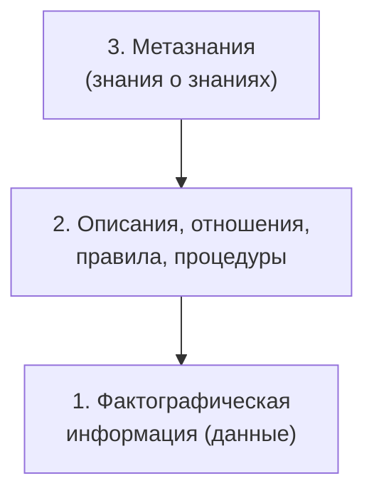
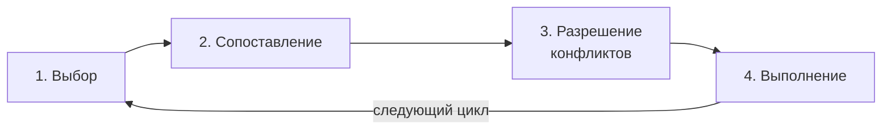

# Проектирование базы знаний

> [!note] Связанные лекции
> Компоненты интеллектуальной системы — [[06.04/Лекции/03.09.26|03.09]], экспертные системы — [[06.04/Лекции/01.10.26|01.10]].

### 1. Основы

- **Ядро интеллектуальной системы (ИС)** составляют база знаний (БЗ) и механизм вывода решений.
- Они определяют две характеристики системы: способность **хранить знания** и умение **оперировать ими**.
- Более развитые системы умеют **обучаться**: расширять БЗ и корректировать знания при изменении ситуации.

**Задачи начального этапа разработки:**

- изучить проблемную область (что и для чего представлять в БЗ);
- определить понятие «знание» для этой области и выявить источники знаний;
- определить типы знаний;
- оценить пространство поиска и выбрать способ структуризации знаний и метод поиска (механизм вывода);
- выбрать способ представления знаний и определить структуру БЗ;
- определить взаимодействие частей БЗ друг с другом и с другими компонентами ИС;
- подготовиться к заполнению БЗ.

### 2. Структура БЗ

БЗ состоит из двух подбаз:

| Подбаза | Что хранит | Как часто меняется |
|---|---|---|
| **База данных (БД)** | фактографическую информацию: факты и данные по предметной области | быстро |
| **База правил (БП)** | модели знаний (правила): отношения между данными и способы активизации знаний; правила активны и могут порождать новые факты и гипотезы | реже |

**Уровни представления знаний:**

1. Фактографическая информация (данные).
2. Описания, отношения, правила и процедуры, то есть способы манипулирования данными.
3. **Метазнания** (во многих системах, особенно реального времени).

Помимо знаний о предметной области, в БЗ хранятся модель мира системы, знания о пользователе и целях. Обычно они находятся на втором уровне, иногда на первом.

**Метазнания** — это знания системы о себе: о своих знаниях, их структуре и принципах работы. С их помощью выбирается самая эффективная стратегия поиска. Обычно это та, при которой используется не вся БЗ, а только нужная её часть.

**Взаимодействие БЗ с компонентами ИС (рис. 2):**

- **Механизм (блок) вывода** связан с пользователем и с БЗ. Он генерирует новые правила и знания, взаимодействуя с метауровнем при интерпретации правил и данных.
- **Рабочая область** содержит описание запроса или задачи, данные текущей ситуации, а также данные, правила и процедуры из БЗ.
- Есть связь с блоком ввода и обновления знаний.

**Продукционные системы (рис. 3).** БЗ здесь называют «базой правил», а механизм вывода — «интерпретатором правил». Компоненты:

- **БЗ** — правила, знания, правила вывода (источники знаний);
- **управляющая структура** (интерпретатор правил) — механизм вывода;
- **рабочая память** (глобальная БД) — состояние задачи и входные данные.

### 3. Типы знаний

- **Основные (глубинные)** — детальное понимание процесса на основе фундаментальных принципов, например математические уравнения переноса тепла, потока жидкости, химических реакций. Для процедурных задач к ним относятся полные эксплуатационные процедуры.
- **Экспертные** — получены из опыта и наблюдений. Отношения между переменными известны или оцениваются в качественных терминах.
- На практике БЗ содержат **комбинацию** обоих типов: часть знаний качественная, часть количественная.

### 4. Разработка механизма вывода

**Основные понятия:**

- **Механизм вывода** реализует общую встраиваемую схему поиска решений.
- **Стратегия управления** определяет последовательность и содержание действий в рамках этой схемы. Она может быть частью метазнаний, потому что это знание о знаниях.
- **Управляющая структура** анализирует состояние рабочей памяти и находит в БЗ подходящие блоки знаний.
- **Образцы** — форматы, определяющие условия активизации знаний.
- **Модуль, управляемый по образцам** — правило или блок правил.
- **Системы выводов, управляемые по образцам** — системы, в основе которых лежит обработка модулей по образцам.

**Четыре стадии вывода:**

1. **Выбор** — отбираются модули БЗ и данные, относящиеся к ситуации. Уже здесь сокращается пространство поиска.
2. **Сопоставление** — сравнение с образцами. Модули, для которых выполнены условия, называются **означенными**, а их множество — **конфликтным**.
3. **Разрешение конфликтов** — выбор модулей для выполнения в текущем цикле по одной из стратегий разрешения конфликтов.
4. **Выполнение** — запуск выбранных модулей. Изменяется рабочая память, выдаются рекомендации пользователю, возможны изменения самой БЗ.

**Стратегии рассуждения:**

|Стратегия|Направление|Суть|
|---|---|---|
|**Поиск от целей** (обратная цепочка)|от цели к начальным условиям|Выбираются правила, которые могут привести к цели. Цель проверяется рекурсивно через истинность подцелей (посылок). Процесс заканчивается, когда все подцели истинны или БЗ исследована и результатов нет.|
|**Поиск от данных** (прямая цепочка)|от фактов к цели|Находятся правила, посылки которых соответствуют данным рабочей памяти. При нескольких подходящих правилах применяется разрешение конфликтов, затем выполняется действие.|
|**Комбинированная**|с двух сторон|Прямой и обратный поиск идут навстречу друг другу до пересечения. Либо правила представляются сетью логических выводов, и поиск ведётся по сети.|

> [!example] Прямой и обратный вывод на примере принтера
> Правила: П1 «индикатор питания горит → принтер включён», П2 «принтер включён И мигает индикатор ошибки → застряла бумага».
> - **Прямой вывод:** известны факты «питание горит», «ошибка мигает» → по П1 выводим «принтер включён» → по П2 выводим «застряла бумага».
> - **Обратный вывод:** проверяем гипотезу «застряла бумага» → нужно доказать «принтер включён» и «мигает ошибка» → для первого по П1 спрашиваем про индикатор питания.

**Новые структуры управления:**

- **Agenda (агенда, «повестка дня»).** Работает с источниками знаний, то есть модулями, у которых помимо условия и действия есть имя и параметры планирования. План — это список модулей для выполнения с учётом состояния системы и дисциплины планирования.
- **Blackboard («доска объявлений»).** Источники знаний взаимодействуют через общую область памяти. В ней находятся активные источники знаний, текущий план, промежуточные результаты и данные. Доска состоит из зоны предметной области (экспертные знания) и зоны планирования (рассуждения о функционировании).

Выбор метода поиска зависит от размера пространства поиска, специфики области, определённости и надёжности знаний и данных, динамики области и способа представления знаний.

### 5. Объяснение и обоснование решений

**Система объяснений (СО)** отвечает на вопросы пользователя о том, как система пришла к заключению. Это одно из главных отличительных свойств ИС, оно повышает доверие к рекомендациям.

**Два способа реализации:**

1. **Фиксация событий** — заготовленные тексты на естественном языке хранятся вместе с правилами и фактами.
    - _Плюс:_ объяснения простые и удобные для восприятия.
    - _Минусы:_ тексты нужно исправлять при каждом изменении БЗ или эвристик; их трудно адаптировать под конкретного пользователя; пользователя часто интересует именно цепочка рассуждений.
2. **Трассировка рассуждений** — обход дерева целей. СО проходит по удовлетворённым подцелям и при необходимости повторяет задействованные правила в краткой формулировке.

**Типы вопросов:** «Почему?» и «Как?». Их интерпретируют на разных уровнях, в зависимости от приоритета и компетентности пользователя.

**Моделирование рассуждений человека.** Каждый вывод ИС должен соответствовать этапам, которые прошёл бы эксперт. Оценка ситуации опирается на закономерности, связывающие данные с типами ситуаций; их можно выразить «жёсткими» моделями. При интерпретации данных ИС извлекает информацию о ситуации в целом, которой нет в самих данных. Эта операция называется **понятийным анализом данных**. Результаты представляются в виде чисел, таблиц, формализованных текстов или графики.

---

## Вопросы для самопроверки

> [!question]- Из каких двух подбаз состоит база знаний?
> Из базы данных (факты, быстро меняются) и базы правил (модели знаний, меняются реже).

> [!question]- Что такое метазнания?
> Знания системы о себе: о своих знаниях, их структуре и принципах работы. Помогают выбрать эффективную стратегию поиска.

> [!question]- Чем глубинные знания отличаются от экспертных?
> Глубинные основаны на фундаментальных принципах (уравнения, полные процедуры). Экспертные получены из опыта и часто выражены качественно.

> [!question]- Назовите четыре стадии вывода.
> Выбор, сопоставление, разрешение конфликтов, выполнение.

> [!question]- Что такое конфликтное множество?
> Множество означенных модулей — тех, для которых выполнены условия активизации на стадии сопоставления.

> [!question]- Чем поиск от целей отличается от поиска от данных?
> От целей (обратная цепочка): начинают с гипотезы и проверяют подцели. От данных (прямая цепочка): начинают с фактов и применяют подходящие правила, пока не придут к выводу.

> [!question]- Какие два способа реализации системы объяснений существуют?
> Фиксация событий (заготовленные тексты) и трассировка рассуждений (обход дерева целей).