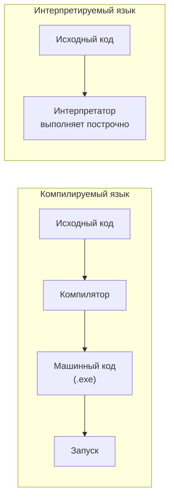

# Программа и основные элементы кода

## 1. Что такое программа

> [!note] Определение
> **Программа** — последовательность инструкций (команд), которую выполняет устройство или человек для достижения цели.

Программы создаются с помощью **языков программирования**.

## 2. Компилируемые и интерпретируемые языки



| | Компилируемые | Интерпретируемые |
|---|---|---|
| **Как работают** | файл с исходным кодом **компилируется**: инструкции, понятные человеку, превращаются в машинный код | программа-**интерпретатор** выполняет код из исходного файла построчно или поэтапно |
| **Скорость работы**¹ | высокая | ниже |
| **Ошибки**¹ | многие находятся ещё при компиляции | обнаруживаются во время выполнения |
| **Удобство**¹ | нужно перекомпилировать после каждого изменения | можно сразу запускать и анализировать код по шагам |
| **Примеры**¹ | C, C++, Go, Rust | Python, JavaScript, PHP |

¹ Строки сравнения и примеры добавлены.

## 3. Основные элементы кода

> [!info] Дополнение
> Определения из конспекта уточнены, к каждому элементу добавлен пример на C++.

| Элемент | Определение | Пример (C++) |
|---|---|---|
| **Переменная** | именованная область памяти для хранения данных | `int age = 18;` |
| **Тип данных** | определяет, какие значения может хранить переменная, сколько байт под неё выделить и какие операции с ней допустимы | `int`, `double`, `bool`, `std::string` |
| **Оператор** | специальная команда языка (часто из одного-двух символов), выполняющая математическое или логическое действие | `+`, `-`, `*`, `==`, `&&` |
| **Условие** | конструкция, которая выполняет действия в зависимости от результата проверки | `if (age >= 18) { ... } else { ... }` |
| **Цикл** | конструкция для повторения одинаковых действий, пока выполняется условие | `for (int i = 0; i < 10; i++) { ... }` |
| **Функция** | именованный участок кода для выполнения определённой задачи | `int sum(int a, int b) { return a + b; }` |
| **Класс** | шаблон для создания своих типов данных с полями (параметрами) и методами | `class Student { ... };` |
| **Объект** | экземпляр класса со своими значениями полей | `Student ivan;` |

### Всё вместе

```cpp
#include <iostream>
#include <string>

class Student {                     // класс — шаблон
public:
    std::string name;               // поля
    int grade;

    bool passed() {                 // метод (функция класса)
        return grade >= 3;          // оператор сравнения
    }
};

int main() {
    Student ivan;                   // объект — экземпляр класса
    ivan.name = "Иван";             // переменные и типы данных
    ivan.grade = 4;

    if (ivan.passed()) {            // условие
        std::cout << ivan.name << " сдал\n";
    }

    for (int i = 1; i <= 3; i++) {  // цикл
        std::cout << "Попытка " << i << "\n";
    }
    return 0;
}
```

---

## Вопросы для самопроверки

> [!question]- Чем компилируемый язык отличается от интерпретируемого?
> Компилируемый заранее переводится в машинный код целиком. Интерпретируемый выполняется интерпретатором построчно прямо из исходного файла.

> [!question]- Что определяет тип данных?
> Какие значения может хранить переменная, сколько памяти под неё выделяется и какие операции с ней допустимы.

> [!question]- Чем класс отличается от объекта?
> Класс — шаблон (описание полей и методов). Объект — конкретный экземпляр класса со своими значениями.

> [!question]- Зачем нужны функции?
> Чтобы дать имя участку кода, решающему одну задачу, и вызывать его многократно вместо повторения кода.
