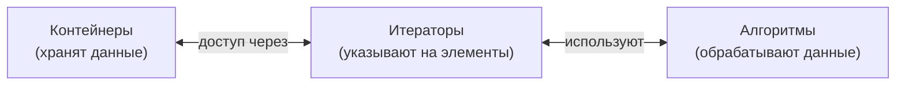

# Решение задач с помощью STL

## 1. Что такое STL

> [!note] Определение
> **STL** (Standard Template Library) — стандартная библиотека шаблонов языка C++.

STL состоит из трёх основных компонентов:



| Компонент | Что это | Примеры |
|---|---|---|
| **Контейнеры** | хранилища данных | `vector`, `list`, `map`, `set` |
| **Алгоритмы** | функции для обработки данных | `sort`, `find`, `transform`, `copy_if` |
| **Итераторы** | «умные указатели» для обхода контейнеров | `v.begin()`, `v.end()` |

> [!important] Пространство имён std
> Все классы и функции STL находятся в пространстве имён **`std`**, поэтому пишут `std::vector`, `std::sort`.

> [!info] Дополнение: какой контейнер выбрать
> | Контейнер | Что хранит | Когда использовать |
> |---|---|---|
> | `vector` | динамический массив | почти всегда по умолчанию; быстрый доступ по индексу |
> | `list` | двусвязный список | частые вставки и удаления в середине |
> | `set` | уникальные значения в отсортированном порядке | нужно убрать повторы |
> | `map` | пары «ключ → значение» | словарь, например «номер комнаты → гость» |

## 2. Контейнер vector

> [!note] Определение
> **`std::vector`** — динамический массив. В отличие от обычного массива, он **сам управляет памятью** и может менять размер. С обычным массивом в C++ приходится работать с памятью напрямую через указатели.

Чтобы использовать вектор, нужно подключить заголовок `<vector>`.

```cpp
#include <vector>
#include <iostream>

int main() {
    std::vector<int> v = {5, 2, 8};   // создаём вектор из трёх чисел
    v.push_back(1);                   // добавляем в конец → {5, 2, 8, 1}
    std::cout << v.size();            // размер: 4
    std::cout << v[0];                // первый элемент: 5
}
```

## 3. Итераторы

> [!note] Определение
> **Итератор** — объект, который указывает на элемент контейнера (как курсор).

| Итератор | Куда указывает |
|---|---|
| `begin()` | на **первый** элемент |
| `end()` | на позицию **после последнего** элемента («последний + 1») |

```text
 индекс:   0    1    2    3
         [ 5 ][ 2 ][ 8 ][ 1 ][  ]
           ↑                   ↑
        begin()              end()  ← за последним, разыменовывать нельзя
```

> [!warning]
> `end()` не указывает на существующий элемент. Его используют только как границу: «дошли до конца».

## 4. Алгоритмы: пример решения задачи

> [!example] Задача
> Дан список оценок. Отсортировать его, найти оценку 2 и посчитать, сколько пятёрок.

```cpp
#include <vector>
#include <algorithm>
#include <iostream>

int main() {
    std::vector<int> marks = {4, 5, 2, 5, 3};

    std::sort(marks.begin(), marks.end());              // {2, 3, 4, 5, 5}

    auto it = std::find(marks.begin(), marks.end(), 2); // ищем двойку
    if (it != marks.end()) {                            // end() = «не найдено»
        std::cout << "Есть двойка\n";
    }

    int fives = std::count(marks.begin(), marks.end(), 5);
    std::cout << "Пятёрок: " << fives << "\n";          // 2
}
```

> [!tip] Почему алгоритмы принимают итераторы
> Алгоритму всё равно, какой это контейнер: `vector`, `list` или обычный массив. Он работает с диапазоном **[begin, end)**. Поэтому один `std::sort` или `std::find` подходит ко многим контейнерам.

---

## Вопросы для самопроверки

> [!question]- Из каких трёх компонентов состоит STL?
> Контейнеры, алгоритмы, итераторы.

> [!question]- Чем vector лучше обычного массива?
> Сам управляет памятью и может менять размер.

> [!question]- На что указывает итератор end()?
> На позицию после последнего элемента. Это граница, а не элемент.

> [!question]- Как понять, что std::find ничего не нашёл?
> Он возвращает итератор `end()`.

> [!question]- Какой заголовочный файл нужен для std::sort?
> `<algorithm>`.
