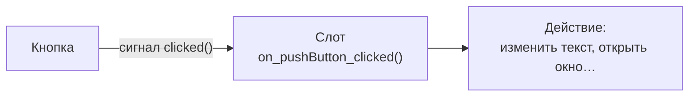

# Управление окнами и их интерфейсом в Qt

## 1. Файлы формы

При создании класса формы (окна) Qt создаёт **три файла**:

| Файл | Пример для `MainWindow` | Что содержит |
|---|---|---|
| **Исходный код класса** | `mainwindow.cpp` | реализация методов окна |
| **Заголовочный файл** | `mainwindow.h` | объявление класса окна |
| **Файл интерфейса** | `mainwindow.ui` | расположение кнопок, полей и других элементов (редактируется в Qt Designer) |

Имена файлов зависят от настроек проекта. По умолчанию используется **имя класса в нижнем регистре**.

## 2. Точка входа — main.cpp

Как и в обычных программах на C/C++, основной файл — **`main.cpp`**. Чтобы показать окно:
1. подключить заголовочный файл окна;
2. создать переменную с типом класса окна;
3. показать окно.

```cpp
#include <QApplication>
#include "mainwindow.h"          // 1. подключаем заголовок окна

int main(int argc, char *argv[]) {
    QApplication app(argc, argv);
    MainWindow w;                // 2. создаём объект окна
    w.show();                    // 3. показываем
    return app.exec();           // запускаем цикл обработки событий¹
}
```

¹ Комментарии и строки `show()` и `exec()` добавлены: без них окно не появится.

## 3. Указатель ui и setupUi

- При создании класса формы появляется указатель **`ui`**. Через него доступны все элементы интерфейса из `.ui`-файла.
- В конструкторе вызывается **`ui->setupUi(this)`**: метод создаёт и инициализирует элементы интерфейса.
- В деструкторе `~MainWindow()` указатель `ui` **удаляется**, чтобы освободить память.

```cpp
MainWindow::MainWindow(QWidget *parent)
    : QMainWindow(parent), ui(new Ui::MainWindow) {
    ui->setupUi(this);                          // создаём интерфейс
    ui->label->setText("Привет!");              // обращение к элементу через ui
}

MainWindow::~MainWindow() {
    delete ui;                                  // освобождаем память
}
```

## 4. Сигналы и слоты

> [!info] Уточнение
> В конспекте слоты описаны как функции, которые «сигнализируют о событии». На самом деле в Qt о событии **сообщает сигнал**, а **слот** — функция, которая на этот сигнал **реагирует**.

| Понятие | Что это | Пример |
|---|---|---|
| **Сигнал** | уведомление элемента о событии | `clicked()` — кнопка нажата |
| **Слот** | обычная функция (обычно `void`), которая выполняется в ответ на сигнал | `on_pushButton_clicked()` — что делать при нажатии |



У каждого элемента интерфейса есть свои сигналы: нажатие кнопки, изменение текста, наведение курсора и т. д.

### Как связать сигнал со слотом

**Способ 1 — через Qt Designer:** правой кнопкой по элементу → «Перейти к слоту…» → выбрать сигнал. Qt сам создаст слот с именем вида `on_ИмяЭлемента_сигнал()`.

```cpp
void MainWindow::on_pushButton_clicked() {
    ui->label->setText("Кнопка нажата");
}
```

**Способ 2 — вручную через `connect`:**

```cpp
connect(ui->pushButton, &QPushButton::clicked,
        this, &MainWindow::onButtonClicked);
```

## 5. Открытие второго окна

> [!info] Дополнение
> Частая задача в теме «Управление окнами».

```cpp
#include "secondwindow.h"

void MainWindow::on_openButton_clicked() {
    SecondWindow *w = new SecondWindow(this);  // окно — дочернее для главного
    w->show();          // немодальное: можно переключаться между окнами
    // w->exec();       // для QDialog: модальное, блокирует главное окно
}
```

---

## Вопросы для самопроверки

> [!question]- Какие три файла создаются для формы?
> Исходный код (`.cpp`), заголовочный файл (`.h`) и файл интерфейса (`.ui`).

> [!question]- Что делает ui->setupUi(this)?
> Создаёт и инициализирует элементы интерфейса, описанные в `.ui`-файле.

> [!question]- Зачем в деструкторе писать delete ui?
> Чтобы освободить память, выделенную под объект интерфейса.

> [!question]- Чем сигнал отличается от слота?
> Сигнал сообщает о событии (например, `clicked()`). Слот — функция, которая выполняется в ответ на сигнал.

> [!question]- Чем show() отличается от exec() при открытии окна?
> `show()` открывает немодальное окно. `exec()` открывает модальный диалог и блокирует остальные окна до его закрытия.
