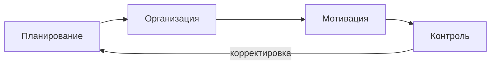

# Понятие менеджмента и его задачи

## 1. Что такое менеджмент

> [!note] Определение
> **Менеджмент** — умение достигать поставленных целей, используя труд, интеллект и мотивы поведения других людей.

Менеджмент — это подготовка, принятие и реализация решений во всех областях деятельности предприятия, нацеленные на главную цель: **получение прибыли и работу на перспективу**.

> [!important] Главная задача менеджмента
> Обеспечить **существование предприятия на рынке**.

## 2. Ресурсы

Большинство управленческих решений связано с **распределением ресурсов**:

| Ресурс | Примеры¹ |
|---|---|
| **Трудовые** | сотрудники, их знания и время работы |
| **Материальные** | оборудование, сырьё, здания |
| **Финансовые** | деньги, кредиты, инвестиции |
| **Время** | **невосполнимый** ресурс: его нельзя накопить или вернуть |

¹ Примеры добавлены.

## 3. Производственная информация

> [!note] Определение
> **Производственная информация** — сведения, необходимые для принятия решения. Работа менеджера — целенаправленная переработка этой информации.

| Вид информации | Откуда поступает¹ |
|---|---|
| **Внутренняя** | изнутри предприятия: отчёты отделов, данные учёта |
| **Внешняя** | из внешней среды: рынок, конкуренты, законы, клиенты |
| **Сверху** | от вышестоящего руководства: приказы, планы, распоряжения |

¹ Пояснения добавлены.

## 4. Функции менеджмента

> [!info] Дополнение
> На лекции функции не перечислены, но без них понятие менеджмента неполное. Классически выделяют четыре функции.

| Функция | Вопрос | Суть |
|---|---|---|
| **Планирование** | что и когда сделать? | постановка целей и выбор путей их достижения |
| **Организация** | кто и как сделает? | распределение работ, ресурсов и полномочий |
| **Мотивация** | почему люди будут это делать? | побуждение сотрудников к работе (зарплата, признание, развитие) |
| **Контроль** | получилось ли? | сравнение результатов с планом, корректировка |

---

## Вопросы для самопроверки

> [!question]- Что такое менеджмент?
> Умение достигать целей, используя труд, интеллект и мотивы поведения других людей.

> [!question]- Какой ресурс называют невосполнимым?
> Время.

> [!question]- Какие три вида производственной информации выделяют?
> Внутреннюю, внешнюю и поступающую сверху (от руководства).

> [!question]- Назовите четыре функции менеджмента.
> Планирование, организация, мотивация, контроль.
