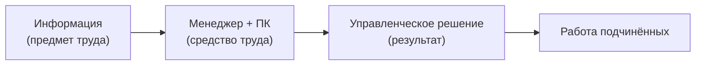
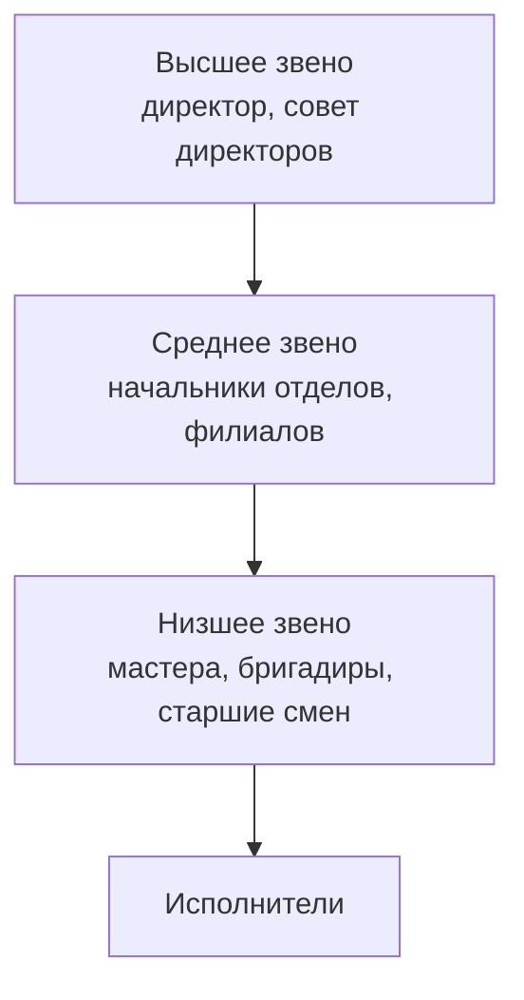

# Менеджер, его место в организации

## 1. Кто такой менеджер

> [!note] Определение
> **Менеджер** — человек, имеющий специальное образование и должность в организации и готовый принимать решения по всем вопросам своей деятельности.

## 2. Особенности управленческого труда

| Особенность | Что означает |
|---|---|
| **Вид труда** | умственный |
| **Участие в производстве** | создаёт материальные блага и услуги **опосредованно** — через труд других людей |
| **Предмет труда** | информация |
| **Средство труда** | организационная и вычислительная техника (ПК) |
| **Результат труда** | управленческие решения |

## 3. Уровни управления

> [!info] Дополнение
> На лекции уровни не разбирались, но они определяют «место менеджера в организации».

| Уровень | Кто | Чем занимается | Пример в отеле |
|---|---|---|---|
| **Высшее звено** | руководители организации | стратегия, долгосрочные цели | генеральный директор |
| **Среднее звено** | руководители подразделений | перевод стратегии в задачи отделов, контроль низшего звена | управляющий номерным фондом |
| **Низшее звено** | непосредственные руководители исполнителей | ежедневная организация работы | старший администратор смены |

## 4. Роли менеджера (по Г. Минцбергу)

> [!info] Дополнение

| Группа ролей | Роли |
|---|---|
| **Межличностные** | руководитель, лидер, связующее звено |
| **Информационные** | собирает информацию, распространяет её, представляет организацию вовне |
| **Связанные с принятием решений** | предприниматель, устраняет нарушения, распределяет ресурсы, ведёт переговоры |

---

## Вопросы для самопроверки

> [!question]- Что является предметом и результатом труда менеджера?
> Предмет — информация, результат — управленческие решения.

> [!question]- Почему говорят, что менеджер создаёт блага опосредованно?
> Он сам не производит продукцию, а организует работу других людей, которые её производят.

> [!question]- Назовите три уровня управления.
> Высшее, среднее и низшее звено.

> [!question]- Какие три группы ролей выделил Минцберг?
> Межличностные, информационные и связанные с принятием решений.
