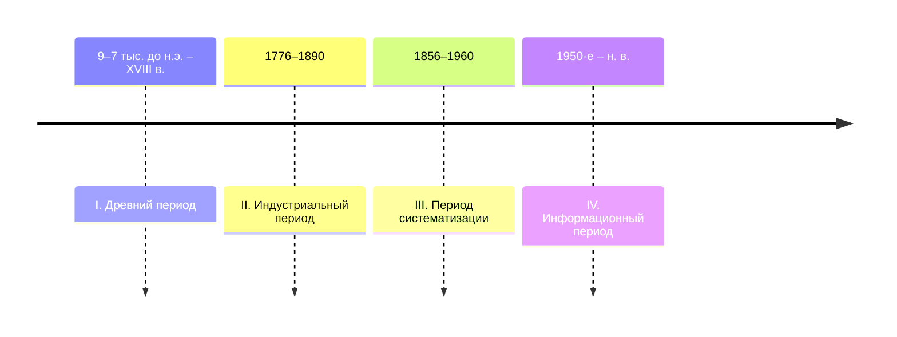

# Основные этапы развития менеджмента

## I период: древний (9–7 тыс. до н.э. — XVIII в.)

Самый длительный период: опыт управления накапливался тысячелетиями.

- При **первобытнообщинном строе** управляли сообща, руководящим началом были старейшины и вожди.
- В **9–7 тыс. до н.э.** на Ближнем Востоке произошёл переход от **присваивающего хозяйства** (охота, собирательство) к **производящей экономике**. С этого начинается зарождение менеджмента.
- **Древний Египет** (3000–2800 гг. до н.э.): сложился государственный управленческий аппарат с чиновниками-писцами.

| Мыслитель | Вклад |
|---|---|
| **Сократ** (470–399 до н.э.) | описал управление как особую сферу деятельности, выдвинул принцип **универсальности управления** |
| **Платон** (428–348 до н.э.) | классифицировал формы государственного управления, пытался разграничить функции органов управления |
| **Александр Македонский** (356–323 до н.э.) | развил теорию и практику **управления войсками** |

## II период: индустриальный (1776–1890)

| Деятель | Вклад |
|---|---|
| **А. Смит** | проанализировал формы **разделения труда**, описал обязанности государя и государства |
| **Р. Оуэн** (начало XIX в.) | на фабрике в Нью-Ланарке (Шотландия) дал рабочим жильё, улучшил условия труда, ввёл справедливую оценку работников и доплаты за хорошую работу. Фабрика была прибыльной, но другие предприниматели его не поддержали |
| **Ч. Бэббидж** (1833) | создал проект **«аналитической машины»** — прообраза компьютера. Первый переворот в управлении: решения стали приниматься быстрее |

> [!tip] Почему именно 1776
> В 1776 году вышла книга А. Смита «Исследование о природе и причинах богатства народов»¹.

## III период: систематизации (1856–1960)

> [!important] Управление становится наукой
> В **1911 году Ф. Тейлор** издал книгу **«Принципы научного управления»**. С этого момента управление признали наукой.

- Толчком послужила **промышленная революция**, начавшаяся в Англии. А идея, что само управление влияет на успех организации, зародилась в **Америке**.
- В этот период появились **управленческие школы**.

**Почему именно Америка:**
- успеха можно было добиться личной компетентностью, независимо от происхождения;
- иммиграция создала огромный рынок рабочей силы;
- там поддерживали образование для всех.

> [!info] Дополнение: школы управления
> | Школа | Представители | Главная идея |
> |---|---|---|
> | **Научного управления** (1885–1920) | Ф. Тейлор, Ф. и Л. Гилбрет, Г. Гантт | рационализация труда рабочего: замеры операций, стандарты, сдельная оплата |
> | **Административная** (1920–1950) | А. Файоль, М. Вебер | принципы управления организацией в целом; функции управления |
> | **Человеческих отношений** (1930–1950) | Э. Мэйо, М. Фоллет | производительность зависит от отношений в коллективе и внимания к людям (Хоторнские эксперименты) |
> | **Поведенческих наук** (с 1950) | А. Маслоу, Д. Макгрегор, Ф. Герцберг | мотивация и потребности работника |

## IV период: информационный (с 1950-х гг. по настоящее время)

- Связан с развитием **математических методов** и **информационных технологий**.
- Появляется **количественная школа**: модели, статистика, исследование операций, компьютеры для принятия решений.

> [!info] Дополнение
> В этот же период складываются **системный подход** (организация — система взаимосвязанных частей) и **ситуационный подход** (лучший способ управления зависит от конкретной ситуации).

¹ Пояснение к дате добавлено.

---

## Вопросы для самопроверки

> [!question]- С какого события начинается зарождение менеджмента?
> С перехода от присваивающего хозяйства к производящей экономике в 9–7 тыс. до н.э.

> [!question]- Что сделал Р. Оуэн?
> Улучшил условия труда рабочих, дал им жильё, ввёл справедливую оценку и доплаты. Фабрика была прибыльной.

> [!question]- С какого события управление признали наукой?
> С выхода книги Ф. Тейлора «Принципы научного управления» в 1911 году.

> [!question]- Почему менеджмент как наука сложился в Америке?
> Успех зависел от компетентности, а не от происхождения; иммиграция дала большой рынок труда; образование было доступно всем.

> [!question]- С чем связан информационный период?
> С развитием математических методов и информационных технологий; появляется количественная школа.
